# Video Pipeline (Production-Ready)

> **Scripts:** Engine script inventory and mappings: `references/engine-scripts.md`.  
> **Architecture:** Engine architecture and style taxonomy: `references/pipeline-architecture.md`.

Orchestrates the complete professional video editing workflow. Transforms raw creator footage into high-retention, studio-grade videos (Reels, Shorts, YouTube) through an optimized **3-phase workflow** with interactive user direction and zero dead black frames.

```bash
ENG="${VIDEO_ENGINE:-$HOME/.agents/skills/video-pipeline/engine}"
W="videos/<project>"
```

---

## Core Pipeline Principles & Skill Alignment

### 1. Standard Ingest First (SDR BT.709 & H.265)
Before running analysis, cutting, or staging, raw camera footage (including 10-bit HLG/HDR iPhone and ProRes takes) is converted to standard SDR (Rec.709 `yuv420p`) and H.265 (`libx265 -crf 18 -preset fast -tag:v hvc1`) at native 60fps CFR. This eliminates downstream gamma shifts, HDR clipping, and playback incompatibilities.

### 2. Parallel Ingest & Dynamic Color Correction
Visual and audio tracks are analyzed concurrently:
- **Audio Worker:** 80Hz rumble high-pass, EBU R128 `loudnorm`, and word-exact `whisper.cpp` ASR with Hinglish dictionary normalization.
- **Visual Worker:** Native framerate probe, 4 beat keyframe extractions, and **dynamic frame-accurate color correction** (`grade.py`). Statistically calculates shadow floor ($P_1$), highlight ceiling ($P_{99}$), midtone gamma ($P_{50}$), adaptive contrast, natural HSV vibrance, white balance (5650K daylight calibration), and micro-clarity from actual frame pixels. Zero artificial stylized filter presets.

### 3. Tight Acoustic Cuts (`video-cut-audit`)
`paper-cut.py` (`--tight`) scans acoustic waveform silences, eliminating stumbles, false starts, and hesitation dead air with tight 0.15s rhythm.

### 4. Reference Intelligence & Video Presets (`video-reference-match`)
Runs immediately after `video-cut-audit`:
- **References Precedence Contract:** User-supplied references (videos, screenshots, or benchmark files in `references/`, `videos/<project>/references/`, or passed via prompt/CLI) **ALWAYS take absolute precedence over blueprints**. The reference's measured structure, pacing, framing, and visual devices dictate the edit.
- **Blueprint Presets & HyperFrames Linking:** The 50 creator blueprints evaluate transcript content against proven creator formats to rank the top 3 presets and supply verified HyperFrames compositions (first-class motion scenes, proof cards, charts, and device mockups) to execute the desired aesthetic.

### 5. HyperFrames Composition Library First
During installation (`install.sh`), **all 447 compositions and components** from the HyperFrames registry are pre-installed into the global engine sandbox (`$ENGINE_DIR/compositions/`). When a video is matched to a blueprint, the pipeline's first priority is to pick and stage the best HyperFrames compositions tailored to the video's beats, eliminating cold network calls and ensuring 100% offline determinism.

### 6. Proof & Asset Sourcing (`video-researcher`)
When the user's prompt or script asks for logos, articles, evidence for claims, or statement verification, `video-researcher` sources vector marks (SimpleIcons/Svgl) and article evidence screenshots/quotes to display in the motion canvas.

### 7. Interactive User Direction (`ask_question` before Storyboard)
If the user did not specify their editing preferences in their prompt, the agent invokes `ask_question` **before `video-plan-storyboard`**. The user selects:
- Their preferred video-preset from `video-reference-match`
- Layout & framing mode (Bottom Split-Screen, Squircle PiP, Full-Frame)
- Caption accent colors & proof requirements
This choice directly dictates how `video-plan-storyboard` constructs the storyboard.

### 8. Framing Geometry & Active Motion Scenes (`video-take-geometry` & `video-motion-graphics`)
**No Dead Black Backgrounds:**
- When in `split` or `pip` layouts, the non-speaker canvas utilizes a deep studio mesh gradient (`radial-gradient(circle at 50% 25%, #1e293b 0%, #0f172a 65%, #020617 100%)`).
- **Bottom Split-Screen Geometry (70% Standard):** In split-screen video, the speaker takes the bottom pane (~44% height) with rounded top corners (`border-radius: 24px 24px 0 0`) and upward elevation drop-shadow (`0 -18px 45px rgba(0,0,0,.6)`).
- **Head-Area Focus Crop (Top & Bottom Crop):** The speaker video is cropped at the top (dead headroom) and bottom (torso/arms) with 1.15x scale and vertical focus centered at 24% to maximize head and facial visibility.
- **Floating Corner Squircle (PiP):** Sleek floating squircle window (`border-radius: 24px`, glass border, drop-shadow).
- **HyperFrames Motion Scenes:** The opened upper graphic canvas is filled with active motion scenes: animated checklist cards (`b_cards`), tactile paper drawers (`b_drawer`), dynamic data highlighters, and proof quotes.

### 9. Subtle Sound Design (`video-sound-design`)
Tactile sound effects from `sound-palette/audio` create acoustic depth and liveliness:
- `pop.mp3`: Damped kinetic pop on card and badge pill entrances (`-20 dB`)
- `whoosh-fast.mp3`: Swift directional whip on layout transitions (`-22 dB`)
- `click-soft.mp3`: Tactile micro-click on proof checkmarks (`-20 dB`)
Balanced taste-first so sound effects never mask spoken dialogue.

### 10. Small, Single-Row Vibrant Captions (`video-captions`)
- Small font size (`0.048 * W`, ~50-52px on 1080p).
- Strict 1–4 words max per row (`white-space: nowrap; flex-wrap: nowrap;`). Captions never wrap to a second line.
- Vibrant palette: brilliant pure white (`#FFFFFF`) with heavy drop shadow, Electric Gold (`#FFE600`) active word, and Neon Mint (`#00F59B`) punch word. Zero phrase collisions.

### 11. Pass 2 Transcribe & Master Render (`video-render` & `video-review-gate`)
- Re-transcribes the conformed flat cut video (`hyperframes/input-video.mp4`) for 0ms audio/video drift.
- Master renders via HyperFrames and FFmpeg at 60fps BT.709 with -14.4 LUFS loudness mastering.
- `verify-render.py` validates resolution, bitrate, A/V sync, and zero black frames.
- Temporary data folders (`preview/`, `audio_processing/`, `hyperframes/`) remain preserved.

---

## Pipeline Workflow Diagram

```mermaid
flowchart TD
    RAW["Raw Camera Footage\n(HDR/HLG BT.2020 or SDR)"] --> STD["Step 0: Standard Format Ingest\n(Convert to SDR Rec.709 H.265 @ 60fps)"]
    
    subgraph Phase1 ["Phase 1: Ingest, Parallel Analysis & Matching (~20s)"]
        STD --> W_A["Worker A: Audio Track"]
        STD --> W_B["Worker B: Visual Track"]
        
        W_A --> A1["80Hz High-Pass + EBU R128 Loudnorm"]
        A1 --> A2["whisper.cpp ASR + Hinglish Transliteration"]
        
        W_B --> B1["Video Probe & Native 60fps Detection"]
        B1 --> B2["4 Keyframe Extractions (15%, 35%, 60%, 85%)"]
        B2 --> B3["Dynamic Frame-Accurate Color Correction\n(grade.py: Luma P1/P99, Gamma, Saturation, White Balance)"]
        
        A2 --> VCA["video-cut-audit: Tight Paper Cut\n(paper-cut.py: 0.15s rhythm)"]
        B3 --> VCA
        
        VCA --> VRM["video-reference-match\n(match.py: Rank top 3 proven blueprints B19, B03, B11)"]
    end
    
    subgraph Phase2 ["Phase 2: User Direction & Storyboard Gate"]
        VRM --> ASK{"ask_question (Gate Q)\nDid user specify editing style in prompt?"}
        ASK -->|No| PROMPT_USER["Prompt User: Select Blueprint Preset, Layout & Proof Elements"]
        ASK -->|Yes| VPS
        PROMPT_USER --> VPS["video-plan-storyboard\n(Generate STORYBOARD.md with Keyframes, Dynamic Grade & Matched Presets)"]
        VPS --> GATE_S{"Gate S: User Review & Approval\n(Verify Keyframe Framing & Dynamic Color Correction)"}
    end
    
    subgraph Phase3 ["Phase 3: Assembly, Motion Graphics & Master Render (~50s)"]
        GATE_S -->|Approved| S1["apply-cut.py (Tight Cut + Dynamic Color Correction in Rec.709)"]
        S1 --> S2["Pass 2 Transcribe (Direct Word Sync on Flat Cut)"]
        S2 --> S3["stage.py (video-take-geometry & video-motion-graphics)\n- Studio Mesh Backdrop (No Black Background)\n- Squircle PiP / Split Top Card\n- Animated Cards / Drawers\n- Small 1-4 Word Vibrant Captions\n- Subtle SFX (pop, whoosh, click at -20dB)"]
        S3 --> S4["render.py & video-review-gate\n- 60fps BT.709 Master Encoding\n- Audio Master -14.4 LUFS\n- Programmatic QA Verification"]
        S4 --> DELIV["Deliverable: processed/<project>-v1.mp4\n(All Temp Folders Preserved)"]
    end
```



---

## CLI Execution Commands

```bash
# 1. Run Parallel Ingest, Analysis, Cutting, Preset Matching & Storyboard Generation
"$PROJECT/.venv/bin/python3" "$ENG/scripts/parallel_pipeline.py" analyze \
    --input "$W/raw/<video>.MOV" \
    --project "$W"

# 2. If prompt lacks direction, run ask_question presenting the matched presets from matches.json

# 3. Present STORYBOARD.md and preview/grade-preview.jpg to user for Gate S approval

# 4. Assemble and Master Render Deliverable (Dynamic Color Correction + Motion Canvas + SFX)
"$PROJECT/.venv/bin/python3" "$ENG/scripts/parallel_pipeline.py" assemble \
    --project "$W" \
    --preset "dynamic"
```
