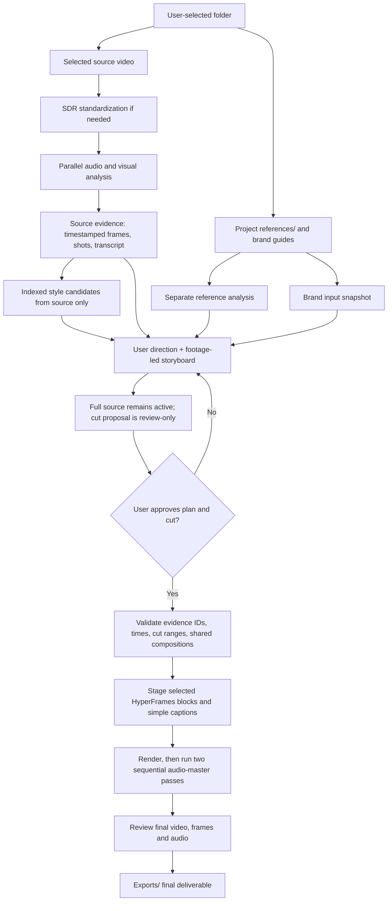

# Pipeline architecture

The user's project folder remains the boundary. All generated material is grouped in `.video-pipeline/`; only approved exports appear in `Exports/`.

## Editorial constraints

- No fixed beat count, hook formula, product quarters, CTA, generic card copy, or automatic style selection.
- Each designed beat cites source evidence. If footage cannot support a graphic, leave it out.
- A reference influences visual grammar only; the source establishes what happens, and the brand guide constrains execution.
- Product and silent footage stays intact unless the user approves specific cut ranges.
- Use local, validated HyperFrames assets only when they serve a source-grounded beat. Missing local dependencies fail clearly; no unpinned package, CDN, Swift package, or alternate framework fallback.
- Keep reusable tools and the full HyperFrames catalog in the user's shared engine. Copy only the blocks selected for this edit into its hidden workspace, because HyperFrames needs bundled assets inside the project root. FFmpeg stays a system tool on `PATH`, and Whisper's model stays in the shared user cache.
- Python uses argument-array subprocess calls for media tools and pipeline stages. That is the process boundary, not shell-command generation.
- When the storyboard has no camera track, HyperFrames adds a restrained centered push/pull up to 1.022×; an authored camera track takes precedence.
- Strong dereverb is applied before transcription and in both final audio-master passes. Pass two consumes pass one's cleaned audio; retain per-pass measurements and do not claim complete echo cancellation.
