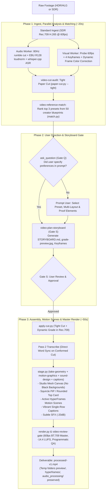

# Pipeline Execution Architecture & Style Rule Checklist

From the 225-style catalog appendix: how a chosen style flows through the skills, and the rules every builder and
reviewer enforces.

How the styles and presets are processed and rendered through the engine:

### Style Rule Checklist for Editors & Autonomous Agents:
1. **Never use the same treatment or visual device twice in a row**: Alternate between speaker framing, graphic cards, full-frame cutaways, and split screens.
2. **Respect the face**: Live-action speakers must never be covered by cards or headlines. Face sits anchored at ~38% canvas height in vertical reframing.
3. **Contrast floor**: Text and key assets must achieve a minimum 3:1 contrast ratio against underlying footage (enforce dark backing pills or text stroke).
4. **Phoneme-level lock**: All animated reveals, card lists, and caption highlights must align to speech phonemes within a ±40ms tolerance window.
5. **Acoustic priority**: Voice intelligibility always takes precedence. Background music must duck cleanly by 12-18dB during vocal activity.
