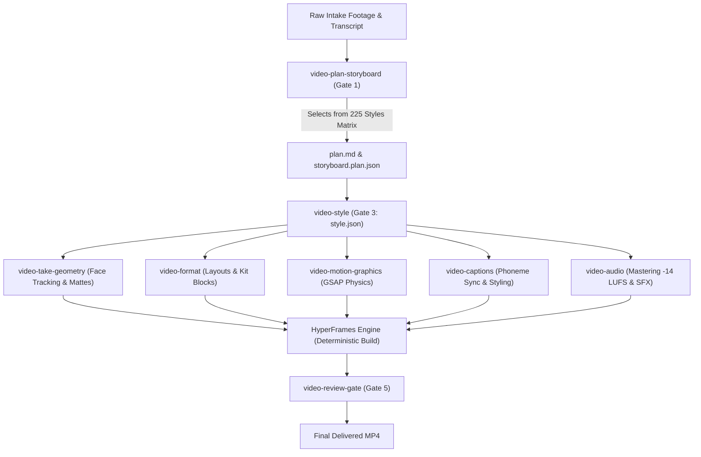

# Video Editing Skill: Master Style Architecture & Catalog (225 Styles)

This document establishes the official reference taxonomy and implementation standard for `video-editing-skill`. Every style is structured according to a deterministic 5-pillar architectural template compatible with HyperFrames, GSAP motion physics, and modern programmatic video rendering engines.

---

## The Universal Style Definition Template Specification

When any style from this catalog is called into a storyboard, script, or `plan.md`, it must conform to the following schema:

```yaml
Style Entry Schema:
  ID & Name: "[Number]. [Style Name]"
  Visual & Spatial Composition:
    Layer Stack: [root | behind | camera | front]
    Framing & Canvas Placement: [Safe-zone coordinates, crop ratios, padding]
    Visual Elements: [Footage, cards, text, badges, masks, background textures]
  Narrative Intent & Best Fits:
    Cognitive Role: [Hook retention, evidence delivery, pacing reset, emotional payoff]
    Optimal Format: [Shorts 9:16, YouTube 16:9, Explainer, Commercial]
  Anti-Patterns & Guardrails (Avoid When):
    Exclusions: [Clutter thresholds, collision with captions/face, overuse fatigue]
    Readability & Contrast Floor: [Minimum WCAG/HyperFrames contrast >= 3:1]
  Motion Physics & Temporal Dynamics:
    Timing: [Entrance duration, hold time, exit duration, stagger latency]
    Easing Curves: [power3.out, back.out(1.4), power2.in, damped harmonic]
  Engine & Asset Requirements:
    Pipeline Skills: [video-take-geometry, video-captions, video-format, video-motion-graphics, video-audio]
    Asset Dependencies: [Alpha mattes, SFX markers, SVG icons, color tokens]
```

---

# Section 1: Layout and Composition Styles

How footage, text, speakers, and graphics are arranged on screen.

### 01. Split-Screen
* **Visual & Spatial Composition**: Two or more distinct video streams playing concurrently on a partitioned screen. In 16:9, divided vertically into dual 8:9 columns; in 9:16, stacked horizontally into dual 9:8 rows. Divided by a crisp 2–4px divider line (`#4A4845` or accent).
* **Narrative Intent & Best Fits**: Contrasting two perspectives, showing cause-and-effect simultaneously, displaying speaker and referenced screen in tandem without obscuring either.
* **Anti-Patterns & Guardrails**: Avoid when one pane remains static for >5 seconds or when text inside a pane drops below 24px legible scale. Captions must span across the divider or sit anchored at bottom, never duplicated inside panes.
* **Motion Physics & Temporal Dynamics**: Split divider animates in along the seam axis (`duration: 0.3s`, `ease: power2.out`). Panes enter via directional slide or simultaneous crossfade.
* **Engine & Asset Requirements**: `video-take-geometry` for face-tracked cropping; `video-format` for layout grid and divider rendering. Audio is locked to primary stream; secondary stream muted or -18dB ambient.

### 02. Side-by-Side Comparison
* **Visual & Spatial Composition**: Two symmetrical columns (50/50 width in 16:9, or side-by-side cards with pillarboxing in 9:16). Clear labels ("Option A" vs "Option B" or "Competitor" vs "Our Product") anchored at top header bands.
* **Narrative Intent & Best Fits**: Direct head-to-head benchmarking, software feature shootouts, price/quality comparisons. Provides immediate visual cognitive closure.
* **Anti-Patterns & Guardrails**: Avoid when differences are too subtle to spot visually without zoom-in callouts. Do not use asymmetric lighting that makes one side artificially unreadable unless intentional.
* **Motion Physics & Temporal Dynamics**: Both sides reveal synchronously or via quick ping-pong wipe (`0.25s`). Synchronized playback markers ensure key comparison events occur at identical timestamps.
* **Engine & Asset Requirements**: Dual video tracks synchronized on timeline; `video-format` badge components for category headers; stereo audio balanced to speaker commentary.

### 03. Stacked Split-Screen
* **Visual & Spatial Composition**: Two video frames stacked vertically (top 50% / bottom 50% or 44% top speaker / 56% bottom demonstration). Ideal native orientation for 9:16 vertical canvas.
* **Narrative Intent & Best Fits**: Reaction video to viral content, coding tutorial with presenter on top and terminal below, live physical unboxing with overhead camera below.
* **Anti-Patterns & Guardrails**: Avoid placing faces in the extreme top 15% (covered by platform UI) or bottom 25% (obscured by engagement buttons and captions).
* **Motion Physics & Temporal Dynamics**: Upper and lower viewports enter from top and bottom edges respectively, snapping at center divider with `back.out(1.2)` damping.
* **Engine & Asset Requirements**: `video-take-geometry` center-face framing on top track; bottom track conformed to 1080x960; central divider bar with optional glowing accent pulse.

### 04. Picture-in-Picture (PiP)
* **Visual & Spatial Composition**: Primary scene occupies 100% full-frame background. Secondary inset window (width: 28–36% of canvas, radius: 12–16px, border: 2px solid rgba(255,255,255,0.2), box-shadow: `0 8px 32px rgba(0,0,0,0.5)`) positioned in a corner.
* **Narrative Intent & Best Fits**: Presenter guiding the viewer through complex gameplay, technical demos, UI walkthroughs, or slide decks while retaining personal connection.
* **Anti-Patterns & Guardrails**: Never place the PiP window over critical UI elements, software menus, or primary focal points of the background video. Move corner dynamically if necessary.
* **Motion Physics & Temporal Dynamics**: PiP scales up from corner anchor point (`scale: 0 -> 1`, `duration: 0.35s`, `ease: back.out(1.4)`). Smooth repositioning tween (`duration: 0.4s`, `ease: power3.inOut`) when dodging background focal shifts.
* **Engine & Asset Requirements**: Inset frame mask, drop-shadow rendering, audio sidechain ducking to presenter voice.

### 05. Layered-Head (Subject Cutout)
* **Visual & Spatial Composition**: Speaker isolated via AI foreground rotoscoping/alpha-matting. Graphics, large typographic numbers, charts, or B-roll are sandwiched strictly *behind* the speaker's head/torso and *in front* of the background footage.
* **Narrative Intent & Best Fits**: High-production YouTube intros, hook sequences, striking proof numbers ("$100,000", "30 Days"). Creates intense cinematic depth.
* **Anti-Patterns & Guardrails**: Avoid if raw footage has low contrast edge boundaries, motion blur on hands that cross the face repeatedly, or frizzy hair artifacts from poor lighting.
* **Motion Physics & Temporal Dynamics**: Typography or graphics rise or scale up behind the subject (`y: +40px -> 0`, `opacity: 0 -> 1`, `duration: 0.28s`) while speaker remains seated/speaking naturally.
* **Engine & Asset Requirements**: `video-take-geometry` / `npx hyperframes remove-background` producing alpha silhouette; z-index layer stack: `[bg-media: 10] -> [graphics-behind: 20] -> [subject-cutout: 30] -> [captions-front: 40]`.

### 06. Facecam Bubble
* **Visual & Spatial Composition**: Circular (1:1 aspect ratio with `border-radius: 50%`) or rounded squircle speaker camera window floating over main footage. Diameter: 240px–320px in 1080p canvas.
* **Narrative Intent & Best Fits**: Casual software demos, Loom-style productivity walkthroughs, micro-commentary clips, educational coding courses.
* **Anti-Patterns & Guardrails**: Avoid small bubbles where speaker facial expressions are unreadable. Ensure speaker eye line points toward the screen action, not off-camera away from content.
* **Motion Physics & Temporal Dynamics**: Enters with spring overshoot (`scale: 0.2 -> 1.0`, `duration: 0.4s`, `ease: elastic.out(1, 0.75)`). Subtle breathing pulse on active speech.
* **Engine & Asset Requirements**: Radial clipping path, circular outline with brand gradient stroke, audio waveform ring reactive to speaker mic input.

### 07. Screen-Plus-Facecam
* **Visual & Spatial Composition**: Structured dual-layout optimizing desktop/browser recordings. Main screen scaled to 70–80% width with a dedicated sidebar or corner bracket housing the 16:9 presenter video.
* **Narrative Intent & Best Fits**: SaaS product walkthroughs, developer tutorials, financial model reviews, executive video memos.
* **Anti-Patterns & Guardrails**: Do not shrink screen recording so much that font sizes become unreadable. Zoom in on active UI zones while keeping facecam steady.
* **Motion Physics & Temporal Dynamics**: Dynamic viewport zoom on screen details (`100% -> 140%` push-in over `0.6s`) while facecam smoothly tucks into a minimized dock.
* **Engine & Asset Requirements**: Clean 4K screen capture asset; cursor smoothing filter; layout template with dark slate container backing (`#1A1D24`).

### 08. Green-Screen Commentary
* **Visual & Spatial Composition**: Full-body or waist-up presenter with chroma-keyed transparent background superimposed directly onto full-frame screenshots, news articles, tweets, or footage.
* **Narrative Intent & Best Fits**: TikTok/Reels style news commentary, trend analysis, gossip/pop-culture breakdowns, critique of landing pages.
* **Anti-Patterns & Guardrails**: Avoid green spill on clothing or hair. Presenter must actively gesture toward and interact with the background elements, not just stand statically in the center.
* **Motion Physics & Temporal Dynamics**: Presenter dynamically pans/slides left or right (`duration: 0.3s`) when background highlights change, maintaining visual balance.
* **Engine & Asset Requirements**: Clean chroma keying / HSV spill suppression; simulated lighting match between background luminance and presenter color temperature.

### 09. Duet / Reaction Layout
* **Visual & Spatial Composition**: Side-by-side or top-and-bottom split optimized for social duets. Creator occupies one pane expressing reactions (nodding, laughing, gasping); original video plays unaltered in adjacent pane.
* **Narrative Intent & Best Fits**: Viral reactions, peer reviews, comedy stitches, expert validation or debunking of common claims.
* **Anti-Patterns & Guardrails**: Avoid dead silence or expressionless staring from the reacting creator. If adding verbal commentary, duck the original audio cleanly.
* **Motion Physics & Temporal Dynamics**: Punch-ins on creator's face during peak comedic/dramatic beats (`scale: 115%`, `duration: 0.15s`).
* **Engine & Asset Requirements**: Time-aligned dual video tracks; audio balance prioritizing the active speaker; platform-compliant safe margins.

### 10. Picture-Frame
* **Visual & Spatial Composition**: Central footage displayed inside an ornate, vintage, or branded graphic frame border (e.g., gold gallery frame, retro TV bezel, sleek neo-brutalist border).
* **Narrative Intent & Best Fits**: Curated art presentations, historical anecdotes, nostalgia themes, premium brand teasers.
* **Anti-Patterns & Guardrails**: Avoid excessive frame width that constricts the inner video to under 75% of screen area. Keep frame textures subtle to prevent visual noise.
* **Motion Physics & Temporal Dynamics**: Frame remains static or participates in gentle 3D tilt while the inner video scales or plays. Inner footage reveals via frame-curtain wipe.
* **Engine & Asset Requirements**: High-resolution PNG/SVG frame asset with alpha viewport cutout; drop shadows inner and outer.

### 11. Multi-Panel Grid
* **Visual & Spatial Composition**: Synchronized matrix of 3, 4, 6, or 9 panels arranged in a balanced grid (e.g., 2x2, 3x3). Each panel shows a different angle, test subject, or data stream.
* **Narrative Intent & Best Fits**: Multiverse comparisons, multi-camera sports action, customer testimonial mosaics, synchronized musical performances.
* **Anti-Patterns & Guardrails**: High cognitive load. Never run rapid individual motion in all panels simultaneously without one highlighted "hero" panel.
* **Motion Physics & Temporal Dynamics**: Panels stagger into frame in sequence (`stagger: 0.08s`, `scale: 0.8 -> 1.0`, `ease: power2.out`). Active panel receives bright highlight border.
* **Engine & Asset Requirements**: Synchronized multi-track video composer; dynamic border highlight shader; audio downmixed to single master feed.

### 12. Dynamic Split-Screen
* **Visual & Spatial Composition**: Split-screen where the dividing boundary line dynamically moves, expands, rotates, or collapses based on narrative beats (e.g., left pane expands from 50% to 80% as subject explains detail).
* **Narrative Intent & Best Fits**: Conversational debates where speaking turns dictate screen territory; showing progress bar conversions; interactive reveals.
* **Anti-Patterns & Guardrails**: Jerky or unpredictable divider motion that causes motion sickness. Limit transitions to purposeful speaker shifts.
* **Motion Physics & Temporal Dynamics**: Divider position tweened using cubic Bezier (`duration: 0.5s`, `ease: cubic-bezier(0.25, 1, 0.5, 1)`). Viewports crop smoothly without stretching content.
* **Engine & Asset Requirements**: Real-time CSS flex/grid or canvas clipping path animation; responsive face-tracking anchor points.

### 13. Layered Collage
* **Visual & Spatial Composition**: Eclectic, textured composition featuring overlapping screenshots, torn paper cutouts, highlighter strips, stickers, arrows, and animated footage snippets on a textured background.
* **Narrative Intent & Best Fits**: Investigative deep-dives (Vox/Johnny Harris style), Gen-Z aesthetic explainers, complex case-study syntheses.
* **Anti-Patterns & Guardrails**: Visual anarchy without hierarchy. One element must clearly hold dominant scale (the primary focus) while supporting assets remain secondary.
* **Motion Physics & Temporal Dynamics**: Elements drop in with rotational jitter (`rotation: random(-6, 6)deg`, `scale: 0.9 -> 1.0`, `duration: 0.22s`, `stagger: 0.12s`).
* **Engine & Asset Requirements**: Asset library of paper rips, masking tape textures, drop shadows (`filter: drop-shadow(0 10px 20px rgba(0,0,0,0.35))`), SVG doodles.

### 14. Paper-Drawer
* **Visual & Spatial Composition**: A tactile, paper-textured compartment or folder tab that slides out smoothly from screen edge (left, right, or bottom) into the frame, revealing a note, definition, or formula.
* **Narrative Intent & Best Fits**: Academic citations, "By the way" technical definitions, side notes, author quotes without interrupting primary video flow.
* **Anti-Patterns & Guardrails**: Text on paper panel exceeding 12–15 words. Avoid leaving drawer open for >6 seconds after narration has moved on.
* **Motion Physics & Temporal Dynamics**: Slide-in (`x: -100% -> 0`, `duration: 0.32s`, `ease: power3.out`), subtle settle (`x: 0 -> -8px -> 0`), hold for speech duration, slide-out (`x: 0 -> -100%`, `duration: 0.24s`, `ease: power2.in`).
* **Engine & Asset Requirements**: High-res paper parchment texture (`#F4ECD8`), ink-black typography (`#1D1A16`), paper slide SFX (`whoosh-paper-friction.mp3`).

### 15. Scrapbook
* **Visual & Spatial Composition**: Analog scrapbook spread with photo prints taped down with semi-transparent scotch tape, handwritten cursive titles, push pins, and cardboard grain.
* **Narrative Intent & Best Fits**: Personal memoirs, travel retrospectives, company milestone celebrations, artistic creator stories.
* **Anti-Patterns & Guardrails**: Modern corporate UI elements clashing with analog textures. Maintain consistent physical lighting and shadow direction across all pinned items.
* **Motion Physics & Temporal Dynamics**: Stop-motion staggered entrance (step-based animation at 12fps) simulating physical hands pasting items down.
* **Engine & Asset Requirements**: Masking tape alphas, paper tear brushes, localized shadow shaders, analog acoustic sounds (tape rip, paper thud).

### 16. Polaroid Stack
* **Visual & Spatial Composition**: Classic white-bordered Polaroid instant photo frames stacked slightly offset on a desk or solid surface. Upper photo is viewed, then swept away to reveal the next.
* **Narrative Intent & Best Fits**: Photo retrospectives, rapid-fire portfolio showcasing, travel highlights, chronological team intros.
* **Anti-Patterns & Guardrails**: Stacks deeper than 4 items cause visual clutter. Avoid tiny photos where subjects are unrecognizable.
* **Motion Physics & Temporal Dynamics**: Top card flicks away with velocity and slight rotation (`x: +120%`, `rotation: 25deg`, `duration: 0.35s`, `ease: power2.inOut`). Lower card springs to focus.
* **Engine & Asset Requirements**: White Polaroid frame template with bottom label text, realistic card shuffle SFX (`foley-card-slide.wav`).

### 17. Floating Cards
* **Visual & Spatial Composition**: Modular rounded glassmorphic or dark-mode UI cards (`border-radius: 18px`, subtle gradient border) floating gracefully in 3D perspective space around the speaker or canvas center.
* **Narrative Intent & Best Fits**: Presenting software features, metrics, key bullet points, or product pricing tiers in high-tech corporate reels.
* **Anti-Patterns & Guardrails**: Cards covering the presenter's mouth or eyes. Cards lingering after spoken point finishes.
* **Motion Physics & Temporal Dynamics**: Smooth 3D tilt (`transform: perspective(1000px) rotateY(-8deg)`), gentle floating sinusoidal hover (`y: ±6px`, `period: 2.5s`).
* **Engine & Asset Requirements**: CSS 3D transforms, frosted glass backdrop filter (`blur(16px)`), luminous border gradients, subtle UI pop chime.

### 18. Over-the-Shoulder Screen
* **Visual & Spatial Composition**: Camera angle positioned behind/beside the presenter, showing their shoulder/profile in foreground while looking at a physical laptop, tablet, or virtual floating projection.
* **Narrative Intent & Best Fits**: Collaborative discussions, coding reviews, strategic teardowns, establishing realistic working environments.
* **Anti-Patterns & Guardrails**: Presenter's head obstructing more than 30% of the active screen area. Screen glare or reflection washing out display data.
* **Motion Physics & Temporal Dynamics**: Subtle handheld camera drift (`wiggle: 1.5%`) giving an authentic fly-on-the-wall observational feel.
* **Engine & Asset Requirements**: 4-point corner pin perspective projection of screen media onto physical monitor surface; ambient screen light casting onto presenter's shoulder.

### 19. Device Mockup
* **Visual & Spatial Composition**: High-fidelity 3D/vector render of an iPhone, MacBook Pro, iPad, or browser window centered on canvas with recorded UI cleanly composited inside screen bezels.
* **Narrative Intent & Best Fits**: Mobile app demonstrations, website launch promos, responsive design showcases, digital product marketing.
* **Anti-Patterns & Guardrails**: Low-resolution screen captures that look pixelated inside 4K device frames. Avoid static mockups; the content inside *must* scroll or interact.
* **Motion Physics & Temporal Dynamics**: Device floats in with smooth rotational tilt (`rotateX: 12deg`, `rotateY: -15deg -> 0deg`, `duration: 0.6s`, `ease: power3.out`). Scroll gestures inside device time-aligned to narration.
* **Engine & Asset Requirements**: Apple hardware vector models (clay/metallic variants), screen mask container, subtle glass reflection glare overlay.

### 20. Foreground-Background Parallax
* **Visual & Spatial Composition**: Multi-plane composition where foreground elements (foliage, cutout speaker, architectural pillars) move at a faster rate across camera than midground graphics and distant background.
* **Narrative Intent & Best Fits**: Immersive cinematic intros, storytelling documentaries, creating artificial depth from still photography (2.5D animation).
* **Anti-Patterns & Guardrails**: Exaggerated speed differentials that break physical optical laws or cause depth tearing artifacts.
* **Motion Physics & Temporal Dynamics**: Linear or smooth eased camera tracking across X/Z axes with speed ratios: FG = 1.0x, MG = 0.5x, BG = 0.15x.
* **Engine & Asset Requirements**: Photoshop layer separation of still assets (inpainted background plate); camera projection plane setup in 3D motion engine.

---

# Section 2: Caption and Typography Styles

Videos where words are the main visual experience.

### 21. Caption-Edit
* **Visual & Spatial Composition**: The visual edit is entirely anchored around massive, stylized, center-weighted captions. Subtitle text is not a secondary aid; it is the primary visual engine of the video.
* **Narrative Intent & Best Fits**: Talking-head reels, short-form viral hooks, noisy social feeds where >70% of viewers watch with audio muted.
* **Anti-Patterns & Guardrails**: Captions overlapping speaker's chin or mouth. Captions displaying more than 4–5 words at a time (causes reading fatigue and loses rhythm).
* **Motion Physics & Temporal Dynamics**: Instant cuts on phrase groups (`duration: 0.18s–0.24s`), perfectly synchronized with speech audio phonemes.
* **Engine & Asset Requirements**: `video-captions` with transcript timestamp alignment; high-impact bold typography (`Poppins Black`, `Anton`), heavy drop-shadow/stroke.

### 22. Karaoke Captions
* **Visual & Spatial Composition**: Full spoken phrases displayed on screen simultaneously in neutral tint (`#B9B5AE` or white), with each individual word lighting up into bright vibrant accent color (`#FFD400` or `#00E0FF`) precisely as spoken.
* **Narrative Intent & Best Fits**: Rapid-fire explanations, educational monologues, rap/music lyric videos, maintaining viewer visual lock through reading anticipation.
* **Anti-Patterns & Guardrails**: Highlight color with poor contrast against backing video (< 3:1 contrast ratio). Highlight triggering out of sync with audio by >60ms.
* **Motion Physics & Temporal Dynamics**: Per-word color transition is instant or micro-flash (`duration: 0.08s`). Optional subtle scale punch (`scale: 1.0 -> 1.08 -> 1.0`) on active word.
* **Engine & Asset Requirements**: Whisper word-level timestamps (`start`, `end`); CSS span classes with color transition; audio-scrubbed verification.

### 23. Kinetic Typography
* **Visual & Spatial Composition**: Typographic elements that dynamically animate, scale, rotate, track, and rearrange themselves in direct physical expression of the emotional tone and rhythm of spoken words.
* **Narrative Intent & Best Fits**: Manifesto videos, high-energy commercial promos, punchy audio excerpts without footage, poetic storytelling.
* **Anti-Patterns & Guardrails**: Overly complex animations that render text illegible before the eye can decode it. Text must be readable before it transforms.
* **Motion Physics & Temporal Dynamics**: Words slam down (`scale: 1.8 -> 1.0`, `duration: 0.16s`, `ease: power4.out`), stretch horizontally on speed lines, or explode into fragments on aggressive audio hits.
* **Engine & Asset Requirements**: GSAP / Web Animations text splitting engine; SVG path morphing; transient impact whoosh and thud SFX.

### 24. Big-Text Hook
* **Visual & Spatial Composition**: Oversized, bold, all-caps headline dominating 40–60% of the upper screen area during the first 0.0s–3.0s of the video. Maximum 3–5 words with one punch-word highlighted.
* **Narrative Intent & Best Fits**: Stopping the social media scroll within the first 500ms; establishing high-stakes premise or irresistible curiosity gap.
* **Anti-Patterns & Guardrails**: Keeping the big-text hook on screen past 3.5 seconds (causes visual boredom). Hook text contradicting spoken opening line.
* **Motion Physics & Temporal Dynamics**: Enters frame at frame 0.0s with immediate visual slam or snappy slide down (`y: -50px -> 0`, `duration: 0.18s`). Exits cleanly via scale-fade.
* **Engine & Asset Requirements**: Heavyweight display font (`Syne 800`, `Montserrat 900`), solid black backing highlight pill or high-contrast outline (`paint-order: stroke fill`).

### 25. Wall-of-Text
* **Visual & Spatial Composition**: High-density screen filled with multiple lines of structured copy or excerpted document text, where rapid visual highlighters or kinetic focus bars isolate specific phrases while dimming the rest.
* **Narrative Intent & Best Fits**: Investigative legal breakdowns, contract reviews, scientific paper proof, establishing overwhelming evidence or exhaustive scale.
* **Anti-Patterns & Guardrails**: Leaving the wall of text unhighlighted, forcing the user to read fine print unaided. Always provide an immediate optical guide.
* **Motion Physics & Temporal Dynamics**: Background text appears at 35% opacity; yellow/green highlighter bar sweeps across critical sentence (`width: 0 -> 100%`, `duration: 0.35s`, `ease: power2.out`).
* **Engine & Asset Requirements**: Monospace or clean editorial serif typeface; highlighter overlay shader with multiply blend mode; document scan asset.

### 26. Sentence-by-Sentence Captions
* **Visual & Spatial Composition**: Natural phrase groups (3 to 6 words forming a complete grammatical clause) presented cleanly in a fixed reading box below the face.
* **Narrative Intent & Best Fits**: Thoughtful interviews, business insights, documentary narratives where word-by-word bouncing would feel too frantic or childish.
* **Anti-Patterns & Guardrails**: Sentences breaking awkwardly across grammatical boundaries (e.g., separating "in" and "London" across different cuts).
* **Motion Physics & Temporal Dynamics**: Smooth upward settle and fade-in (`opacity: 0 -> 1`, `y: +12px -> 0`, `duration: 0.22s`), holding until clause completion, quick fade-out (`0.14s`).
* **Engine & Asset Requirements**: NLP phrase chunker / transcript clause grouping; uniform line-height and bounding container.

### 27. Word-by-Word Pop Captions
* **Visual & Spatial Composition**: Only one single word (or at most two words) displayed on screen at any given instant, flashing in the exact visual center of the canvas.
* **Narrative Intent & Best Fits**: High-intensity, hyper-stimulating short-form reels (Alex Hormozi style) designed to force relentless visual fixation.
* **Anti-Patterns & Guardrails**: Using this for videos longer than 60 seconds (causes cognitive fatigue). Avoid in thoughtful, nuanced, or somber discussions.
* **Motion Physics & Temporal Dynamics**: Each word pops into existence on its exact audio onset (`scale: 0.85 -> 1.0`, `duration: 0.12s`, `ease: back.out(1.5)`). Zero lingering decay.
* **Engine & Asset Requirements**: Sub-frame accurate audio alignment (whisper phonemes); high-visibility contrasting font color (`#00FF66`, `#FFFF00`); thick 4px black text stroke.

### 28. Typewriter Text
* **Visual & Spatial Composition**: Characters appear sequentially one by one from left to right, accompanied by a blinking vertical terminal cursor (`|` or `_`).
* **Narrative Intent & Best Fits**: Quoting written diary entries, displaying technical code inputs, retro mystery reveals, establishing an intimate authorial voice.
* **Anti-Patterns & Guardrails**: Setting typewriter speed slower than speaking speed. Never make the audience wait for words to finish typing when voiceover is already ahead.
* **Motion Physics & Temporal Dynamics**: Linear stepped character reveal (`stagger: 0.03s–0.05s` per character). Cursor blinks at 2Hz frequency.
* **Engine & Asset Requirements**: Monospaced font (`Fira Code`, `JetBrains Mono`); mechanical keyboard clack SFX synchronized to character typing rate.

### 29. Minimal Subtitle Style
* **Visual & Spatial Composition**: Understated, elegant, cinema-standard subtitles. Centered at bottom (12% margin from edge), modest size (28–34px), white text with subtle translucent black backing bar or soft drop shadow.
* **Narrative Intent & Best Fits**: Independent films, foreign language translations, cinematic travel vlogs, prestigious documentaries where visual aesthetics must not be cheapened by loud social captions.
* **Anti-Patterns & Guardrails**: Do not use bold neon colors, heavy outlines, or bouncy kinetic animations. Maintain strict visual humility.
* **Motion Physics & Temporal Dynamics**: Gentle alpha crossfades between lines (`duration: 0.15s`). No scale, position, or rotation movement.
* **Engine & Asset Requirements**: Classic typographic standard (`Helvetica Neue`, `Inter`, `Futura Medium`); standard SRT/VTT parser pipeline.

### 30. Color-Coded Speaker Captions
* **Visual & Spatial Composition**: Captions dynamically change font color or container badge color depending on who is speaking (e.g., Host = Electric Blue, Guest = Amber Gold).
* **Narrative Intent & Best Fits**: Dual-speaker podcasts, debate clips, comedic skits where one actor plays multiple characters, multi-person panel discussions.
* **Anti-Patterns & Guardrails**: Using colors that look too similar (e.g., light blue vs cyan). Inconsistent speaker color assignment between scenes.
* **Motion Physics & Temporal Dynamics**: Color shifts immediately on audio speaker turn, paired with small speaker avatar icon or name tag appearing beside caption.
* **Engine & Asset Requirements**: Speaker diarization data in transcript; multi-token color palette; automated diarization track routing.

### 31. Emphasis-Word Zoom
* **Visual & Spatial Composition**: In a sentence caption, the single operative keyword scales up significantly (130–150% size), punches forward in Z-space, and shifts to a fiery accent color.
* **Narrative Intent & Best Fits**: Punctuating punchlines, financial statistics ("MILLIONS"), unexpected plot twists, verbal expressions of surprise or anger.
* **Anti-Patterns & Guardrails**: Emphasizing filler words ("and", "very", "so"). Limit to at most one emphasis word per 4 seconds of speech to preserve impact.
* **Motion Physics & Temporal Dynamics**: Zoom occurs on audio transient peak (`scale: 1.0 -> 1.45`, `duration: 0.14s`, `ease: back.out(2.0)`), followed by gradual settle.
* **Engine & Asset Requirements**: `video-captions` emphasis detection; camera micro-punch synchronizer; subtle sub-bass thump SFX (`kick-impact.wav`).

### 32. Scrolling Text
* **Visual & Spatial Composition**: Continuous horizontal ticker band along bottom edge (stock ticker / breaking news style) or vertical crawl (Star Wars opening crawl style).
* **Narrative Intent & Best Fits**: Live event streams, disclaimer legal copy, news updates, establishing epic backstories.
* **Anti-Patterns & Guardrails**: Scrolling faster than human reading comprehension speed. Avoid jerky frame-rate stutter; must be hardware-accelerated smooth 60fps scroll.
* **Motion Physics & Temporal Dynamics**: Constant linear velocity (`ease: none`). Pauses momentarily during key alert broadcasts.
* **Engine & Asset Requirements**: CSS `translateX` marquee loop; news-bar backing container; optional blinking "LIVE" or "UPDATE" red badge.

### 33. Oversized Editorial Headlines
* **Visual & Spatial Composition**: Sophisticated, high-fashion editorial layout featuring massive serif typography (`Playfair Display`, `Cormorant Garamond`) spanning edge-to-edge, partially masked by footage frames.
* **Narrative Intent & Best Fits**: Luxury brand spots, architectural documentaries, high-end lifestyle vlogs, artistic video essays.
* **Anti-Patterns & Guardrails**: Cramming multiple long sentences. Editorial headlines must be terse (1–3 words) with generous whitespace and breathing room.
* **Motion Physics & Temporal Dynamics**: Slow, majestic tracking expansion (`letter-spacing: 0.05em -> 0.15em`, `duration: 1.8s`, `ease: power1.out`), paired with gentle footage zoom.
* **Engine & Asset Requirements**: Premium display serif font files; ultra-fine stroke lines; ambient cinematic drone audio score.

### 34. Text-Message Conversation
* **Visual & Spatial Composition**: Realistic mobile messaging bubbles (iOS Blue / WhatsApp Green / SMS Gray) appearing alternately on screen inside or beside a smartphone frame.
* **Narrative Intent & Best Fits**: Storytelling depicting private chats, internet drama recaps, customer interaction re-enactments, suspenseful digital thrillers.
* **Anti-Patterns & Guardrails**: Showing massive blocks of text in one bubble. Messages must mimic authentic texting brevity with realistic typos/reactions.
* **Motion Physics & Temporal Dynamics**: Animated three-dot typing indicator appears for 0.8s, followed by message bubble popping up from bottom (`y: +20px -> 0`, `duration: 0.2s`).
* **Engine & Asset Requirements**: Native chat UI bubble components; authentic platform audio chimes (sent swoosh, received ding, keyboard tap clicks).

### 35. Fake Social-Media Comments
* **Visual & Spatial Composition**: Exact visual replicas of YouTube, TikTok, Instagram, or X (Twitter) comment cards with avatars, usernames, upvote counts, and comment text floating over footage.
* **Narrative Intent & Best Fits**: Addressing viewer questions, debunking hate comments, showing social proof and community consensus, humor inserts.
* **Anti-Patterns & Guardrails**: Blurry low-res screenshots taken from phones. Render crisp vector/SVG mockups with legible high-resolution typography.
* **Motion Physics & Temporal Dynamics**: Card scales in with a jaunty tilt (`rotation: -3deg`, `scale: 0.8 -> 1.0`, `duration: 0.25s`, `ease: back.out(1.4)`).
* **Engine & Asset Requirements**: Reusable social comment UI block; vector platform icons (thumbs up, heart, verified checkmark); light pop SFX.

### 36. Terminal / Code-Text Animation
* **Visual & Spatial Composition**: Monochromatic dark IDE or Linux shell window (`#0F141C`) with syntax-highlighted code lines executing, compiling, or being typed in real-time.
* **Narrative Intent & Best Fits**: Software engineering tutorials, cybersecurity stories, developer tool product launches, hacker aesthetic themes.
* **Anti-Patterns & Guardrails**: Code text too small to read on mobile screens (minimum 14pt relative font size). Overwhelming viewers with 50 lines of unformatted code.
* **Motion Physics & Temporal Dynamics**: Line-by-line syntax reveal with auto-scrolling terminal window. Terminal output commands generate instant execution blocks.
* **Engine & Asset Requirements**: Prism / Highlight.js syntax highlighting engine; monospace fonts (`Fira Code`, `JetBrains Mono`); subtle electric hum and keystroke sounds.

### 37. Handwritten Annotations
* **Visual & Spatial Composition**: Organic digital pen strokes, underlined phrases, circled words, corrective strikethroughs, and handwritten marginalia appearing over text or footage.
* **Narrative Intent & Best Fits**: Educational breakdowns, architectural audits, pointing out subtle visual easter eggs in footage, personalized human touch.
* **Anti-Patterns & Guardrails**: Sloppy illegible handwriting. Keep stroke thickness balanced so it accents rather than obscures underlying assets.
* **Motion Physics & Temporal Dynamics**: SVG stroke-dashoffset animation simulating the real-time velocity of a drawing hand (`duration: 0.4s–0.8s`, `ease: power2.inOut`).
* **Engine & Asset Requirements**: SVG vector paths with animated trim-path properties; marker/chalk writing sound effects (`chalkboard-stroke.wav`).

### 38. Marker-and-Doodle Captions
* **Visual & Spatial Composition**: Playful illustrated doodles (stars, question marks, lightning bolts, lightbulbs, squiggly arrows) drawn around active words in dynamic hand-drawn marker style.
* **Narrative Intent & Best Fits**: Casual creator vlogs, playful storytelling, creative design tutorials, high-energy entertainment shorts.
* **Anti-Patterns & Guardrails**: Distracting clutter around every single word. Reserve marker doodles exclusively for peak punchlines or conceptual hooks.
* **Motion Physics & Temporal Dynamics**: Two-frame or three-frame loop animated at 12fps (boiling effect) to create lively organic vibration.
* **Engine & Asset Requirements**: Custom animated SVG sticker library; bright marker yellow (`#FFE600`) and cyan (`#00F0FF`); squeaky marker SFX.

### 39. Quote-Card Typography
* **Visual & Spatial Composition**: Elegant full-frame or centered modal card featuring large decorative quotation marks (`“`), quote text in high-legibility italic type, and author attribution with portrait thumbnail.
* **Narrative Intent & Best Fits**: Book summaries, historical philosophy videos, podcast guest highlights, corporate customer testimonials.
* **Anti-Patterns & Guardrails**: Quotes exceeding 25 words on screen. Break lengthy quotes into sequential cards to preserve viewer engagement.
* **Motion Physics & Temporal Dynamics**: Card fades up with subtle scale (`scale: 0.95 -> 1.0`, `duration: 0.4s`), while quotation marks expand in background at 15% opacity.
* **Engine & Asset Requirements**: High-contrast card container (`#252525` on `#171717` dark background); serif quotation glyphs; subtle chime or bass bed.

### 40. Number-Counter Typography
* **Visual & Spatial Composition**: Prominently displayed numerical figure (financial figures, subscriber counts, stopwatch seconds, percentages) whose digits dynamically roll or count up at high speed.
* **Narrative Intent & Best Fits**: Revealing revenue milestones ("$0 to $1,000,000"), countdowns, performance benchmark comparisons, stat verification.
* **Anti-Patterns & Guardrails**: Counting up so slowly that pacing drags, or so fast that the final figure cannot be absorbed. Always hold on the final number for >=1.5s.
* **Motion Physics & Temporal Dynamics**: Rapid count with exponential deceleration (`ease: power4.out`, `duration: 1.2s`). Final digit settle accompanied by green scale flash.
* **Engine & Asset Requirements**: GSAP numerical tween formatting commas and currency symbols (`$`, `₹`, `%`); rapid mechanical ticking SFX resolving to cash register ring.

### 41. Three-Dimensional Typography
* **Visual & Spatial Composition**: Heavy typographic characters rendered with true physical 3D depth, bevels, realistic surface textures (chrome, stone, brushed metal, neon glass), casting shadows into the scene.
* **Narrative Intent & Best Fits**: Movie title sequences, AAA gaming trailers, blockbuster brand announcements, cinematic music videos.
* **Anti-Patterns & Guardrails**: Cheesy low-polygon 3D text that feels like 1990s WordArt. Must feature sophisticated lighting, ambient occlusion, and environment reflections.
* **Motion Physics & Temporal Dynamics**: 3D camera sweeps across the word geometry, with dynamic specular highlight gleam sliding across bevel edges (`duration: 1.5s`).
* **Engine & Asset Requirements**: Three.js / WebGL / Blender rendering pipeline; environment reflection maps; cinematic sub-bass boom SFX.

### 42. Text-Mask Reveal
* **Visual & Spatial Composition**: Video footage or secondary animation is visible *only* inside the geometric silhouettes of large bold letterforms, surrounded by solid black or white negative space.
* **Narrative Intent & Best Fits**: Cinematic title intros, location establishing shots, revealing a new environment through the project name.
* **Anti-Patterns & Guardrails**: Fine-line, lightweight fonts that show almost zero video inside the strokes. Use ultra-wide heavy type (`Impact`, `Druk Wide`, `Futura Bold`).
* **Motion Physics & Temporal Dynamics**: Letters expand rapidly toward camera (`scale: 1.0 -> 15.0`, `duration: 0.8s`, `ease: power3.in`), zooming through a letter opening to reveal full footage.
* **Engine & Asset Requirements**: CSS `background-clip: text` or SVG clip-path mask; sweeping whoosh transition audio.

### 43. Glitch Typography
* **Visual & Spatial Composition**: Digital transmission distortion: RGB color splitting (chromatic aberration), horizontal pixel displacement slices, scan lines, and temporary character scramble.
* **Narrative Intent & Best Fits**: Cyberpunk aesthetic, hacking themes, highlighting system failures, dystopian narratives, high-impact beat drops.
* **Anti-Patterns & Guardrails**: Endless continuous glitching that induces headaches. Glitches must be sharp, surgical bursts lasting 2 to 6 frames maximum.
* **Motion Physics & Temporal Dynamics**: Sudden erratic X-displacement (`±20px`), RGB channel separation (red channel offset left, blue offset right), resolving immediately to clean text.
* **Engine & Asset Requirements**: WebGL chromatic aberration shader; digital noise displacement map; analog static burst SFX (`digital-glitch-hit.wav`).

### 44. Text-on-B-Roll
* **Visual & Spatial Composition**: Clean, restrained typography positioned strategically in natural negative space (sky, dark wall, empty road) of high-production cinematic B-roll footage.
* **Narrative Intent & Best Fits**: Documentaries, travel films, luxury brand spots, video essays where footage and words coexist in visual harmony.
* **Anti-Patterns & Guardrails**: Placing text directly over busy, high-contrast visual details (e.g., checkered shirts, tree foliage) where letters become illegible.
* **Motion Physics & Temporal Dynamics**: Text tracks smoothly to camera movement using 2D/3D planar tracking, giving the impression of being anchored in physical space.
* **Engine & Asset Requirements**: Motion tracking metadata; soft vignette underlay; clean sans-serif type (`Inter SemiBold`).

### 45. Transcript-Following Highlight
* **Visual & Spatial Composition**: An interactive transcript or teleprompter-style list where a rectangular highlight block or glowing underline tracks down the page line-by-line in sync with speech.
* **Narrative Intent & Best Fits**: Language learning apps, audiobooks with video accompaniment, legal testimony reviews, dense academic lecture reviews.
* **Anti-Patterns & Guardrails**: Highlight falling behind audio cadence. Ensure smooth vertical scrolling so active line stays anchored at 45% screen height.
* **Motion Physics & Temporal Dynamics**: Continuous vertical auto-scroll (`ease: linear`) with subtle ease adjustments on paragraph transitions.
* **Engine & Asset Requirements**: Synchronized transcript parser; automated auto-scroll controller; calm ambient study room tone audio.


---

# Section 3: Camera and Footage-Driven Styles

How a real person, location, product, or activity is filmed and presented.

### 46. Talking-Head
* **Visual & Spatial Composition**: Direct-to-camera address. Subject framed centrally or along rule-of-thirds grid line (waist-up or bust shot). Eyes aligned at 65–70% vertical height. Shallow depth of field (blurred background).
* **Narrative Intent & Best Fits**: Authoritative teaching, expert opinions, editorial arguments, personal accountability, building trust and direct connection.
* **Anti-Patterns & Guardrails**: Unbroken static shot running >10s without optical reset (causes gaze fatigue). Camera positioned below eye-level (unflattering upward nostril angle).
* **Motion Physics & Temporal Dynamics**: Periodic punch-in reframe (106–112% scale) on thesis statements or emotional shifts; instant reset to 100% at scene cuts.
* **Engine & Asset Requirements**: Face-tracking focal lock; natural color balance; studio vocal audio (-14 LUFS, crisp broadcast compression).

### 47. Vlog
* **Visual & Spatial Composition**: Dynamic first-person and third-person hybrid footage captured on handheld cameras or mobile rigs. Natural lighting, fluid camera movement, real-world acoustic environments.
* **Narrative Intent & Best Fits**: Personal brand building, authentic day-in-the-life journeys, behind-the-curtain creator updates.
* **Anti-Patterns & Guardrails**: Shaky cam that causes vertigo. Heavy artificial motion graphics that destroy the raw, organic intimacy of the format.
* **Motion Physics & Temporal Dynamics**: Micro-camera jitters preserved; cuts occur naturally on physical action (door opening, stepping into a car, sitting down).
* **Engine & Asset Requirements**: Handheld stabilization filter (gyro smoothing); directional shotgun mic audio mixed with ambient environmental soundbeds.

### 48. Walk-and-Talk
* **Visual & Spatial Composition**: Presenter walking through an urban, office, or natural setting while speaking directly to a retreating forward gimbal camera or selfie stick.
* **Narrative Intent & Best Fits**: High-energy thought leadership, casual brainstorm sharing, establishing momentum and urgency in business topics.
* **Anti-Patterns & Guardrails**: Presenter losing breath or puffing audio into microphone. Extreme background noise (traffic sirens) drowning out vocal intelligibility.
* **Motion Physics & Temporal Dynamics**: Steady forward tracking motion with slight vertical rhythmic bob matching footstep cadence.
* **Engine & Asset Requirements**: Lavalier mic with physical wind muff; AI voice isolation / spectral denoise; dynamic gimbal horizon lock.

### 49. Day-in-the-Life
* **Visual & Spatial Composition**: Chronological sequence documenting daily routine from morning to night. Incorporates time-stamps (`06:30 AM`), atmospheric lighting shifts, and varied activities.
* **Narrative Intent & Best Fits**: Aspirational founder routines, engineer lifestyle showcases, productivity system demonstrations, recruitment culture reels.
* **Anti-Patterns & Guardrails**: Tedious real-time pacing. Routine tasks (making coffee, commuting) must be compressed into snappy micro-beats (1.5s–3s).
* **Motion Physics & Temporal Dynamics**: Time-lapse accelerations between distinct lifestyle chapters; rhythmic jump cuts on repetitive actions.
* **Engine & Asset Requirements**: Dynamic clock/time badge overlay; acoustic sound design (alarm beep, kettle whistle, subway transit).

### 50. Behind-the-Scenes (BTS)
* **Visual & Spatial Composition**: Fly-on-the-wall observational angles showing the unpolished reality behind a polished production: lighting rigs, teleprompters, makeup, failed takes, crew banter.
* **Narrative Intent & Best Fits**: Demystifying high-budget projects, celebrating team effort, establishing authenticity, teasing upcoming launches.
* **Anti-Patterns & Guardrails**: Fabricated or staged "candid" moments that feel fake to savvy audiences. Keep color grading neutral and unvarnished.
* **Motion Physics & Temporal Dynamics**: Whip-pans and rack-focus transitions between primary actors and production monitors.
* **Engine & Asset Requirements**: Multi-cam setup with dedicated roving camera; raw, un-sweetened room audio capturing laughter and off-mic remarks.

### 51. B-Roll Style
* **Visual & Spatial Composition**: High-production contextual cutaway footage (slow-motion details, environment establishing shots, macro textures) that visually manifests spoken narration.
* **Narrative Intent & Best Fits**: Elevating production value, sustaining visual engagement during complex voiceovers, showing proof of physical environments or objects.
* **Anti-Patterns & Guardrails**: Generic stock footage that feels corporate and detached (e.g., random business handshake). Footage must be specific and authentic to the topic.
* **Motion Physics & Temporal Dynamics**: Butter-smooth slow-motion (60fps/120fps conformed to 24fps timeline) with constant directional slide or gimbal push.
* **Engine & Asset Requirements**: High-bitrate 4K footage; speed-ramp transitions; subtle whoosh SFX on shot entrances.

### 52. Voiceover Plus B-Roll
* **Visual & Spatial Composition**: Continuous, polished voiceover narration running as the audio spine, while the visual timeline is composed entirely of curated B-roll clips changing every 2–4 seconds.
* **Narrative Intent & Best Fits**: Faceless YouTube channels, documentary essays, historical retrospectives, software overview explainers.
* **Anti-Patterns & Guardrails**: Visual cutaways disconnected from spoken concepts. Every visual cut must have a direct conceptual anchor in the voiceover transcript.
* **Motion Physics & Temporal Dynamics**: Cuts land on vocal stressed syllables or musical downbeats; visual momentum flows consistently in one screen direction (left to right).
* **Engine & Asset Requirements**: Master voiceover track conformed to -14 LUFS; intelligent transcript-to-shot matching database; rich ambient SFX beds.

### 53. Cinematic Montage
* **Visual & Spatial Composition**: Rhythmically edited sequence of visually striking shots, synchronized precisely to a swelling musical soundtrack, often without spoken dialogue.
* **Narrative Intent & Best Fits**: Emotional video climaxes, athletic hype sequences, travel showreels, transformation reveals.
* **Anti-Patterns & Guardrails**: Random shots without narrative progression. The montage must follow an emotional arc (tension building to euphoria/resolution).
* **Motion Physics & Temporal Dynamics**: Beat-synced cuts with progressive tempo acceleration; speed ramps ramping into action impacts.
* **Engine & Asset Requirements**: High dynamic range color grade (LUT); transient audio hit points; cinematic sub-drops and riser sound effects.

### 54. POV Video (Point-of-View)
* **Visual & Spatial Composition**: Camera mounted to creator's chest, helmet, or forehead, showing the world exactly as the creator sees it (hands entering frame, direct eye-level perspective).
* **Narrative Intent & Best Fits**: Extreme sports, culinary cooking tutorials, unboxing, hands-on mechanical repairs, immersive experiential travel.
* **Anti-Patterns & Guardrails**: Camera angled too low (filming floor) or too high (filming ceiling). Hands must remain centered in active working zone.
* **Motion Physics & Temporal Dynamics**: Rock-steady horizon stabilization; natural head-turn panning physics matching human ocular tracking.
* **Engine & Asset Requirements**: Action camera / binaural microphone setup capturing immersive stereo spatial audio.

### 55. Hands-Only Demonstration
* **Visual & Spatial Composition**: Overhead top-down "flat lay" camera angle or tight 45-degree angle focused exclusively on hands manipulating tools, sketchbooks, cards, or culinary ingredients on a clean surface.
* **Narrative Intent & Best Fits**: Crafting, digital illustration tutorials, watchmaking, recipe videos (Tasty style), physical product teardowns.
* **Anti-Patterns & Guardrails**: Cluttered work surfaces with distracting shadows. Use soft, diffused, shadowless overhead ring lighting.
* **Motion Physics & Temporal Dynamics**: Precise, deliberate hand choreography; speed ramps across repetitive mechanical operations.
* **Engine & Asset Requirements**: Overhead boom arm mount; clean non-reflective work mat; hyper-detailed ASMR foley sound recording.

### 56. Interview Format
* **Visual & Spatial Composition**: Classic multi-camera setup. Wide two-shot establishing scene, alternating with tight medium close-ups of interviewer and subject adhering to the 180-degree cinematic rule.
* **Narrative Intent & Best Fits**: In-depth journalism, celebrity dialogues, executive leadership profiles, investigative cross-examinations.
* **Anti-Patterns & Guardrails**: Cutting to the speaking person after they have already started their sentence (late cut). Cut on the question prompt or show reaction shots.
* **Motion Physics & Temporal Dynamics**: Subtle handheld float or slow motorized slider drift; natural conversational cuts allowing emotional pauses to breathe.
* **Engine & Asset Requirements**: Multi-cam synchronized timeline; discrete lavalier/boom audio tracks per speaker; cross-camera color matching.

### 57. Street Interview / Vox Pop
* **Visual & Spatial Composition**: Handheld roving camera, handheld microphone thrust toward random pedestrians on public streets. Dynamic, slightly chaotic framing capturing raw ambient bustle.
* **Narrative Intent & Best Fits**: Social experiments, public opinion polls, viral trivia challenges, market research feedback reels.
* **Anti-Patterns & Guardrails**: Terrible audio where city traffic drowns out pedestrian answers. Always use a tight cardioid or dynamic handheld microphone (`Shure SM58`).
* **Motion Physics & Temporal Dynamics**: Rapid snap-zooms on pedestrian facial expressions, sudden whip-pans between interviewer and respondent.
* **Engine & Asset Requirements**: Broadcast handheld mic with custom logo flag; rapid noise reduction filter; playful sound effects for wrong/funny answers.

### 58. Podcast Clip
* **Visual & Spatial Composition**: Studio video recording of podcast conversation. Prominently features studio microphones (`Shure SM7B` on boom arms), acoustic wall baffles, headphones, and branded neon signs.
* **Narrative Intent & Best Fits**: Repurposing long-form audio podcasts into viral short-form social reels, highlighting provocative debate moments or vulnerable stories.
* **Anti-Patterns & Guardrails**: Wide shots that make speakers look distant on vertical mobile screens. Re-crop dynamically to vertical 9:16 solo close-ups for each speaker.
* **Motion Physics & Temporal Dynamics**: Automated audio-activated camera switching (camera switches automatically to speaker when vocal threshold breaks).
* **Engine & Asset Requirements**: Multi-track podcast DAW stems; `video-take-geometry` facial tracking to center speaker in 9:16 crop; animated waveform overlay.

### 59. Reaction Video
* **Visual & Spatial Composition**: Creator seated with headphones on, viewing external media displayed via PiP or split-screen. Creator facial expressions, vocal gasps, pauses, and breakdowns take center stage.
* **Narrative Intent & Best Fits**: Movie trailer reviews, music album first listens, comedy commentary, viral stunt breakdowns.
* **Anti-Patterns & Guardrails**: Pausing the source media every 2 seconds for trivial remarks, or staying dead silent for 30 seconds straight without reacting.
* **Motion Physics & Temporal Dynamics**: Zoom-in punch on creator's eyes/mouth during dramatic plot revelations; audio ducking of source video during creator speech.
* **Engine & Asset Requirements**: Synchronized source recording track; auto-ducking sidechain compressor; expressive creator lighting.

### 60. Commentary Over Source Footage
* **Visual & Spatial Composition**: Full-screen playback of third-party footage, news broadcasts, or archival clips, accompanied by an authoritative spoken analytical voiceover, interspersed with graphic highlight overlays.
* **Narrative Intent & Best Fits**: Sports play-by-play tactical breakdowns, political speech fact-checking, cinematography analysis, video game strategy guides.
* **Anti-Patterns & Guardrails**: Copyright infringement risk from uninterrupted source playback. Must provide substantial transformative commentary, freeze frames, and telestrator overlays.
* **Motion Physics & Temporal Dynamics**: Slow-motion playback during technical micro-movements, freeze frames paired with kinetic telestrator arrows.
* **Engine & Asset Requirements**: Telestrator drawing engine; slow-motion frame interpolation; clear audio ducking.

### 61. UGC Selfie-Style Video (User-Generated Content)
* **Visual & Spatial Composition**: Front-facing smartphone camera held at arm's length by creator in authentic home/bedroom environment. Casual attire, unpolished natural backdrop, direct eye contact with lens.
* **Narrative Intent & Best Fits**: High-converting TikTok/Instagram direct-response ads, skincare testimonials, app referral campaigns, peer-to-peer recommendations.
* **Anti-Patterns & Guardrails**: Looking too cinematic, corporate, or over-produced. The entire power of UGC lies in looking like a message from a trusted friend, not an ad agency.
* **Motion Physics & Temporal Dynamics**: Natural walking/talking arm micro-shake; quick, unedited feeling jump-cuts between spoken thoughts.
* **Engine & Asset Requirements**: Raw native smartphone color profile; direct uncompressed audio; platform native captions font (`TikTok Sans`).

### 62. Screen-Recording Tutorial
* **Visual & Spatial Composition**: Full-resolution computer desktop capture featuring clean mouse cursor movements, active application windows, keyboard shortcut visualizer HUD, and optional corner webcam.
* **Narrative Intent & Best Fits**: Coding bootcamps, Photoshop/Figma masterclasses, SaaS onboarding guides, administrative workflows.
* **Anti-Patterns & Guardrails**: Tiny illegible text. Editor must programmatically crop and zoom into active UI menus and text fields as they are discussed.
* **Motion Physics & Temporal Dynamics**: Smooth cursor smoothing (removing erratic mouse jitter); dynamic camera pan-and-zoom following the cursor locus.
* **Engine & Asset Requirements**: 4K screen capture; keystroke HUD overlay; subtle cursor highlight halo and click ripple animations.

### 63. Live Demonstration
* **Visual & Spatial Composition**: Continuous real-time camera capture showing a physical or scientific experiment, recipe, machine operation, or athletic feat with zero hidden cuts or deceitful camera tricks.
* **Narrative Intent & Best Fits**: Proving product claims (e.g., indestructible phone case drop test, stain remover on white rug), high-stakes magic tricks, scientific experiments.
* **Anti-Patterns & Guardrails**: Any visible cut or jump during the critical climax moment destroys viewer trust. Must feature a continuous visible timekeeper/stopwatch in frame.
* **Motion Physics & Temporal Dynamics**: Uninterrupted real-time playback speed; camera slowly zooms in as tension peaks to prove authenticity.
* **Engine & Asset Requirements**: High-framerate camera recording to provide slow-motion instant replays after the live demonstration succeeds.

### 64. Product Close-Up / Macro Shots
* **Visual & Spatial Composition**: Extreme macro lens capture (1:1 magnification ratio) highlighting minute details: carbon fiber weaves, stitching on leather, bevelled metal edges, water droplets on glass.
* **Narrative Intent & Best Fits**: Luxury goods advertising, electronics reviews, culinary gourmet showcases, establishing bespoke craftsmanship.
* **Anti-Patterns & Guardrails**: Dust specs, fingerprints, or chromatic fringing on product surfaces. Requires clean macro lighting and spotless product prep.
* **Motion Physics & Temporal Dynamics**: Motorized macro rail slide (`0.5mm/sec`), slow focus racks moving across product contours.
* **Engine & Asset Requirements**: Macro lens footage; focus-stacking capability; delicate high-frequency foley SFX (metallic clicks, leather creak).

### 65. Unboxing
* **Visual & Spatial Composition**: Dual-camera view (overhead flat-lay plus 45-degree angle). The pristine product packaging is introduced, seals sliced, lid lifted, accessories revealed, and protective films peeled.
* **Narrative Intent & Best Fits**: New tech hardware releases, luxury unboxing experiences, subscription box reviews, consumer desire induction.
* **Anti-Patterns & Guardrails**: Spending 5 minutes struggling to open tape off-camera. Keep package handling deft, confident, and rapid.
* **Motion Physics & Temporal Dynamics**: Slow-motion close-ups on plastic peel moments; snappy rhythmic cuts on component reveals.
* **Engine & Asset Requirements**: Crystal-clear ASMR audio capturing box slide friction, tape slice, and screen peel sounds.

### 66. First-Person Experience
* **Visual & Spatial Composition**: Ultra-wide immersive field of view (action cam or VR 180 capture) placing the viewer directly inside high-adrenaline situations (skydiving, rollercoaster, concert mosh pit).
* **Narrative Intent & Best Fits**: Theme park promos, sports brand campaigns, travel adventures, experiential virtual reality teasers.
* **Anti-Patterns & Guardrails**: Jarring un-stabilized camera shake that causes nausea. Use horizon-lock gyro stabilization algorithms.
* **Motion Physics & Temporal Dynamics**: Dynamic motion blur on rapid lateral head turns; speed changes accentuating acceleration forces.
* **Engine & Asset Requirements**: Wide-angle lens distortion correction; binaural 3D spatial audio recording.

### 67. Travel Diary
* **Visual & Spatial Composition**: Poetic blend of landscape panoramas, architectural golden-hour footage, cultural street scenes, local culinary delights, and reflective voiceover reflections.
* **Narrative Intent & Best Fits**: Tourism marketing, nomadic lifestyle chronicles, destination promotion, evocative lifestyle escapism.
* **Anti-Patterns & Guardrails**: Generic travel montage without personal emotional stakes or local cultural context.
* **Motion Physics & Temporal Dynamics**: Sweeping drone hyperlapses; match-cuts connecting footsteps across different global landmarks.
* **Engine & Asset Requirements**: Warm cinematic color grade; location title geo-tag overlays; authentic cultural music soundtrack.

### 68. Event Recap
* **Visual & Spatial Composition**: High-octane montage encapsulating a multi-day conference, festival, hackathon, or wedding into a punchy 60–90 second visual highlights reel.
* **Narrative Intent & Best Fits**: Post-event marketing, ticket sales for next year's conference, sponsor thank-you reels, social celebrations.
* **Anti-Patterns & Guardrails**: Boring footage of attendees staring at slides in dark auditoriums. Focus on smiling faces, energetic applause, networking, and stage keynotes.
* **Motion Physics & Temporal Dynamics**: Fast-paced beat-synced cuts with whip-pan and light-leak transitions linking distinct event segments.
* **Engine & Asset Requirements**: Multi-cam footage ingest; energetic electronic/indie-rock bed; lower-third speaker identification tags.

### 69. Testimonial Interview
* **Visual & Spatial Composition**: Warm, authentic close-up framing of a real customer or client in their natural environment (office, home). Eyes directed slightly off-camera toward an unseen conversational interviewer.
* **Narrative Intent & Best Fits**: B2B case studies, social proof advertisements, healthcare patient stories, non-profit donor appeals.
* **Anti-Patterns & Guardrails**: Scripted, robotic delivery where the customer sounds like they are reading legal talking points. Edit around genuine emotional cadence.
* **Motion Physics & Temporal Dynamics**: Gentle slow push-in during poignant vulnerable statements (`scale: 100% -> 108%` over 12 seconds).
* **Engine & Asset Requirements**: High-fidelity lavalier recording; documentary-style subtle string/piano musical bed; proof metric lower-thirds.

### 70. Single-Take / One-Shot Video (Oner)
* **Visual & Spatial Composition**: The entire video or significant narrative section is executed in one continuous, unbroken camera take without visible cuts, choreographing actors and camera through multiple rooms.
* **Narrative Intent & Best Fits**: High-concept music videos, dramatic storytelling climaxes, studio facility tours, establishing virtuoso filmmaking skill.
* **Anti-Patterns & Guardrails**: Long stretches where the camera stares at a blank wall or actors stumble on lines. Requires rigorous rehearsal and lighting cues.
* **Motion Physics & Temporal Dynamics**: Continuous fluid Steadicam / gimbal motion with dynamic pacing shifting from fast sprints to intimate pauses.
* **Engine & Asset Requirements**: Steadicam / Ronin stabilizer; wireless video transmission; concealed hidden whip-pan cut points (for emergency safety).

### 71. Surveillance / Found-Footage Aesthetic
* **Visual & Spatial Composition**: Simulated closed-circuit TV (CCTV), police bodycam, or dashboard camera look. High-angle wide lens, digital timecode stamps (`REC ● 2026-10-17 11:45:00`), timestamp overlays, low-bitrate compression.
* **Narrative Intent & Best Fits**: True-crime documentaries, investigative thrillers, paranormal mysteries, dramatic realism in fictional stories.
* **Anti-Patterns & Guardrails**: Looking too pristine and modern. Must accurately mimic camera lens distortion, chromatic fringing, interlaced scanning, and night-vision infrared glare.
* **Motion Physics & Temporal Dynamics**: Static fixed security camera mount or jerky mechanical pan-tilt-zoom (PTZ) stepped movements.
* **Engine & Asset Requirements**: CCTV overlay UI template; interlacing scanline shader; low-fidelity bandpass audio filter (telephone voice).

### 72. Archival-Footage Documentary
* **Visual & Spatial Composition**: Historical black-and-white or aged 16mm/35mm footage, public domain newsreels, declassified government documents, and historical photographs treated with slow pan-and-scan.
* **Narrative Intent & Best Fits**: Historical retrospectives, retrospective corporate retrospectives, geopolitical essays, cultural retrospectives.
* **Anti-Patterns & Guardrails**: Inaccurate aspect ratio stretching (e.g., stretching historical 4:3 archive into 16:9). Pillarbox with textured borders instead.
* **Motion Physics & Temporal Dynamics**: Classic Ken Burns effect (slow organic pan and zoom across photograph details); authentic film projector gate jitter.
* **Engine & Asset Requirements**: Film dust, scratches, and grain emulation; archival transfer color-timing; vintage audio hiss and crackle bed.

### 73. Silent Observational Video
* **Visual & Spatial Composition**: Pure visual cinema without spoken voiceover, talking heads, or intrusive text. The camera observes a master craftsman, natural landscape, or industrial process in meditative stillness.
* **Narrative Intent & Best Fits**: Artisanal manufacturing, nature meditations, fine woodworking, culinary preparation, high-art showcases.
* **Anti-Patterns & Guardrails**: Rushing cuts. Shots must hold long enough for the viewer's eye to explore textures and subtleties (5s–12s per shot).
* **Motion Physics & Temporal Dynamics**: Locked-off tripod shots or imperceptible motorized slider drift. Cuts occur on physical action completions.
* **Engine & Asset Requirements**: Pristine 4K/8K resolution; high dynamic range color grade; hyper-realistic pristine field audio recording.

### 74. ASMR Close-Up Video
* **Visual & Spatial Composition**: Intimate macro framing emphasizing repetitive, delicate physical tactile interactions (whispering, tapping nails on glass, slicing soap, crunching kinetic sand).
* **Narrative Intent & Best Fits**: Sensory relaxation, stress relief, product tactile demonstration, viral TikTok odd-satisfaction feeds.
* **Anti-Patterns & Guardrails**: Sudden loud noises or harsh abrasive peaks that shatter the sensory trance. Every sound must be soft, clean, and close.
* **Motion Physics & Temporal Dynamics**: Rhythmic, hypnotic, unhurried physical gestures. Cuts are seamless crossfades or gentle match-cuts.
* **Engine & Asset Requirements**: Ultra-sensitive binaural dummy-head microphone recording; zero background noise floor; ultra-detailed macro lens.

### 75. Time-Lapse / Hyperlapse
* **Visual & Spatial Composition**: Massive temporal acceleration. Time-lapse captures hours/days from a fixed camera (clouds billowing over skyscrapers, sun setting); hyperlapse tracks camera through miles of space while accelerating time.
* **Narrative Intent & Best Fits**: Conveying passage of time, structural construction milestones, bustling city energy, majestic natural transformations.
* **Anti-Patterns & Guardrails**: Jittery hyperlapse paths. Camera path must be meticulously smoothed using frame-to-frame feature tracking.
* **Motion Physics & Temporal Dynamics**: Continuous forward velocity with light-trail motion blur on moving vehicles and pedestrians (slow shutter interval).
* **Engine & Asset Requirements**: Intervalometer camera capture; frame stabilization / warping algorithms; ambient swelling drone score.

---

# Section 4: Animation, Transitions, and Visual Effects

The visual treatment and movement used to communicate the story.

### 76. Paper-Cutout Animation
* **Visual & Spatial Composition**: Tactile visual world composed of layered physical paper shapes, torn edges, cardboard textures, and cutout photographic elements casting soft drop shadows onto one another.
* **Narrative Intent & Best Fits**: Whimsical storytelling, children's educational content, satirical political sketches (South Park / Terry Gilliam style), indie creative explainers.
* **Anti-Patterns & Guardrails**: Smooth digital 60fps tweens that ruin the physical handcrafted illusion. Animate strictly at 12fps (on twos).
* **Motion Physics & Temporal Dynamics**: Stepped keyframe interpolation (`step-end`), physical pivot-joint rotations with slight rotational overshoot.
* **Engine & Asset Requirements**: Textured paper asset library; drop-shadow offset shader; paper rustling and folding sound design.

### 77. Whiteout
* **Visual & Spatial Composition**: Screen instantly blows out to pure 100% blinding solid white (`#FFFFFF`), holds momentarily, and reveals a completely new visual scene, location, or timeline as it decays.
* **Narrative Intent & Best Fits**: Paradigm shifts ("And then everything changed"), catastrophic failures, explosive revelations, transitioning between dark indoor scene and bright daylight exterior.
* **Anti-Patterns & Guardrails**: Using more than once in a short video; blinding the viewer needlessly between ordinary talking points; pairing with aggressive high-pitch whoosh.
* **Motion Physics & Temporal Dynamics**: Rapid flash to white (`duration: 0.18s–0.24s`), hold for 2–4 frames (0.08s), smooth logarithmic decay back to new scene (`duration: 0.35s`).
* **Engine & Asset Requirements**: Full-screen white overlay host; soft warm swell or momentary acoustic silence on the white peak.

### 78. Morph Transition
* **Visual & Spatial Composition**: One distinct vector shape, icon, or visual composition smoothly and continuously deforms and re-interpolates its vector paths into a completely different object (e.g., a coffee cup deforms into an hourglass).
* **Narrative Intent & Best Fits**: Explaining conceptual evolution, showing financial conversions (time is money), maintaining continuous visual flow without hard cuts.
* **Anti-Patterns & Guardrails**: Morphing objects with drastically mismatched path node counts, causing chaotic tangling of vertices. Clean path mapping required.
* **Motion Physics & Temporal Dynamics**: Fluid vector spline interpolation (`duration: 0.6s–0.9s`, `ease: cubic-bezier(0.65, 0, 0.35, 1)`).
* **Engine & Asset Requirements**: SVG path morphing engine (GSAP MorphSVGPlugin); organic liquid chime sound effects.

### 79. Mask-Reveal Animation
* **Visual & Spatial Composition**: Content is uncovered dynamically by an animated geometric mask (circle, diagonal wipe, sliding rectangle) or organic brush stroke traveling across the canvas.
* **Narrative Intent & Best Fits**: Revealing hidden features, before-and-after comparisons, peeling back surface layers to reveal internal mechanisms.
* **Anti-Patterns & Guardrails**: Sloppy mask edges that clip important typography. Mask edges should feature subtle feathering (2–6px blur).
* **Motion Physics & Temporal Dynamics**: Mask scales or sweeps across frame (`duration: 0.4s`, `ease: power3.out`), revealing underlying content.
* **Engine & Asset Requirements**: CSS `clip-path` / SVG `clipPath` definitions; soft whoosh reveal SFX.

### 80. Wipe and Slide Transitions
* **Visual & Spatial Composition**: Incoming scene sweeps across the frame from an edge (left, right, top, bottom), pushing the outgoing scene off-screen or covering it like a physical card.
* **Narrative Intent & Best Fits**: Fast-paced listicles, switching between distinct product features, energetic comedic shifts, retro sports recaps.
* **Anti-Patterns & Guardrails**: Generic default corporate PowerPoint slide transitions. Must use snappy velocity curves with physical motion blur.
* **Motion Physics & Temporal Dynamics**: Swift lateral translate (`x: -100% -> 0`, `duration: 0.28s`, `ease: power3.out`) with directional motion blur trail.
* **Engine & Asset Requirements**: Dual-host transition manager; directional blur shader; crisp mechanical slide audio cue.

### 81. Motion-Graphics Explainer
* **Visual & Spatial Composition**: Fully vector-animated world combining kinetic icons, typography, geometric layouts, and character vignettes to visualize abstract software or financial systems.
* **Narrative Intent & Best Fits**: B2B tech marketing, cryptographic security explainers, fintech workflow overviews, venture funding pitch videos.
* **Anti-Patterns & Guardrails**: Pointless geometric animation that adds no educational clarity. Every animated movement must illustrate a functional concept.
* **Motion Physics & Temporal Dynamics**: Interlocking mechanical choreography; elements assemble seamlessly with damped harmonic spring physics.
* **Engine & Asset Requirements**: HyperFrames / Lottie / GSAP composition runtime; curated corporate color palette; multi-layered micro-sound design.

### 82. Flat-Vector Animation
* **Visual & Spatial Composition**: Clean, modern 2D aesthetic characterized by bold flat colors, solid geometric silhouettes, zero gradients, and high contrast (Kurzgesagt / Google Material style).
* **Narrative Intent & Best Fits**: Scientific education, global demographics explainers, healthcare and biology tutorials, clean brand anthems.
* **Anti-Patterns & Guardrails**: Overly simplistic kindergarten shapes that feel juvenile for serious adult corporate topics. Maintain sophisticated design proportion.
* **Motion Physics & Temporal Dynamics**: Crisp geometric scale and rotation tweens (`ease: power2.inOut`); characters moving along smooth spline curves.
* **Engine & Asset Requirements**: Optimized SVG vector assets; flat color tokens; cheerful organic acoustic and synth sound beds.

### 83. Whiteboard Animation
* **Visual & Spatial Composition**: High-speed simulated hand holding a dry-erase marker sketching black-and-white cartoon doodles, icons, and diagrams onto an expansive white dry-erase board.
* **Narrative Intent & Best Fits**: Traditional corporate training, book summaries, educational psychology lectures, low-budget direct response marketing.
* **Anti-Patterns & Guardrails**: Fake static hand floating awkwardly without realistic wrist articulation. Animate stroke drawing with true path following.
* **Motion Physics & Temporal Dynamics**: Drawing path stroke-dash offset animated in sync with high-speed squeaky marker foley sound.
* **Engine & Asset Requirements**: Animated hand sprite; vector line path tracer; authentic dry-erase squeak and dry cloth erase foley.

### 84. Stop-Motion Animation
* **Visual & Spatial Composition**: Physical tangible objects (clay, Lego bricks, paper cutouts, puppets) photographed frame-by-frame, creating a charming, slightly jerky, handcrafted motion texture.
* **Narrative Intent & Best Fits**: Artisanal craft commercials, quirky holiday promos, music videos, creative DIY storytelling.
* **Anti-Patterns & Guardrails**: Smoothing the frame-rate with AI optical flow (destroys the soul of stop-motion). Render strictly at 12fps or 15fps.
* **Motion Physics & Temporal Dynamics**: Step-based linear motion (`step-start`), slight physical variations in lighting and surface fingerprint impressions between frames.
* **Engine & Asset Requirements**: Frame-by-frame image sequence pipeline; tactile acoustic sound effects (wood clicks, clay squish).

### 85. 2D Character Animation
* **Visual & Spatial Composition**: Illustrated character rigs (walk cycles, expressive facial lip-sync, gesture comedy) acting out scripted narrative scenarios in colorful illustrated scenes.
* **Narrative Intent & Best Fits**: Narrative moral fables, corporate customer persona journeys, humorous skits, brand mascot marketing.
* **Anti-Patterns & Guardrails**: Stiff "puppet" joint rotation where characters look like robotic wooden cutouts. Incorporate squash and stretch principles.
* **Motion Physics & Temporal Dynamics**: Classic 12 principles of animation: anticipation, squash and stretch, follow-through, secondary action.
* **Engine & Asset Requirements**: Rive / Spine / After Effects rigged vector characters; phonetic lip-sync mapping; character voiceover tracks.

### 86. 3D Product Animation
* **Visual & Spatial Composition**: Photorealistic CAD/3D render of physical product (smartphone, watch, sneaker, vehicle) rotating in an ethereal studio vacuum with studio light reflections sweeping across curves.
* **Narrative Intent & Best Fits**: Hardware product launches (Apple keynote style), industrial design showcases, luxury watch unveilings.
* **Anti-Patterns & Guardrails**: Unrealistic plastic shaders or low-poly jagged edges. Requires ray-traced global illumination and accurate physical materials.
* **Motion Physics & Temporal Dynamics**: Majestic slow-motion 3D camera orbits, exploding parts diagram separating components into 3D space (`duration: 1.5s`).
* **Engine & Asset Requirements**: Cinema 4D / Blender / Three.js 3D models; high-res PBR textures; cinematic bass swells and metallic gleam SFX.

### 87. Isometric Animation
* **Visual & Spatial Composition**: Orthographic 3D projection (fixed 30-degree isometric angle) displaying micro-worlds, architectural cross-sections, server rooms, or city grids with no perspective vanishing point.
* **Narrative Intent & Best Fits**: Cloud architecture explainers, logistics and supply chain demos, city planning visualizations, game development teasers.
* **Anti-Patterns & Guardrails**: Mixing true perspective assets with isometric grids (breaks spatial illusion). Keep projection strictly axonometric.
* **Motion Physics & Temporal Dynamics**: Isometric cubes and conveyor belts operating in synchronized perpetual motion loops.
* **Engine & Asset Requirements**: Isometric grid vector/3D engine; precise 30-degree angle transforms; clockwork ambient sound design.

### 88. Kinetic-Shape Animation
* **Visual & Spatial Composition**: Abstract geometric shapes (circles, squares, toruses, squiggles) pulsing, colliding, and rearranging to visual rhythms, setting mood without literal characters.
* **Narrative Intent & Best Fits**: Music visualizers, event opening titles, transitions between conceptual chapters, brand mood anthems.
* **Anti-Patterns & Guardrails**: Chaos without underlying geometric harmony. Align shapes to strict underlying Swiss graphic design grids.
* **Motion Physics & Temporal Dynamics**: Heavy elastic springs (`damping: 10`, `stiffness: 150`), rhythmic expansion and contraction to drum transients.
* **Engine & Asset Requirements**: WebGL / Canvas2D shape particle system; tight audio-reactive beat markers.

### 89. Animated Infographic
* **Visual & Spatial Composition**: High-density statistical information presented cleanly: percentage dials filling, demographic human icon grids lighting up, flow arrows routing capital.
* **Narrative Intent & Best Fits**: Annual corporate reports, socio-economic journalism, climate change data presentations, market size analysis.
* **Anti-Patterns & Guardrails**: Cramming too many metrics on screen simultaneously. Highlight one metric at a time, dimming historical data.
* **Motion Physics & Temporal Dynamics**: Radial gauge sweeps (`angle: 0 -> 270deg`, `duration: 0.8s`, `ease: power3.out`), numerical counters rolling concurrently.
* **Engine & Asset Requirements**: Dynamic chart rendering components; SVG dial masks; digital ascending chime SFX.

### 90. Data-Visualization Animation
* **Visual & Spatial Composition**: Dynamic animated bar charts, multi-line trend graphs, scatter plots, candlestick trading charts, and heatmaps updating in real-time.
* **Narrative Intent & Best Fits**: Financial market analysis, crypto trading breakdowns, scientific research presentations, sports analytics.
* **Anti-Patterns & Guardrails**: Showing axes without clear numerical units and labels. Viewers must instantly understand what X and Y represent.
* **Motion Physics & Temporal Dynamics**: Bars grow upward sequentially (`stagger: 0.08s`, `scaleY: 0 -> 1`); trend lines draw via animated stroke (`stroke-dashoffset`).
* **Engine & Asset Requirements**: D3.js / Chart.js integration; financial ticker audio clatter; highlighted milestone flash.

### 91. Animated Map / Route
* **Visual & Spatial Composition**: Satellite or clean vector geographic map. Camera swoops down to terrain, glowing route line traces path between cities, and 3D map pin drops with impact.
* **Narrative Intent & Best Fits**: Geopolitical analysis, travel itineraries, historical military campaigns, corporate supply chain tracking.
* **Anti-Patterns & Guardrails**: Cluttered maps with thousands of irrelevant town names. Clean map tiles to show only relevant narrative topography.
* **Motion Physics & Temporal Dynamics**: Smooth 3D camera pitch and yaw following the advancing route head (`ease: power2.inOut`).
* **Engine & Asset Requirements**: Mapbox / Vector GIS tiles; SVG route tracer; deep thud sound on pin drop (`pin-drop-impact.wav`).

### 92. Timeline Animation
* **Visual & Spatial Composition**: Horizontal or vertical chronological axis with milestone nodes, dates, and connected photo/text cards lighting up in sequence as camera travels down the line.
* **Narrative Intent & Best Fits**: Company history retrospectives, biographical profiles, product roadmap reveals, evolutionary history.
* **Anti-Patterns & Guardrails**: Jumping erratically back and forth in time without clear chronological visual anchors.
* **Motion Physics & Temporal Dynamics**: Camera glides smoothly along timeline track, pausing and snapping to each node (`duration: 0.5s`, `ease: power3.out`).
* **Engine & Asset Requirements**: Linear progression rail component; milestone pop badges; mechanical click on each date hit.

### 93. UI / Website Animation
* **Visual & Spatial Composition**: Clean browser viewport showing high-fidelity website interface. Virtual mouse cursor glides across links, clicks buttons, triggers dropdown menus, and scrolls page content.
* **Narrative Intent & Best Fits**: SaaS feature launches, web design agency portfolios, e-commerce checkout walkthroughs.
* **Anti-Patterns & Guardrails**: Jagged manual screen scrolling. Must use silky smooth programmatic programmatic scroll with authentic easing.
* **Motion Physics & Temporal Dynamics**: Natural Bézier cursor pathing with slight overshoot on hover target; subtle button scale depression on click (`scale: 0.96`).
* **Engine & Asset Requirements**: HTML/CSS DOM capture or Figma export; virtual cursor component; crisp mouse click SFX (`mouse-click-clean.wav`).

### 94. App-Product Showcase
* **Visual & Spatial Composition**: Sleek smartphone frame suspended in 3D space, running a high-speed tour through a mobile app's primary UI flows (swiping cards, biometric login, instant payment confirmation).
* **Narrative Intent & Best Fits**: App Store preview videos, fintech mobile launch trailers, consumer app feature showcases.
* **Anti-Patterns & Guardrails**: Showing complex settings menus. Focus on the single magical core action that provides immediate user value.
* **Motion Physics & Temporal Dynamics**: Touch ripple animations at thumb contact points; snappy tab bar transitions (`duration: 0.22s`).
* **Engine & Asset Requirements**: High-res iOS/Android UI mockups; haptic click and chime foley; 3D device tilt animations.

### 95. Parallax Photo Animation (2.5D / Camera Projection)
* **Visual & Spatial Composition**: A vintage or historic still photograph brought to life: subject cut out from background, background hole inpainted, and virtual 3D camera pushed through scene.
* **Narrative Intent & Best Fits**: Historical documentaries (Ken Burns upgraded), biographical retrospectives, true-crime storytelling, bringing dead archives to life.
* **Anti-Patterns & Guardrails**: Excessive camera angle deviation that exposes planar cardboard cutouts. Keep camera travel subtle and frontal.
* **Motion Physics & Temporal Dynamics**: Slow, majestic forward camera push (`Z: 0 -> 200px` over 5s) with subtle dust particle drift floating in air.
* **Engine & Asset Requirements**: AI inpainting plate generator; multi-plane depth projection; atmospheric ambient drone audio.

### 96. Glitch / Digital-Distortion Aesthetic
* **Visual & Spatial Composition**: Visual corruption simulation: CRT horizontal tearing, pixel sorting, RGB color fringing, block compression artifacts, and digital dropout flashes.
* **Narrative Intent & Best Fits**: Cyber-attacks, horror themes, internet mysteries, dramatic plot interruptions, high-energy music drops.
* **Anti-Patterns & Guardrails**: Indiscriminate continuous use that degrades viewer retention. Reserve for 2–6 frame bursts at key shock moments.
* **Motion Physics & Temporal Dynamics**: Random stepped displacement (`x: ±40px`, `frame-rate: 24fps`), instant snap-back to clean footage.
* **Engine & Asset Requirements**: WebGL displacement glitch shader; electrical crackle, radio static, and tape crunch sound effects.

### 97. VHS / Retro-Camcorder Aesthetic
* **Visual & Spatial Composition**: Authentic 1980s/1990s home video look: 4:3 aspect ratio, tracking noise static bar rolling at bottom, glowing green timestamp (`PLAY ▶ 12:04 AM OCT 17 1994`), tape saturation.
* **Narrative Intent & Best Fits**: Nostalgia marketing, skate videos, indie horror aesthetics, flashback sequences, streetwear lookbooks.
* **Anti-Patterns & Guardrails**: Fake cheesy overlays that just slap a static PNG over HD video. Must simulate authentic low-pass color smearing and edge ghosting.
* **Motion Physics & Temporal Dynamics**: Subtle tape flutter jitter (vertical frame wobble); periodic tracking noise roll.
* **Engine & Asset Requirements**: NTSC/PAL composite video shader emulation; tape hiss, head-drum hum, and rewind whine sound design.

### 98. Film-Grain / Analog Aesthetic
* **Visual & Spatial Composition**: Warm cinematic film emulation: organic 16mm or 35mm celluloid silver halide grain, gentle halation around bright light sources, gate weave, and soft highlight rolloff.
* **Narrative Intent & Best Fits**: Cinematic narrative shorts, timeless brand commercials, high-fashion reels, indie music videos.
* **Anti-Patterns & Guardrails**: Digital monochromatic noise masquerading as organic grain. True film grain is multi-chromatic and concentrated in midtones.
* **Motion Physics & Temporal Dynamics**: Dynamic 24fps film grain overlay scanned from authentic Kodak film stock.
* **Engine & Asset Requirements**: Authentic 35mm grain plate overlay (Overlay / Soft Light blend mode); halation bloom shader; subtle analog warmth grade.

### 99. Light-Leak Transitions
* **Visual & Spatial Composition**: Warm vintage optical phenomenon where stray sunlight leaks into the film camera chamber, washing the frame in glowing orange, golden, and magenta flare bursts.
* **Narrative Intent & Best Fits**: Summer travel montages, romantic wedding films, indie music videos, nostalgic memory transitions.
* **Anti-Patterns & Guardrails**: Heavy neon light leaks that blow out facial details completely. Position light leaks to enter from frame corners.
* **Motion Physics & Temporal Dynamics**: Light flare blooms to 80% luminance at the cut seam (`0.2s`), carrying the eye smoothly into the next shot.
* **Engine & Asset Requirements**: 4K optical light leak overlay footage (Screen blend mode); gentle warm breath/swell audio cue.

### 100. Speed-Ramp Editing
* **Visual & Spatial Composition**: Footage playback velocity shifts dynamically within a single continuous shot: real-time -> super slow-motion (20% speed) at peak action -> hyper-fast whip speed (400%) out.
* **Narrative Intent & Best Fits**: Action sports (skateboard kickflip, snowboard jump), martial arts hits, automotive drifts, dance choreography.
* **Anti-Patterns & Guardrails**: Ramping footage that was filmed at standard 24fps/30fps (causes hideous stuttering frames). Source *must* be filmed at 60fps/120fps/240fps.
* **Motion Physics & Temporal Dynamics**: Bezier curve velocity mapping: smooth deceleration into slow-mo apex, exponential acceleration out.
* **Engine & Asset Requirements**: High-framerate source video; optical flow motion estimation; pitch-corrected audio or pitch-diving whoosh SFX.

### 101. Whip-Pan Transitions
* **Visual & Spatial Composition**: Camera violently jerks or pans horizontally (or vertically) at high speed, creating extreme directional motion blur that seamlessly conceals a cut to a new scene.
* **Narrative Intent & Best Fits**: High-energy vlog pacing (Casey Neistat style), comedic smash cuts, fast geographic relocations, energetic product tours.
* **Anti-Patterns & Guardrails**: Directional mismatch (whipping right in shot A, but incoming shot B whips in from the left). Movement direction must match exactly.
* **Motion Physics & Temporal Dynamics**: Exponential acceleration into blur (duration: 4–6 frames), instant deceleration into stable framing of shot B.
* **Engine & Asset Requirements**: Directional blur filter; authentic high-speed camera whip whoosh SFX (`whip-pan-swish.wav`).

### 102. Match-Cut Transitions
* **Visual & Spatial Composition**: Two completely different scenes are spliced together across a cut where a prominent object, visual silhouette, or physical movement in shot A aligns precisely with shot B.
* **Narrative Intent & Best Fits**: Illustrating thematic parallels, time jumps (a young girl blowing a birthday candle cuts to an elderly woman blowing a candle), cinematic visual poetry.
* **Anti-Patterns & Guardrails**: Sloppy alignment. The two matched subjects must occupy the exact same pixel coordinates and focal scale on canvas.
* **Motion Physics & Temporal Dynamics**: Instant hard cut on exact frame of spatial alignment. Audio of shot B can lead by 2 frames (J-cut) for seamlessness.
* **Engine & Asset Requirements**: Onion-skinning frame comparison during edit; matching focal length lenses; resonant sound bridge connecting both shots.

### 103. Zoom-Through Transitions
* **Visual & Spatial Composition**: Camera rapidly zooms directly into an open aperture (a keyhole, a window, a coffee cup rim, an eye pupil), piercing through the dark void to emerge inside a completely new scene.
* **Narrative Intent & Best Fits**: High-impact portal travel, entering a character's mind or memory, transition from macro product view to lifestyle setting.
* **Anti-Patterns & Guardrails**: Centering the zoom on a flat, textured wall with no natural opening (feels like a digital camera crash rather than a portal).
* **Motion Physics & Temporal Dynamics**: Exponential zoom acceleration (`scale: 1.0 -> 20.0`, `duration: 0.5s`, `ease: power3.in`), bursting outward into shot B.
* **Engine & Asset Requirements**: Central circular mask; motion blur zoom radial shader; deep whoosh portal sound effect.

### 104. Spin Transitions
* **Visual & Spatial Composition**: The entire canvas rapidly spins 180 or 360 degrees on its Z-axis with intense radial blur, resolving into the next scene upon completion of rotation.
* **Narrative Intent & Best Fits**: Fast-paced social reels, dance videos, disorienting plot twists, music video beat transitions.
* **Anti-Patterns & Guardrails**: Overuse causing viewer nausea. Never use more than twice in an entire edit; keep rotational duration ultra-brief (<0.3s).
* **Motion Physics & Temporal Dynamics**: 360-degree rotation (`rotation: 0 -> 360deg`, `scale: 1.0 -> 0.85 -> 1.0`, `duration: 0.28s`, `ease: power2.inOut`).
* **Engine & Asset Requirements**: Radial motion blur filter; rotational canvas transform; centrifugal whoosh sound design.

### 105. White-Background Minimalist Motion Design
* **Visual & Spatial Composition**: Pristine, clinical, high-key white or light-gray canvas (`#FAFAFA`) populated by immaculate typography, subtle dark gray hairline borders, and hyper-refined micro-interactions.
* **Narrative Intent & Best Fits**: Premium consumer hardware, Swiss design explainers, medical technology, high-end SaaS apps (Apple/Linear aesthetic).
* **Anti-Patterns & Guardrails**: Cluttered colorful elements that break the disciplined monochromatic aesthetic. Accent color restricted to at most one brand hue.
* **Motion Physics & Temporal Dynamics**: Subtly damped harmonic springs (`mass: 0.8`, `stiffness: 220`), effortless micro-translations with zero overshoot.
* **Engine & Asset Requirements**: Ultra-clean vector graphics; soft diffuse ambient occlusion drop shadows; subtle ceramic tap/click sound design.

### 106. Dark Cinematic Motion Design
* **Visual & Spatial Composition**: Moody, deep charcoal/slate canvas (`#0B0D12`) with luminous neon or metallic accent glows, frosted glass cards, and dramatic directional volumetric lighting.
* **Narrative Intent & Best Fits**: Web3 platforms, cybersecurity software, luxury automotive spots, high-tier developer developer tools.
* **Anti-Patterns & Guardrails**: Muddy, washed-out gray tones. True black floor (`#050608`) combined with disciplined localized specular highlights.
* **Motion Physics & Temporal Dynamics**: Smooth, weighty, authoritative motion curves (`power3.out`); glowing lines drawing across dark surfaces.
* **Engine & Asset Requirements**: Frosted glass CSS shaders (`backdrop-filter: blur(20px)`); ambient colored rim light glows; deep cinematic sub-bass drones.

### 107. Liquid / Fluid-Motion Graphics
* **Visual & Spatial Composition**: Organic, viscous fluid shapes that melt, drip, coalesce, splash, and morph with realistic surface tension and bubble dynamics.
* **Narrative Intent & Best Fits**: Beverage commercials, cosmetics and skincare promos, youth culture reels, creative agency branding.
* **Anti-Patterns & Guardrails**: Stiff vector approximations that look like melting plastic. Fluid dynamics must reflect realistic liquid physics and viscosity.
* **Motion Physics & Temporal Dynamics**: Organic surface tension calculations; droplet detachment with spring recoil physics.
* **Engine & Asset Requirements**: 2D metaball shader or 3D fluid simulation (Blender Mantaflow); water splash and bubble foley.

### 108. Particle / Abstract-Motion Graphics
* **Visual & Spatial Composition**: Swarms of thousands of microscopic glowing particle nodes floating in 3D space, flocking together to form text, logos, or holographic human forms.
* **Narrative Intent & Best Fits**: Artificial intelligence explainers, big data analytics, quantum computing, sci-fi world-building, concert visuals.
* **Anti-Patterns & Guardrails**: Heavy frame-rate drops from unoptimized particle counts. Particles must maintain rock-solid 60fps rendering.
* **Motion Physics & Temporal Dynamics**: Curl noise turbulence fields directing particle velocity; magnetic attraction toward target mesh vertices.
* **Engine & Asset Requirements**: GPU WebGL particle shaders; ambient electrical shimmer and resonant harmonic chord sound design.

### 109. Paper-Texture / Editorial Animation
* **Visual & Spatial Composition**: High-end magazine spread brought to life: grainy newsprint paper textures, halftone dot print screens, CMYK color offset, and classic serif typographic layouts.
* **Narrative Intent & Best Fits**: Long-form journalistic essays, cultural critiques, literary retrospectives, artistic fashion lookbooks.
* **Anti-Patterns & Guardrails**: Slick digital gradients clashing with vintage print textures. Everything must look printed on a physical printing press.
* **Motion Physics & Temporal Dynamics**: Snappy, slightly stepped animation mimicking page turns and stamping ink presses onto paper.
* **Engine & Asset Requirements**: High-resolution scanned paper textures; halftone raster shaders; paper rustle and printing press thud SFX.

### 110. Cutout-Subject Background Replacement
* **Visual & Spatial Composition**: Live-action human presenter rotoscoped out from their real background and composited seamlessly into an entirely animated 2D/3D surreal or branded vector world.
* **Narrative Intent & Best Fits**: Explainer videos where the host walks through virtual charts, fantasy environments, or surreal brand dimensions.
* **Anti-Patterns & Guardrails**: Harsh, glowing green fringing around subject edges. Alpha matte must be eroded and choked slightly, with edge-wrap color blending.
* **Motion Physics & Temporal Dynamics**: Host remains anchored to a virtual ground plane, with virtual camera moves synchronized to real camera perspective.
* **Engine & Asset Requirements**: AI background matting (`video-take-geometry`); edge-wrap light spill shader; matched ambient lighting and shadows.


---

# Section 5: Cards, Lists, and Information Structures

Especially useful for educational content, business explainers, and social video series.

### 111. Card-List
* **Visual & Spatial Composition**: Structured modular UI cards (dark slate `#252525`, radius 14px, thin border `#4A4845`) stacked vertically or appearing sequentially below the speaker's face (from ~52% canvas height down).
* **Narrative Intent & Best Fits**: Numbered key takeaways ("3 tools you need"), service deliverables, summary recaps in hooks and Reels.
* **Anti-Patterns & Guardrails**: Stacking more than 4 cards on screen at once (leads to claustrophobia and covers face). Keep card text under 18 characters.
* **Motion Physics & Temporal Dynamics**: Each card slides up and settles (`y: +24px -> 0`, `duration: 0.22s`, `ease: power3.out`) exactly as its corresponding word is spoken.
* **Engine & Asset Requirements**: `video-format` card component; numbered badge icons; subtle mechanical latch sound on each card entry.

### 112. Top-N Ranking
* **Visual & Spatial Composition**: Dramatic hierarchical list counting down from #N to #1 (or up from #1 to #N). Features prominent metallic or colored ordinal number badges (`#5`, `#4`, etc.) and ranking leaderboards.
* **Narrative Intent & Best Fits**: Viral curiosity hooks ("Top 5 AI tools that will replace designers"), countdown lists, comparative benchmarking.
* **Anti-Patterns & Guardrails**: Rushing through lower ranks too fast without context, or spending 2 minutes on #5 and 10 seconds on #1.
* **Motion Physics & Temporal Dynamics**: Number badge slams down with heavy impact, followed by card expansion; previous ranks shrink or stack upward.
* **Engine & Asset Requirements**: High-visibility number badge component; ascending riser pitch or heavy bass thud for each rank reveal.

### 113. Checklist
* **Visual & Spatial Composition**: Vertical task list where round or square checkbox markers beside each item dynamically populate with a drawn green checkmark (`✔`) or red strike upon completion.
* **Narrative Intent & Best Fits**: SOP tutorials, daily routine breakdowns, audit criteria, process completion milestones.
* **Anti-Patterns & Guardrails**: Pre-filling all checkmarks before the speaker mentions them. Checkmarks must activate in strict lockstep with spoken affirmation.
* **Motion Physics & Temporal Dynamics**: SVG stroke-dashoffset checkmark draws across path (`duration: 0.18s`), accompanied by subtle green card glow pulse.
* **Engine & Asset Requirements**: SVG path draw component; tactile "ding" or pen scribble checkmark audio cue (`check-mark-done.wav`).

### 114. Step-by-Step Tutorial
* **Visual & Spatial Composition**: Numbered procedural stages ("Step 1: Ingest", "Step 2: Conform", "Step 3: Render") anchored by a continuous progress stepper bar spanning the top or side of canvas.
* **Narrative Intent & Best Fits**: How-to educational videos, software setup guides, complex multi-stage technical workflows.
* **Anti-Patterns & Guardrails**: Jumping steps or introducing sub-steps without updating the visible step indicator counter.
* **Motion Physics & Temporal Dynamics**: Active step card expands and illuminates; completed steps collapse to compact badge pills with dimmed opacity (40%).
* **Engine & Asset Requirements**: Multi-step state machine component; step progression tracker; clean transition whoosh between steps.

### 115. Myth-Versus-Fact
* **Visual & Spatial Composition**: Split layout or sequential flip-card format. Stage 1 presents the common misconception with a red "MYTH" badge; Stage 2 slashes through the myth and reveals the verified "FACT" in emerald green.
* **Narrative Intent & Best Fits**: Educational debunking, contrarian business advice, nutrition/fitness corrections, challenging industry orthodoxy.
* **Anti-Patterns & Guardrails**: Making the myth look visually identical to the fact, confusing viewers who skim without sound. Visual polarities must be extreme.
* **Motion Physics & Temporal Dynamics**: Heavy red diagonal strike-line or "BUSTED" stamp slams across the myth (`duration: 0.15s`), followed by card 3D flip to fact.
* **Engine & Asset Requirements**: Dual-state flip card; rubber stamp slam sound effect (`stamp-slam.wav`); triumphant fact chime.

### 116. Pros-and-Cons Comparison
* **Visual & Spatial Composition**: Two distinct columns or opposing cards: Emerald Green theme for "Pros / Advantages" (plus icons), Coral Red theme for "Cons / Limitations" (minus icons).
* **Narrative Intent & Best Fits**: Unbiased product reviews, software buying guides, career decision analyses, investment risk assessments.
* **Anti-Patterns & Guardrails**: Unbalanced visual weight (e.g., 5 pros vs 1 con filling same card height). Keep typography and spacing symmetric.
* **Motion Physics & Temporal Dynamics**: Pros cascade in on left (`stagger: 0.1s`), pause, then cons cascade on right, giving equal perceptual consideration.
* **Engine & Asset Requirements**: Dual-column responsive grid container; custom plus/minus vector glyphs; soft balance scale audio cue.

### 117. Before-and-After Reveal
* **Visual & Spatial Composition**: Interactive visual slider line splitting the canvas, dragging across to reveal the dramatic transformation between the untreated "Before" and fully optimized "After".
* **Narrative Intent & Best Fits**: Video color grading showcases, fitness body transformations, architectural renovations, audio remastering demos.
* **Anti-Patterns & Guardrails**: "Before" state deliberately degraded or darkened with dishonest lighting to exaggerate the "After". Maintain fair lighting baselines.
* **Motion Physics & Temporal Dynamics**: Central slider bar wipes smoothly from left to right (`duration: 1.2s`, `ease: power2.inOut`), holding at 50% split.
* **Engine & Asset Requirements**: Dual-canvas wipe mask; slider handle graphic with interactive arrows; smooth linear servo motor hum SFX.

### 118. A-Versus-B Comparison
* **Visual & Spatial Composition**: Head-to-head clash layout with "VS" lightning badge centered between two distinct competitor products, strategies, or creator styles.
* **Narrative Intent & Best Fits**: Product shootouts (e.g., "iPhone 16 Pro vs Samsung S25 Ultra", "React vs Svelte"), strategic debates.
* **Anti-Patterns & Guardrails**: Cluttered multi-attribute tables shown all at once. Isolate one battle dimension at a time (Speed, Battery, Cost).
* **Motion Physics & Temporal Dynamics**: The two contenders smash into center frame from opposite edges (`x: -100% -> -10%`, `x: +100% -> +10%`), meeting at the "VS" spark.
* **Engine & Asset Requirements**: Collision impact shader; sparks/dust particle burst; metallic impact clang audio.

### 119. Do-This-Not-That Format
* **Visual & Spatial Composition**: Dual-pane comparison explicitly categorizing behavioral actions: Top/Left highlighted with red "DON'T" (incorrect technique), Bottom/Right highlighted with green "DO THIS" (optimal technique).
* **Narrative Intent & Best Fits**: Fitness exercise form guides, coding best practices, social etiquette tips, design critique reels.
* **Anti-Patterns & Guardrails**: Showing only the mistake without demonstrating the exact physiological or programmatic correction clearly.
* **Motion Physics & Temporal Dynamics**: "Don't" video plays first with red warning buzzer, freezes on the error, then camera pans/cuts to "Do This" with green checkmark.
* **Engine & Asset Requirements**: Red/Green banner badges; error buzzer SFX followed by pleasant positive confirmation chime.

### 120. Mistakes-and-Fixes
* **Visual & Spatial Composition**: Narrative problem-solution card pair. Top half highlights the painful error with a warning triangle; bottom card expands with the concrete code/action fix.
* **Narrative Intent & Best Fits**: Debugging tutorials, rookie business mistakes, financial blunder retrospectives.
* **Anti-Patterns & Guardrails**: Spending 90% of video on the mistake and rushing the fix in 2 seconds. The fix must be clearly actionable and documented.
* **Motion Physics & Temporal Dynamics**: Error card shakes slightly (`shakeX: ±8px`, `duration: 0.2s`), then resolves as solution card slides smoothly into place.
* **Engine & Asset Requirements**: Warning icon vector; solution code snippet container; tension swell resolving to relief chord.

### 121. Tips-and-Tricks List
* **Visual & Spatial Composition**: Rapid-fire micro-cards anchored by lightbulb or lightning badges, delivering bite-sized, high-utility hacks in rapid succession.
* **Narrative Intent & Best Fits**: Productivity hacks, hidden software shortcuts, insider trade secrets, viral engagement reels.
* **Anti-Patterns & Guardrails**: Clickbait "tricks" that are basic, common-sense knowledge. Every tip must offer genuine novel utility.
* **Motion Physics & Temporal Dynamics**: High-speed entrance (`scale: 0.8 -> 1.0`, `duration: 0.18s`, `ease: back.out(1.4)`), holding for 2.5s, rapid flick exit.
* **Engine & Asset Requirements**: Lightbulb spark animation; crisp pop sound for each tip reveal.

### 122. FAQ Sequence
* **Visual & Spatial Composition**: Accordion-style UI card structure: the frequently asked question appears in bold header text, followed by the accordion smoothly expanding downward to reveal the clear answer.
* **Narrative Intent & Best Fits**: Customer objection handling, product launch Q&As, onboarding FAQs, clearing up community misconceptions.
* **Anti-Patterns & Guardrails**: Rambling answers. Force answers into crisp 1–2 sentence cards or bullet summaries.
* **Motion Physics & Temporal Dynamics**: Accordion height tween (`height: 0 -> auto`, `duration: 0.3s`, `ease: power3.out`); chevron arrow rotates 180 degrees.
* **Engine & Asset Requirements**: Smooth CSS height-interpolation container; UI toggle click sound.

### 123. Question-and-Answer Cards
* **Visual & Spatial Composition**: Clean dialogue-card layout where a prominent question card from a viewer/customer is positioned at top, while the creator delivers the spoken breakdown below.
* **Narrative Intent & Best Fits**: Addressing community comments, client strategy consultations, AMA (Ask Me Anything) reels.
* **Anti-Patterns & Guardrails**: Obscuring the speaker's eyes with the question card. Position question card in top 15% header band or safe margin.
* **Motion Physics & Temporal Dynamics**: Card glides in from top edge (`y: -100% -> 0`), holds during introduction, and minimizes into a compact chip.
* **Engine & Asset Requirements**: Social avatar badge, question mark badge, gentle floating card shadow.

### 124. Decision-Tree Explainer
* **Visual & Spatial Composition**: Branching logic diagram ("If A -> Go to B; If not -> Go to C") with animated routing lines guiding the viewer through complex choices.
* **Narrative Intent & Best Fits**: Diagnostic troubleshooting, choosing which software framework/tool to use, medical triage logic, financial investment branching.
* **Anti-Patterns & Guardrails**: Sprawling decision trees with 20 tiny unreadable nodes. Zoom in dynamically to follow the single active branch path.
* **Motion Physics & Temporal Dynamics**: Glowing pulse travels down connecting lines, illuminating choice nodes sequentially as they are evaluated.
* **Engine & Asset Requirements**: SVG path network engine; dynamic node highlight states; electrical pulse SFX.

### 125. Flowchart Animation
* **Visual & Spatial Composition**: Kinetic flowchart featuring standard geometric symbols (ovals for start/end, rectangles for processes, diamonds for decisions) linked by directional arrows.
* **Narrative Intent & Best Fits**: Business operations mapping, software algorithmic logic, supply chain walkthroughs.
* **Anti-Patterns & Guardrails**: Static dense diagrams pasted from Lucidchart. Every node must animate into existence dynamically as the speaker narrates.
* **Motion Physics & Temporal Dynamics**: Sequential node pop-ins (`scale: 0 -> 1.0`, `duration: 0.2s`); directional flow dashes moving continuously along arrows.
* **Engine & Asset Requirements**: Vector flowchart node library; directional animated SVG stroke paths; soft chime on node arrival.

### 126. Process Breakdown
* **Visual & Spatial Composition**: Linear chronological pipeline diagram (3 to 5 discrete stages) spanning horizontally or vertically, highlighting the active stage while dimming completed ones.
* **Narrative Intent & Best Fits**: Manufacturing processes, client onboarding lifecycles, creative project milestones.
* **Anti-Patterns & Guardrails**: Showing stages without duration or output expectations. Clarify what each stage produces.
* **Motion Physics & Temporal Dynamics**: Active stage pulses with subtle ambient glow; camera tracks laterally to follow pipeline progression.
* **Engine & Asset Requirements**: Pipeline stage container; glow shader; smooth stage-transition sound design.

### 127. Roadmap / Milestone Progression
* **Visual & Spatial Composition**: Strategic timeline showing quarterly milestones (Q1, Q2, Q3, Q4) with progress bars, status badges ("Shipped", "In Progress", "Planned"), and feature cards.
* **Narrative Intent & Best Fits**: Startup investor updates, open-source project roadmaps, corporate vision presentations.
* **Anti-Patterns & Guardrails**: Over-promising with dozens of tiny unreadable feature tags. Focus on top 2 critical deliverables per milestone.
* **Motion Physics & Temporal Dynamics**: Progress bar fills smoothly across milestones (`width: 0 -> 75%`, `duration: 1.0s`, `ease: power2.out`).
* **Engine & Asset Requirements**: Horizontal roadmap container; milestone pin graphics; ascending chime progression.

### 128. Timeline of Events
* **Visual & Spatial Composition**: Chronological historical ruler with year markers (`1995`, `2004`, `2026`) and vertical connector lines tying dates to archival photographs or headline cutaways.
* **Narrative Intent & Best Fits**: Company founding histories, retrospective timelines of market crashes, geopolitical crises.
* **Anti-Patterns & Guardrails**: Non-linear jumps without visual warning. Maintain consistent time-distance scale along axis.
* **Motion Physics & Temporal Dynamics**: High-speed camera sweep across years with numbers blurring by, braking smoothly at target milestone date.
* **Engine & Asset Requirements**: Infinite ruler scroll component; tick mark audio clatter (`clock-wheel.wav`).

### 129. Ranking Leaderboard
* **Visual & Spatial Composition**: Dynamic scoreboard table where rows animate and physically swap positions upward or downward based on score changes, metrics, or revenue.
* **Narrative Intent & Best Fits**: Competition recaps, sales team leaderboards, stock performance rankings, benchmarking tests.
* **Anti-Patterns & Guardrails**: Rows jumping instantly without smooth positional tweening, confusing the eye as to who moved where.
* **Motion Physics & Temporal Dynamics**: FLIP (First, Last, Invert, Play) smooth vertical position swapping (`duration: 0.4s`, `ease: power3.inOut`).
* **Engine & Asset Requirements**: Dynamic list reordering engine; green upward arrow for risers, red downward for fallers; arcade score SFX.

### 130. Stat-of-the-Day
* **Visual & Spatial Composition**: Minimalist, high-impact hero card featuring one colossal statistic ("87%", "4.2x", "$1.4B") with a concise 1-line explanatory subtitle below.
* **Narrative Intent & Best Fits**: Opening video hooks, memorable anchor facts, social media thought-leadership carousels.
* **Anti-Patterns & Guardrails**: Diluting impact by adding 3 other supporting statistics on the same card. Keep it singular and undeniable.
* **Motion Physics & Temporal Dynamics**: Stat digit counts up or slams down (`duration: 0.25s`), followed by subtle breathing glow.
* **Engine & Asset Requirements**: High-impact numeral display font; bold accent color (`#FFD400` or `#00E0FF`); sub-bass impact thud.

### 131. Data Point / Chart Reveal
* **Visual & Spatial Composition**: Focus zooms in on an expansive data chart, darkening 90% of the graphic while a circular spotlight or magnifying callout isolates the single critical inflection point.
* **Narrative Intent & Best Fits**: Revealing market turning points, pinpointing anomalies, scientific data proofs, financial earnings calls.
* **Anti-Patterns & Guardrails**: Pointing at a chart without drawing a clear marker or circle around the exact spoken data point.
* **Motion Physics & Temporal Dynamics**: Vignette mask dims surrounding canvas (`opacity: 0 -> 0.75`), while spotlight circle pulses around the data node.
* **Engine & Asset Requirements**: SVG chart masking shader; callout pointer line with text pill; gentle focus chime.

### 132. Interactive-Style Quiz
* **Visual & Spatial Composition**: Broadcast game-show layout: a trivia question appears at top, with 4 selectable multiple-choice cards (A, B, C, D) below, paired with a ticking countdown timer bar.
* **Narrative Intent & Best Fits**: Educational engagement, viewer retention boosting, social media trivia reels, audience knowledge testing.
* **Anti-Patterns & Guardrails**: Revealing the answer instantly before the viewer has 2 seconds to process the choices.
* **Motion Physics & Temporal Dynamics**: Countdown bar depletes across 3.0 seconds; winning card flashes bright green with checkmark while incorrect cards dim to gray.
* **Engine & Asset Requirements**: Quiz card state engine; tension clock ticking SFX (`quiz-tick-loop.wav`); correct answer ding or wrong buzzer.

### 133. Guess-the-Answer Reveal
* **Visual & Spatial Composition**: Mystery card with blurred text or a giant question mark badge (`?`). Narration prompts the viewer to guess, followed by the blur clearing to reveal the answer.
* **Narrative Intent & Best Fits**: Mystery hooks, pricing guessing games, blind taste tests, history trivia.
* **Anti-Patterns & Guardrails**: Leaving the question mark unresolved. Deliver an immediate, gratifying visual payoff.
* **Motion Physics & Temporal Dynamics**: Question mark spins and pops out of existence (`scale: 1.0 -> 0`, `duration: 0.2s`), followed by rapid un-blur of text (`blur: 16px -> 0`).
* **Engine & Asset Requirements**: CSS Gaussian blur filter animation; tension riser sound resolving to brass reveal fanfare.

### 134. Flashcard Sequence
* **Visual & Spatial Composition**: Rapid-fire double-sided flashcard: Front side displays foreign word, technical term, or formula; card rapidly flips on Y-axis to reveal definition/translation on back.
* **Narrative Intent & Best Fits**: Language learning reels, medical terminology study guides, rapid vocabulary expansion.
* **Anti-Patterns & Guardrails**: Slow sluggish 3D card flips that drag pacing down. Card flip must be snappy and crisp (<0.25s).
* **Motion Physics & Temporal Dynamics**: 3D card flip (`transform: rotateY(180deg)`, `duration: 0.22s`, `ease: power2.inOut`).
* **Engine & Asset Requirements**: CSS 3D preserve-3d card container; realistic card flick / snap sound effect.

### 135. Quote-by-Quote Presentation
* **Visual & Spatial Composition**: A curated sequence of prominent testimonials or historical quotes fading in and out sequentially against a dark, elegant textured backdrop.
* **Narrative Intent & Best Fits**: Pitch deck video intros, book launch trailers, customer advocacy reels, philosophical video essays.
* **Anti-Patterns & Guardrails**: Displaying quote cards for too short a time to read. Rule of thumb: display time = (word count / 3) + 1.0 second.
* **Motion Physics & Temporal Dynamics**: Smooth crossfade transitions with slow subtle scale drift (`scale: 0.98 -> 1.02` over 4s).
* **Engine & Asset Requirements**: Elegant serif typography pairing; subtle paper or dust particle overlay; warm ambient piano bed.

### 136. Case-Study Breakdown
* **Visual & Spatial Composition**: Structured executive dashboard card layout divided into 3 standardized quadrants: **Client Challenge** -> **Solution Deployed** -> **Quantified Results** (+340% ROI).
* **Narrative Intent & Best Fits**: B2B enterprise sales reels, marketing agency client showcases, consulting pitch videos.
* **Anti-Patterns & Guardrails**: Focusing entirely on the solution while skipping the pain of the challenge. Contrast is what sells.
* **Motion Physics & Temporal Dynamics**: Quadrants highlight sequentially in narrative order; the final "Results" metric explodes with green accent fire.
* **Engine & Asset Requirements**: Multi-pane dashboard component; metric counter animation; celebratory success chime.

### 137. Review Scorecard
* **Visual & Spatial Composition**: Product evaluation scorecard showing rated categories (Design, Battery, Performance, Value) with animated 1-to-5 star ratings or 1-to-10 slider scores, culminating in an overall score badge.
* **Narrative Intent & Best Fits**: Consumer tech reviews, restaurant food ratings, movie critiques, automobile reviews.
* **Anti-Patterns & Guardrails**: Showing static pre-filled score bars. Bars must fill up progressively to build suspense toward final score.
* **Motion Physics & Temporal Dynamics**: Star icons fill sequentially with gold gleam; final master score stamp drops with heavy impact.
* **Engine & Asset Requirements**: Rating star SVG component; score gauge slider; star pop audio cues and heavy gavel stamp.

### 138. Feature Matrix
* **Visual & Spatial Composition**: High-density grid comparison comparing 3–4 product tiers (Free, Pro, Enterprise) across specific feature rows with checkmarks, cross marks, and numerical limits.
* **Narrative Intent & Best Fits**: Software pricing page walkthroughs, subscription tier recommendations, hardware model breakdowns.
* **Anti-Patterns & Guardrails**: Matrix text so small it requires a magnifying glass on mobile screens. Zoom in and highlight the single row being discussed.
* **Motion Physics & Temporal Dynamics**: Spotlight bar pans down table to highlight the specific active feature row (`duration: 0.3s`).
* **Engine & Asset Requirements**: Responsive table component; row focus shader; subtle row selection click SFX.

### 139. Pros, Cons, Verdict
* **Visual & Spatial Composition**: Three-phase narrative summary sequence: Card 1 highlights top 3 Pros; Card 2 highlights top 2 Cons; Card 3 takes over full frame with the definitive "FINAL VERDICT: BUY / SKIP".
* **Narrative Intent & Best Fits**: Concluding minutes of comprehensive consumer reviews, definitive buying advice.
* **Anti-Patterns & Guardrails**: A weak, non-committal verdict ("It depends on what you like"). Audiences demand definitive recommendations.
* **Motion Physics & Temporal Dynamics**: Final verdict card slams into center screen with camera screen shake (`duration: 0.18s`).
* **Engine & Asset Requirements**: High-contrast verdict badge; bold color token (Buy = Neon Green, Pass = Crimson Red); heavy cinematic hit.

### 140. Comparison Table Animation
* **Visual & Spatial Composition**: An interactive spreadsheet or financial matrix where values, columns, and rows dynamically sort, reorder, filter, and calculate totals in real-time.
* **Narrative Intent & Best Fits**: Financial modeling, real estate deal breakdowns, cost-benefit calculations, salary comparisons.
* **Anti-Patterns & Guardrails**: Unanimated static Excel screenshots. The numbers must calculate dynamically to convey living financial models.
* **Motion Physics & Temporal Dynamics**: Highlight beam sweeps across row; summary total cell rolls numbers to final sum.
* **Engine & Asset Requirements**: Interactive HTML table engine; number calculation script; digital calculator beep audio.

### 141. Map-and-Marker Explainer
* **Visual & Spatial Composition**: Regional or country map with custom branded pin markers highlighting store locations, battle sites, real estate properties, or demographic clusters.
* **Narrative Intent & Best Fits**: Franchise expansion updates, real estate investing overviews, geopolitical event tracking.
* **Anti-Patterns & Guardrails**: Pin markers clustering so densely that individual locations become an unreadable blob. Implement cluster grouping badges.
* **Motion Physics & Temporal Dynamics**: Pins drop from top with physical gravity and elastic bounce (`duration: 0.4s`, `ease: bounce.out`).
* **Engine & Asset Requirements**: Vector map SVG engine; pin drop physics script; rubber pop or map thud sound effects.

### 142. Animated Diagram
* **Visual & Spatial Composition**: Technical engineering blueprint, anatomical biological illustration, or architectural cross-section with animated callout leader lines linking labels to parts.
* **Narrative Intent & Best Fits**: Deep technical explainers, medical surgery breakdowns, automotive engine mechanics, industrial design.
* **Anti-Patterns & Guardrails**: Crossed leader lines that confuse what label belongs to what part. Leader lines must follow clean orthogonal 45/90 degree paths.
* **Motion Physics & Temporal Dynamics**: Leader lines draw out from component anchor (`duration: 0.25s`), ending in a circular dot and expanding text pill.
* **Engine & Asset Requirements**: SVG animated leader line component; technical blueprint background grid; subtle laser draw sound effect.

### 143. Glossary / Term Breakdown
* **Visual & Spatial Composition**: Dictionary-style editorial card: Term in bold primary font, phonetic pronunciation guide (`/ˈsiːkwəl/`), grammatical part of speech (`noun`), and concise 12-word plain-English definition.
* **Narrative Intent & Best Fits**: Demystifying complex industry jargon, crypto/AI acronym explainers, educational language lessons.
* **Anti-Patterns & Guardrails**: Academic definitions filled with secondary jargon. Define terms in simple, vivid, concrete terms.
* **Motion Physics & Temporal Dynamics**: Card slides smoothly in from side edge, holds for pronunciation audio, and retracts cleanly.
* **Engine & Asset Requirements**: Clean dictionary layout typography; phonetic symbol font support; soft page turn audio cue.

### 144. One-Concept Explainer
* **Visual & Spatial Composition**: Dedicated full-frame thematic visual metaphor (e.g., an iceberg representing conscious vs unconscious mind, or water pipes representing electrical voltage/current).
* **Narrative Intent & Best Fits**: Mental model breakdowns, foundational conceptual teaching, simplifying complex abstract theories.
* **Anti-Patterns & Guardrails**: Mixing multiple competing metaphors in the same scene. Pick one strong visual metaphor and explore it thoroughly.
* **Motion Physics & Temporal Dynamics**: The visual metaphor builds layer by layer in synchronization with speaker's progressive explanation.
* **Engine & Asset Requirements**: Custom vector illustration metaphor asset; fluid motion graphic engine; calming ambient educational soundscape.

---

# Section 6: Storytelling and Narrative Formats

These describe the structure of the story, regardless of whether the visuals use a talking head, B-roll, captions, or animation.

### 145. Mini-Documentary
* **Visual & Spatial Composition**: Highly cinematic multi-act narrative structure combining archival footage, expert talking-head interviews, atmospheric B-roll, custom motion graphics, and orchestral score.
* **Narrative Intent & Best Fits**: Deep investigative journalism, corporate rise-and-fall stories, scientific breakthroughs, cultural retrospectives (8–20 minutes).
* **Anti-Patterns & Guardrails**: Rushing through complex historical context without establishing emotional stakes. The narrative requires deliberate act breaks.
* **Motion Physics & Temporal Dynamics**: Dynamic cinematic pacing: thoughtful slow-burn exposition alternating with fast-paced montage crescendos.
* **Engine & Asset Requirements**: Multi-layer timeline structure; professional cinematic grade; multi-stems orchestral score; archival historical media.

### 146. Educational Explainer
* **Visual & Spatial Composition**: Concept-first pedagogical hierarchy: First principles definition -> Visual conceptual model -> Real-world case study -> Practical takeaway summary.
* **Narrative Intent & Best Fits**: Science, economics, engineering, and software masterclasses (Vox, Kurzgesagt, Veritasium style).
* **Anti-Patterns & Guardrails**: Talking at a high abstract level without grounding the theory in tangible, everyday physical examples.
* **Motion Physics & Temporal Dynamics**: Visual assets appear precisely as their spoken concept is vocalized; zero visual dead air or unillustrated speech.
* **Engine & Asset Requirements**: Vector motion graphic library; technical diagrams; clear voiceover stem; focused pedagogical sound design.

### 147. Teaser / Trailer
* **Visual & Spatial Composition**: High-intensity montage featuring rapid non-linear micro-scenes, unresolved dramatic questions, escalating orchestral risers, and bold title flashes.
* **Narrative Intent & Best Fits**: Building massive anticipation for an upcoming product launch, documentary premiere, course release, or long-form video.
* **Anti-Patterns & Guardrails**: Giving away the ultimate climax or resolution in the teaser. Withhold the answer to create an unbearable itch to watch.
* **Motion Physics & Temporal Dynamics**: Exponential cut acceleration (shots shorten from 2.0s -> 1.0s -> 0.5s -> 0.1s at climax), cutting to black on peak riser.
* **Engine & Asset Requirements**: Cinematic riser and sub-drop SFX; rapid flash frames; bold metallic 3D title logo.

### 148. Hook → Problem → Solution → Call to Action (HPSC)
* **Visual & Spatial Composition**: Standard high-converting direct-response advertising architecture: Act 1 (0-3s Hook) -> Act 2 (3-15s Agonizing Problem) -> Act 3 (15-45s Revolutionary Solution) -> Act 4 (45-60s Clear Frictionless CTA).
* **Narrative Intent & Best Fits**: E-commerce product commercials, SaaS lead generation ads, customer acquisition campaigns.
* **Anti-Patterns & Guardrails**: Burying the hook or introducing the product solution in the first 2 seconds before the problem pain is established.
* **Motion Physics & Temporal Dynamics**: Urgent opening pace, transitioning to clear, methodical demonstration pace during solution, ending on high-contrast static CTA card.
* **Engine & Asset Requirements**: Product mockup assets; problem pain-point stock clips; conversion CTA button component; upbeat promotional score.

### 149. Problem → Agitation → Solution (PAS)
* **Visual & Spatial Composition**: Dark, emotionally tense visual palette during Problem and Agitation phases, transitioning abruptly to bright, vibrant, clean visual palette when Solution is revealed.
* **Narrative Intent & Best Fits**: B2B enterprise software ads, health and wellness pain-relief products, high-ticket consulting offers.
* **Anti-Patterns & Guardrails**: Weak agitation. The agitation phase must vividly articulate the ongoing emotional, financial, and time cost of leaving the problem unsolved.
* **Motion Physics & Temporal Dynamics**: Dissonant, minor-key audio and jittery editing during agitation, resolving to harmonious major-key chord and smooth motion on solution.
* **Engine & Asset Requirements**: Dynamic color-grade shift (cold desaturated -> warm saturated); dissonant riser resolving to clean harmonic resolution.

### 150. Story Arc: Setup → Conflict → Resolution
* **Visual & Spatial Composition**: Classic 3-act dramatic structure: Act 1 establishes the baseline status quo; Act 2 introduces an inciting crisis and escalating struggle; Act 3 delivers hard-won triumph.
* **Narrative Intent & Best Fits**: Founder memoirs, athletic comeback stories, customer transformation journeys, long-form YouTube essays.
* **Anti-Patterns & Guardrails**: Flat conflict. Without genuine obstacle, stakes, and risk of failure, the final resolution feels unearned and hollow.
* **Motion Physics & Temporal Dynamics**: Classical narrative pacing: deliberate exposition, accelerating cuts during conflict climax, sustained breathing hold on resolution.
* **Engine & Asset Requirements**: Emotional orchestral/ambient soundtrack with distinct thematic cues for each of the three acts.

### 151. Mystery / Reveal
* **Visual & Spatial Composition**: Visuals withhold the central object or identity (silhouette lighting, cropped tight angles, obscured faces) while narration drops tantalizing clues, culminating in a dramatic full reveal.
* **Narrative Intent & Best Fits**: Secret project unveilings, magic/illusion breakdowns, true-crime investigations, celebrity guest appearances.
* **Anti-Patterns & Guardrails**: Teasing a mystery whose eventual payoff is disappointing or mundane. The reveal must match the build-up intensity.
* **Motion Physics & Temporal Dynamics**: Suspenseful drone note holding for extended duration, cutting abruptly to complete acoustic silence right before the explosive reveal.
* **Engine & Asset Requirements**: Shadow silhouette lighting; smoke/fog particle shader; dramatic spotlight reveal.

### 152. Failure → Lesson → Improvement
* **Visual & Spatial Composition**: Vulnerable, unvarnished visual aesthetic during the failure confession (candid camera, desaturated tones), shifting to structured educational cards for the lessons.
* **Narrative Intent & Best Fits**: Post-mortem business reviews, startup shutdown stories, personal growth reflections, coding disaster breakdowns.
* **Anti-Patterns & Guardrails**: Arrogant or defensive tone. True vulnerability and radical transparency are essential for audience connection and credibility.
* **Motion Physics & Temporal Dynamics**: Thoughtful, reflective pacing with pauses allowed to breathe; snappy card list animations for the structured improvement takeaways.
* **Engine & Asset Requirements**: Candid B-roll assets; financial chart downturn visualizations; somber piano bed shifting to inspiring progression.

### 153. Transformation / Journey
* **Visual & Spatial Composition**: Fast-paced chronological time progression tracking a visible physical, technical, or financial metamorphosis from day 1 to day 365.
* **Narrative Intent & Best Fits**: Weight-loss transformations, learning a skill in 30 days, building a house, bootstrapping a business from zero to profitability.
* **Anti-Patterns & Guardrails**: Showing only the start and the end while skipping the agonizing middle struggle. The journey *is* the story.
* **Motion Physics & Temporal Dynamics**: Consistent camera framing across hundreds of days (match-cut alignment), creating a seamless timelapse of human evolution.
* **Engine & Asset Requirements**: Timestamp calendar overlays; match-cut alignment guide; escalating motivational soundtrack.

### 154. Personal Origin Story
* **Visual & Spatial Composition**: Childhood photographs, humble early beginnings, home videos, early rejection letters, intercut with current professional accomplishments.
* **Narrative Intent & Best Fits**: Creator personal branding, author bio videos, establishing deep rapport and humble authority with an audience.
* **Anti-Patterns & Guardrails**: Boastful or self-aggrandizing framing. The focus must remain on the formative struggles and pivotal human choices.
* **Motion Physics & Temporal Dynamics**: Slow, affectionate Ken Burns zooms on vintage personal photographs; intimate acoustic guitar or piano bed.
* **Engine & Asset Requirements**: High-res scans of personal archives; photo album frame layout; warm analog color grade.

### 155. Founder Story
* **Visual & Spatial Composition**: Gritty garage/dorm-room early footage contrasted with modern bustling headquarters, patent sketches, whiteboard architecture sessions, and founder direct address.
* **Narrative Intent & Best Fits**: Company about pages, investor pitch decks, recruitment anthems, premium brand heritage films.
* **Anti-Patterns & Guardrails**: Corporate buzzword bingo. The story must focus on the singular obsession and stubborn thesis that birthed the product.
* **Motion Physics & Temporal Dynamics**: Forward-moving rhythmic drive; cuts synchronized to the momentum of company milestones.
* **Engine & Asset Requirements**: Startup archival screenshots; product prototype footage; inspiring cinematic corporate score.

### 156. Customer Success Story
* **Visual & Spatial Composition**: Documentary profile following a real customer at work in their own facility, discussing the bottleneck that used to threaten their livelihood before adopting the product.
* **Narrative Intent & Best Fits**: High-ticket B2B enterprise validation, testimonial advertising, closing enterprise procurement teams.
* **Anti-Patterns & Guardrails**: Scripted infomercial feel where the customer recites marketing taglines. Keep customer dialogue authentic and conversational.
* **Motion Physics & Temporal Dynamics**: Documentary handheld realism; clean animated metric badges verifying ROI statistics.
* **Engine & Asset Requirements**: On-location customer B-roll; verified metric callout graphics; professional lavalier audio master.

### 157. Experiment / Challenge
* **Visual & Spatial Composition**: High-stakes hypothesis-testing format: "I tried X for 30 days" or "Can an AI run my company for a week?". Includes daily video diaries, rule graphics, and live tracking metrics.
* **Narrative Intent & Best Fits**: Viral entertainment, empirical product testing, fitness/lifestyle challenges, software stress tests.
* **Anti-Patterns & Guardrails**: Abandoning the challenge midway without honest accountability. If the experiment fails, the failure itself is the content.
* **Motion Physics & Temporal Dynamics**: Day counter graphic flipping rapidly (`Day 1`, `Day 2`...); energetic vlog pacing with sudden crisis hurdles.
* **Engine & Asset Requirements**: Day counter calendar component; empirical tracking dashboard; dynamic sound design for rule violations.

### 158. Myth-Busting
* **Visual & Spatial Composition**: Experimental laboratory aesthetic: High-speed slow-motion cameras, physical stress tests, forensic data measurements, and industrial testing rigs disproving common beliefs.
* **Narrative Intent & Best Fits**: Scientific education, debunking viral internet life hacks, automotive safety demonstrations (MythBusters style).
* **Anti-Patterns & Guardrails**: Declaring a myth busted without rigorous experimental proof or control groups.
* **Motion Physics & Temporal Dynamics**: High-speed phantom slow-mo (1000fps) during the destructive physical test; bold "MYTH BUSTED" rubber stamp graphic.
* **Engine & Asset Requirements**: High-speed camera footage; scientific sensor readout HUD; explosive impact sound effects.

### 159. Contrarian Argument / Hot Take
* **Visual & Spatial Composition**: Unflinching, intense direct-to-camera eye contact. Minimalist background, high contrast lighting, zero distractions. Speaker challenges widely accepted dogma in opening second.
* **Narrative Intent & Best Fits**: Thought leadership disruption, viral LinkedIn/X video essays, sparking debate and passionate comment sections.
* **Anti-Patterns & Guardrails**: Being contrarian purely for clickbait without a defensible, airtight intellectual framework to back it up.
* **Motion Physics & Temporal Dynamics**: Hard jump cuts removing all conversational hesitations; punch-in zooms on operative thesis claims.
* **Engine & Asset Requirements**: `video-take-geometry` punch-in tracking; crisp vocal compression; minimal to zero music to force total focus on the spoken argument.

### 160. Debunking / Fact-Check
* **Visual & Spatial Composition**: Split screen showing the viral claim or misleading politician/influencer clip on one side, paired with verifiable source documents, public databases, and expert refutations on the other.
* **Narrative Intent & Best Fits**: Journalism, political commentary, consumer protection, health misinformation correction.
* **Anti-Patterns & Guardrails**: Partisan emotional shouting. The power of debunking comes from calm, clinical, unassailable documentary evidence.
* **Motion Physics & Temporal Dynamics**: Split-screen highlighter sweeps; false claim video freezes and turns red as fact document illuminates.
* **Engine & Asset Requirements**: Document zoom component; "CLAIM: FALSE" verification stamp; forensic keyboard and document rustle foley.

### 161. Lessons Learned
* **Visual & Spatial Composition**: Thoughtful post-event debrief. Speaker sits in calm study or workshop, presenting a structured numbered ledger of hard-won wisdom derived from an arduous venture.
* **Narrative Intent & Best Fits**: Annual retrospectives, post-exit founder advice, career retrospectives, project post-mortems.
* **Anti-Patterns & Guardrails**: Generic clichés ("Never give up"). Lessons must be counter-intuitive, highly specific, and battle-tested.
* **Motion Physics & Temporal Dynamics**: Deliberate, relaxed pacing; elegant animated lesson cards entering with smooth slide-fades.
* **Engine & Asset Requirements**: Glassmorphic lesson cards; warm studio lighting; reflective ambient music bed.

### 162. Case Study → Evidence → Conclusion
* **Visual & Spatial Composition**: Rigorous scientific/consulting structure: Quadrant 1 states the empirical premise; Quadrant 2 lays out the data tables and customer recordings; Quadrant 3 summarizes the strategic conclusion.
* **Narrative Intent & Best Fits**: Venture capital investment memos, scientific research dissemination, management consulting pitches.
* **Anti-Patterns & Guardrails**: Drawing sweeping conclusions that exceed the scope of the evidence presented.
* **Motion Physics & Temporal Dynamics**: Methodical, logical transitions; data tables highlight in synchronization with the spoken deduction.
* **Engine & Asset Requirements**: Data visualization components; executive summary card layout; clean corporate sound design.

### 163. Prediction → Evidence → Outcome
* **Visual & Spatial Composition**: Tri-part timeline narrative: Scene 1 shows past historical prediction; Scene 2 shows the unfolding trends and indicators; Scene 3 reveals the resulting future outcome.
* **Narrative Intent & Best Fits**: Economic forecasts, technological trend analysis, sports draft predictions, futurism essays.
* **Anti-Patterns & Guardrails**: Hiding past incorrect predictions. True credibility comes from scoring past prediction accuracy honestly.
* **Motion Physics & Temporal Dynamics**: Time-travel transitions linking historical footage, present data dashboards, and 3D conceptual futures.
* **Engine & Asset Requirements**: Historical timeline graphic; dynamic prediction score card; atmospheric sci-fi synth beds.

### 164. News Brief
* **Visual & Spatial Composition**: Modern broadcast studio format: Branded lower-third headline straps (`BREAKING NEWS`), upper corner live topic bug, side B-roll window, and rapid teleprompter delivery.
* **Narrative Intent & Best Fits**: Daily tech industry updates, market opening bells, crypto news alerts, entertainment digests (60–120 seconds).
* **Anti-Patterns & Guardrails**: Stale pacing or rambling introductions. The lead story must be stated in the first 3 seconds with zero pleasantries.
* **Motion Physics & Temporal Dynamics**: Urgent forward clip pacing; swift lower-third strap wipes and graphic ticker scrolling.
* **Engine & Asset Requirements**: News ticker graphics engine; lower-third headline straps; urgent orchestral news chime intro.

### 165. Trend Analysis
* **Visual & Spatial Composition**: Macro-perspective visual layout combining cultural social media screengrabs, Google search trend graphs, demographic maps, and expert commentary.
* **Narrative Intent & Best Fits**: Consumer behavior reports, fashion trend breakdowns, marketing industry forecasts, cultural anthropology essays.
* **Anti-Patterns & Guardrails**: Confusing a temporary viral fad with an enduring macro-trend. Contextualize the underlying structural driver.
* **Motion Physics & Temporal Dynamics**: Dynamic collage animation; multi-layered screenshot fanning; chart extrapolation animations.
* **Engine & Asset Requirements**: 3D screenshot fan component (`fan3d`); search trend chart animation; modern lo-fi hip hop beat.

### 166. Opinion / Commentary Essay
* **Visual & Spatial Composition**: Highly stylized video essay combining personal aesthetic flourishes, film clips, literary citations, and provocative cultural critique (Nerdwriter / Contrapoints style).
* **Narrative Intent & Best Fits**: Film criticism, philosophical cultural analysis, political theory, modern art breakdowns.
* **Anti-Patterns & Guardrails**: Monotonous voiceover delivery without emotional inflection. The essay must be an artistic performance in itself.
* **Motion Physics & Temporal Dynamics**: Thematic visual motifs recurring across scenes; graceful match cuts; poetic pacing pauses.
* **Engine & Asset Requirements**: High-end color grading; literary quote typography; bespoke cinematic musical curation.

### 167. Narrative Voiceover Story
* **Visual & Spatial Composition**: Fiction or narrative non-fiction storytelling where rich, evocative voiceover carries the entire emotional weight, supported by poetic cinematic imagery and foley.
* **Narrative Intent & Best Fits**: True-crime thrillers, bedtime stories, philosophical parables, inspirational brand anthems.
* **Anti-Patterns & Guardrails**: Music drowning out the voiceover or fighting the vocal frequencies. The voice must remain pristine and centered.
* **Motion Physics & Temporal Dynamics**: Visuals dissolve slowly; camera floats continuously through atmospheric environments.
* **Engine & Asset Requirements**: Master voiceover recording with close-mic intimacy; hyper-detailed environmental foley soundscapes.

### 168. Suspense / Countdown Reveal
* **Visual & Spatial Composition**: An ominous digital or mechanical countdown clock ticks toward zero in the corner or center of the screen, with each passing second ratcheting up visual tension.
* **Narrative Intent & Best Fits**: Product drop count-downs, live event openers, escape room challenges, bomb-defusal or deadline thrillers.
* **Anti-Patterns & Guardrails**: Fake artificial suspense where the clock hits zero and nothing happens. The payoff must be explosive.
* **Motion Physics & Temporal Dynamics**: Heartbeat pulse animation synchronized to clock ticks; lighting in scene subtly pulses red as zero approaches.
* **Engine & Asset Requirements**: Digital LED countdown timer component; ticking heartbeat audio loop; high-impact explosion/reveal riser.

### 169. Open-Loop Storytelling with a Delayed Payoff
* **Visual & Spatial Composition**: In the first 10 seconds, a dramatic, shocking, or bizarre event is shown without explanation. The video suddenly cuts away to the beginning ("How did I end up here?"), paying off the loop at the very end.
* **Narrative Intent & Best Fits**: High-retention social reels, narrative entertainment vlogs, dramatic educational mysteries.
* **Anti-Patterns & Guardrails**: Forgetting to pay off the loop at the end (enrages viewers). The resolution must directly connect to the opening frame.
* **Motion Physics & Temporal Dynamics**: Record-scratch freeze frame on the opening climax (`duration: 0.5s`), followed by rapid rewinding VHS tape animation.
* **Engine & Asset Requirements**: Rewind tape visual shader; record-scratch audio cue (`record-scratch-freeze.mp3`); chronological chapter tags.

### 170. Circular Storytelling (Looping Narrative)
* **Visual & Spatial Composition**: The final spoken sentence and visual camera move connect seamlessly with the very first spoken sentence and visual camera move of the video, creating an endless, infinite loop.
* **Narrative Intent & Best Fits**: TikTok/Reels algorithm optimization (viewers watch 1.5x to 2x without realizing the video restarted), artistic narrative loops.
* **Anti-Patterns & Guardrails**: Audible audio pops or visual stutter at the loop point. The seam must be mathematically imperceptible.
* **Motion Physics & Temporal Dynamics**: The outgoing shot matches the lighting, camera angle, and focal length of the opening shot exactly.
* **Engine & Asset Requirements**: Loop-point audio crossfade (20ms); frame-accurate script splicing; seamless video player integration.

### 171. Episodic Series
* **Visual & Spatial Composition**: Standardized opening signature bumper (2s), recurring series logo bug in corner, episodic chapter numbering (`Episode 4: The Heist`), and end-screen next-episode card.
* **Narrative Intent & Best Fits**: Multi-part documentary series, serial fiction, educational multi-week courses, brand web-series.
* **Anti-Patterns & Guardrails**: Making episodes too self-contained with zero cliffhangers, or making them so fragmented that standalone viewers are lost.
* **Motion Physics & Temporal Dynamics**: Consistent series pacing and recurring transition motifs that build brand familiarity.
* **Engine & Asset Requirements**: Episodic intro bumper asset; recurring series motion graphics template; next-episode clickable card.

### 172. Compilation / Highlights Reel
* **Visual & Spatial Composition**: High-speed anthology assembling the top 10–20 best moments, funniest fails, sickest goals, or biggest wins from dozens of hours of source footage into a concentrated dopamine hit.
* **Narrative Intent & Best Fits**: Year-in-review recaps, sports season highlights, streamer funniest clips, festival retrospective reels.
* **Anti-Patterns & Guardrails**: Including mediocre filler clips just to pad run-time. Cut ruthlessly—every single clip must be an A+ highlight.
* **Motion Physics & Temporal Dynamics**: Relentless high-speed beat cuts; energy escalates steadily toward the #1 grand finale clip.
* **Engine & Asset Requirements**: Multi-source footage conformer; high-energy electronic music bed; clip chapter identification tags.


---

# Section 7: Editing Pace and Rhythm Formats

These are editing approaches that can be combined with almost any style above.

### 173. Jump-Cut Editing
* **Visual & Spatial Composition**: Consecutive cuts within the same continuous camera shot where tiny slices of time (pauses, filler words "um", breaths) are surgically excised, causing the subject to "jump" slightly in frame.
* **Narrative Intent & Best Fits**: YouTube talking-head videos, vlog monologues, high-speed tutorials, eliminating dead air to force relentless narrative velocity.
* **Anti-Patterns & Guardrails**: Cutting mid-consonant, creating clipping clicks. Jump cuts must preserve complete phonetic word boundaries with 20ms acoustic crossfades.
* **Motion Physics & Temporal Dynamics**: Instant 1-frame hard cuts; micro-punches (105% scale) on alternating cuts to make the jump intentional and dynamic rather than accidental.
* **Engine & Asset Requirements**: `video-cut-audit` with acoustic zero-crossing splice detection; zero-frame latency rendering.

### 174. Rapid-Fire Cuts
* **Visual & Spatial Composition**: Ultra-fast montage where shot duration drops to 8–18 frames (0.3s to 0.75s per cut), assaulting the viewer with a whirlwind barrage of contextual visuals.
* **Narrative Intent & Best Fits**: Action trailers, sensory overload hooks, showing the sheer scale of options or chaos before presenting clarity.
* **Anti-Patterns & Guardrails**: Sustaining rapid-fire cuts for >5 seconds without an optical breather. Follow a rapid-fire sequence with a stable, held hero shot.
* **Motion Physics & Temporal Dynamics**: Consistent screen center-weighting so viewer eyes don't have to dart across the screen between cuts.
* **Engine & Asset Requirements**: High-density timeline conformer; audio riser building in sync with cut frequency.

### 175. Beat-Synced Editing
* **Visual & Spatial Composition**: Every single visual cut, camera reframe, text reveal, and motion graphic entrance lands with mathematical precision on the musical transients (drum kicks, snares, bass drops).
* **Narrative Intent & Best Fits**: Music videos, sports highlight reels, high-fashion promos, commercial sizzles.
* **Anti-Patterns & Guardrails**: Editing on every single sixteenth note (causes visual chaos). Choose specific musical rhythm layers (e.g., cuts on kicks, text pops on snares).
* **Motion Physics & Temporal Dynamics**: Frame-accurate alignment with detected musical transients; micro-camera scale punch (`scale: 1.04 -> 1.0`) on kick drum hits.
* **Engine & Asset Requirements**: Audio transient detection engine; musical tempo BPM grid snap; dynamic timeline sync script.

### 176. Slow-Cinematic Pacing
* **Visual & Spatial Composition**: Expansive, unhurried shots held for 4 to 12 seconds each. Gentle camera glides, locked tripods, natural environmental movement (wind, waves, smoke).
* **Narrative Intent & Best Fits**: Prestige documentaries, luxury commercials, emotional drama climaxes, reflective philosophical video essays.
* **Anti-Patterns & Guardrails**: Mistaking boring, static footage for "cinematic". Every long shot must contain rich internal movement, lighting shifts, or micro-action.
* **Motion Physics & Temporal Dynamics**: Silky smooth motorized slider or Steadicam motion (`ease: linear`); deliberate dissolves and crossfades (`duration: 0.8s`).
* **Engine & Asset Requirements**: 4K/8K pristine footage; wide focal length lenses; rich ambient room-tone soundscapes.

### 177. Montage Editing
* **Visual & Spatial Composition**: Classical Soviet-style or Hollywood training montage: compressing days, weeks, or years of physical preparation into a 60-second narrative progression.
* **Narrative Intent & Best Fits**: Training routines (Rocky style), software building sprints, home renovations, studying for exams.
* **Anti-Patterns & Guardrails**: Showing repetitive actions that look identical. Each shot in the montage must demonstrate measurable progression toward the goal.
* **Motion Physics & Temporal Dynamics**: Progressively accelerating cut tempo; seamless musical overlay binding disparate geographic locations together.
* **Engine & Asset Requirements**: Diverse multi-location B-roll; energetic montage score; dynamic progress tags.

### 178. Real-Time Continuous Scene
* **Visual & Spatial Composition**: An event presented in strict 1:1 real time without time compression, slow motion, or ellipses, preserving raw authentic tension.
* **Narrative Intent & Best Fits**: Crisis negotiations, live cooking tests, high-stakes physical challenges, intimate emotional dialogues.
* **Anti-Patterns & Guardrails**: Allowing dead air with zero narrative tension. If real-time action slows down, the dialogue or stakes must escalate to compensate.
* **Motion Physics & Temporal Dynamics**: Naturalistic handheld or steady tracking; continuous unbroken audio bed.
* **Engine & Asset Requirements**: Uninterrupted master camera roll; synchronized boom audio.

### 179. Speed-Ramp Montage
* **Visual & Spatial Composition**: Sequence of 5–10 shots where every shot enters at 300% speed, slows down to 24% slow motion at the peak aesthetic moment, and accelerates back to 300% out.
* **Narrative Intent & Best Fits**: Automotive commercials, extreme sports reels, high-fashion runway recaps, dance reels.
* **Anti-Patterns & Guardrails**: Inconsistent ramp curves between shots. Establish a signature speed-ramp rhythm and apply it uniformly across the sequence.
* **Motion Physics & Temporal Dynamics**: S-curve velocity interpolation; whoosh audio on fast ramps, pitch-warped slow-motion audio on holds.
* **Engine & Asset Requirements**: High-framerate (120fps/240fps) capture; optical flow motion blur; dynamic pitch-shift audio processor.

### 180. Flash-Cut Editing
* **Visual & Spatial Composition**: Subliminal, momentary 1-frame or 2-frame visual insertions (a shocking image, a terrifying face, a mathematical clue) flashed into the middle of an ordinary scene.
* **Narrative Intent & Best Fits**: Psychological thrillers, horror teasers, trauma flashbacks, high-impact creative reveals.
* **Anti-Patterns & Guardrails**: Over-flashing that causes epileptic discomfort or feels like an editing glitch. Keep flash-cuts rare and purposeful.
* **Motion Physics & Temporal Dynamics**: Single-frame duration (41ms at 24fps); accompanied by high-transient electrical zap or gunshot SFX.
* **Engine & Asset Requirements**: Single-frame video splice; transient audio spike; high-contrast black-and-white or inverted frame.

### 181. Freeze-Frame Annotation
* **Visual & Spatial Composition**: Video suddenly freezes on an action frame (turning into a still image), accompanied by animated pen scribbles, spotlight arrows, stat badges, and voiceover breakdown.
* **Narrative Intent & Best Fits**: Sports tactical analysis, comedic character introductions (Guy Ritchie style), safety audits, tactical gaming breakdowns.
* **Anti-Patterns & Guardrails**: Freezing on an awkward, blurry, or unflattering face frame. Select a sharp, expressive, perfectly composed frame to freeze.
* **Motion Physics & Temporal Dynamics**: Motion halts instantly (`playbackRate: 0.0`); background desaturates slightly while foreground annotations pop with spring overshoot.
* **Engine & Asset Requirements**: Single-frame hold buffer; animated SVG telestrator brushes; record-scratch or freeze-camera shutter SFX.

### 182. Replay / Instant Rewind
* **Visual & Spatial Composition**: A surprising or hilarious event occurs, followed by an immediate visual rewind effect (video reverses at 400% speed with VHS tracking static) to replay the moment in slow motion.
* **Narrative Intent & Best Fits**: Comedy reels, sports bloopers, magic trick reveals, forensic analysis of subtle background details.
* **Anti-Patterns & Guardrails**: Replaying a moment that was mundane or clear on first watch. Replay only moments that warrant deeper scrutiny.
* **Motion Physics & Temporal Dynamics**: Reverse playback at 4x speed (`duration: 0.4s`), followed by forward replay at 50% slow-mo with zoom-in.
* **Engine & Asset Requirements**: Reverse video buffer; VHS rewind scanline overlay; tape rewind squeal audio (`vhs-rewind.wav`).

### 183. Countdown Structure
* **Visual & Spatial Composition**: The entire editing architecture is governed by an explicit decreasing counter (e.g., "10, 9, 8... 1"), where each number represents a dedicated section with strict time limits.
* **Narrative Intent & Best Fits**: Highly structured listicles, countdown challenges, game show formats, urgency-driven product teardowns.
* **Anti-Patterns & Guardrails**: Breaking the countdown rhythm or skipping numbers without an explicit comedic reason.
* **Motion Physics & Temporal Dynamics**: Number changes occur on rigid periodic intervals; audio riser builds in frequency as the counter approaches zero.
* **Engine & Asset Requirements**: Graphic countdown HUD component; tick audio cues; climactic resolution sound design.

### 184. Seamless-Loop Video
* **Visual & Spatial Composition**: Video engineered so the final frame visually and acoustically matches the opening frame with zero seam, causing social platforms to loop playback infinitely.
* **Narrative Intent & Best Fits**: TikTok/Reels algorithm gaming, hypnotic satisfaction reels, perpetual motion art.
* **Anti-Patterns & Guardrails**: Audible clicks, jump cuts, or grammatical sentences that feel cut off at the loop seam. The sentence must flow grammatically into the start.
* **Motion Physics & Temporal Dynamics**: Final camera move matches the opening camera move in vector and velocity (e.g., pan right out -> pan right in).
* **Engine & Asset Requirements**: Sub-frame audio alignment; 20ms audio crossfade; frame match-cut verification.

### 185. Split-Screen Comparison Cuts
* **Visual & Spatial Composition**: Split screen where both sides cut simultaneously between complementary takes, showing synchronized angles of the same action.
* **Narrative Intent & Best Fits**: Multi-angle musical performances, dual-perspective dialogue scenes, showing before-and-after development simultaneously.
* **Anti-Patterns & Guardrails**: Desynchronized action timing where one pane finishes the move 1 second before the other. Keep actions synchronized.
* **Motion Physics & Temporal Dynamics**: Simultaneous hard cuts across all screen partitions on exact musical downbeats.
* **Engine & Asset Requirements**: Multi-cam synchronized timeline; dual video render hosts; shared audio mix.

### 186. Rhythmic Transition Sequence
* **Visual & Spatial Composition**: A choreographed series of 4–6 rapid transitions (whip-pan right, whip-pan down, zoom-through, wipe right) chained together in rhythmic succession to transport the viewer across scenes.
* **Narrative Intent & Best Fits**: High-energy travel montages, commercial transitions between lifestyles, fashion transformations.
* **Anti-Patterns & Guardrails**: Transitions that feel detached from the music. Every transition impulse must land on a musical drum hit.
* **Motion Physics & Temporal Dynamics**: Consistent momentum chaining: the momentum of transition 1 feeds into transition 2 without stopping.
* **Engine & Asset Requirements**: Chained transition manager; directional blur shaders; synchronized percussion sound design.

### 187. Long-Take Storytelling
* **Visual & Spatial Composition**: Extended unbroken sequence (60s to 3 minutes+) where the camera fluidly follows actors through dynamic choreography, lighting shifts, and spatial changes without cutting.
* **Narrative Intent & Best Fits**: Immersive corporate facility tours, high-drama narrative scenes, high-trust unedited demonstrations.
* **Anti-Patterns & Guardrails**: Camera drifting aimlessly into empty corners. The camera must actively participate as a character, anticipating actor actions.
* **Motion Physics & Temporal Dynamics**: Smooth Steadicam / gimbal floating; dynamic blocking shifts between wide environmental shots and intimate close-ups.
* **Engine & Asset Requirements**: Steadicam / Ronin rig; wireless follow-focus system; boom mic operator choreography.

---

# Section 8: Audio-Led Formats

Where the acoustic track forms the primary creative and editorial spine.

### 188. Voiceover-Led Storytelling
* **Visual & Spatial Composition**: Rich, intimate voiceover recording mixed prominently front-and-center. Visuals serve as evocative visual wallpaper accompanying the spoken word.
* **Narrative Intent & Best Fits**: Historical video essays, true crime stories, philosophical parables, luxury brand narrative spots.
* **Anti-Patterns & Guardrails**: Low-quality microphone audio with room echo or background computer fan noise. Vocal recording must be dry, close, and treated.
* **Motion Physics & Temporal Dynamics**: Visual cuts follow natural vocal pauses, allowing poetic cadence to dictate edit timing.
* **Engine & Asset Requirements**: High-end vocal chain (FET compressor, EQ, de-esser); -14 LUFS vocal master; ambient atmospheric drone score.

### 189. Podcast Audiogram with Animated Waveform
* **Visual & Spatial Composition**: Static podcast cover art or guest photograph paired with a kinetic, pulsing audio waveform bar visualizer, speaker name tag, and animated captions.
* **Narrative Intent & Best Fits**: Repurposing audio-only podcast snippets for social feeds (X, LinkedIn, Instagram) without filming video.
* **Anti-Patterns & Guardrails**: Generic boring static wave bars that don't match the actual voice frequencies. Waveform must react to live audio spectrum.
* **Motion Physics & Temporal Dynamics**: Real-time FFT frequency bars bouncing dynamically with vocal amplitude (`60fps canvas render`).
* **Engine & Asset Requirements**: Web Audio API / FFT spectrum analyzer; dynamic SVG waveform component; high-legibility social caption box.

### 190. Voiceover with Synchronized Subtitles
* **Visual & Spatial Composition**: Minimalist dark background or slow ambient B-roll, with the visual focus dominated by high-precision karaoke or sentence captions lighting up in lockstep with the voice.
* **Narrative Intent & Best Fits**: Poetry readings, motivational quotes, language learning pronunciation guides, soundbite social reels.
* **Anti-Patterns & Guardrails**: Captions drifting out of sync with audio by >50ms. Requires phoneme-accurate alignment.
* **Motion Physics & Temporal Dynamics**: Word-highlight transitions trigger with instantaneous zero-latency optical response.
* **Engine & Asset Requirements**: Whisper word-level timestamps; clean typography tokens; subtle vocal reverb tail.

### 191. Music-Led Montage with Minimal Dialogue
* **Visual & Spatial Composition**: Music track volume at full commercial loudness (0dB reference, ducking disabled). Visual scenes edited with surgical rhythmic precision to melody, hooks, and drum patterns.
* **Narrative Intent & Best Fits**: Action sports hype reels, aesthetic travel films, festival after-movies, fitness lifestyle promos.
* **Anti-Patterns & Guardrails**: Choosing generic elevator royalty-free music. The track must have genuine artistic character, dynamic build-ups, and emotional drops.
* **Motion Physics & Temporal Dynamics**: Cuts accelerate during drum fills; visual slow-motion matches melodic bridge; explosive cuts on drops.
* **Engine & Asset Requirements**: High-energy mastered music track; transient hit markers; sub-bass impact audio reinforcement.

### 192. Sound-Effect-Led Reveal (SFX Punch)
* **Visual & Spatial Composition**: A visual element (card, logo, stat, character) appears on screen accompanied by an exaggerated, hyper-realistic, multi-layered sound effect that commands attention.
* **Narrative Intent & Best Fits**: Comedic punchlines, tech product reveals, cartoon slapstick, financial milestone celebrations.
* **Anti-Patterns & Guardrails**: Generic, repetitive stock whooshes on every single graphic. Curate bespoke, unexpected foley sounds (whip-crack, anvil drop, arcade bell).
* **Motion Physics & Temporal Dynamics**: Visual impact frame lands exactly on the transient acoustic peak of the SFX (zero frame offset).
* **Engine & Asset Requirements**: High-resolution foley library (96kHz/24bit); transient-aligned timeline markers; spatial stereo panning.

### 193. ASMR / Sensory Audio
* **Visual & Spatial Composition**: Macro visual framing paired with hyper-amplified, pristine acoustic sound: gentle whispering, fingernail tapping, crinkling foil, soap cutting.
* **Narrative Intent & Best Fits**: Sensory relaxation, consumer product tactile demos, stress-relief reels, culinary sizzle spots.
* **Anti-Patterns & Guardrails**: Any background noise floor, hiss, or accidental harsh peaks. Heavy multiband limiting and high-pass filtering required.
* **Motion Physics & Temporal Dynamics**: Hypnotic, slow, rhythmic physical movements matching the gentle acoustic cadence.
* **Engine & Asset Requirements**: Binaural 3D stereo microphone capture; ultra-low-noise preamps; macro close-up video feed.

### 194. Sound-Reactive Motion Graphics
* **Visual & Spatial Composition**: Abstract 2D/3D motion graphics where scale, position, color, turbulence, and particle emissions are driven programmatically by audio frequency bands (bass = scale, treble = particles).
* **Narrative Intent & Best Fits**: Electronic music visualizers, DJ set backdrops, high-tech brand anthems, crypto/AI intros.
* **Anti-Patterns & Guardrails**: Cluttered chaotic reactivity that looks like a broken visualizer. Map specific geometric properties to isolated frequency bands.
* **Motion Physics & Temporal Dynamics**: Instantaneous attack with smooth exponential decay curves (`decay: 0.15s`) preventing visual jitter.
* **Engine & Asset Requirements**: WebGL audio analyzer pipeline; frequency band isolator (low/mid/high); dynamic shader uniforms.

### 195. Dialogue-First Interview Edit
* **Visual & Spatial Composition**: Conversational audio edited seamlessly to remove all verbal stumbles and long pauses while preserving natural conversational flow, using J-cuts and L-cuts to show listener reactions.
* **Narrative Intent & Best Fits**: Thought leadership podcasts, investigative journalism, documentary character studies.
* **Anti-Patterns & Guardrails**: Mechanical cut pacing that sounds like robots talking without emotional breathing room.
* **Motion Physics & Temporal Dynamics**: J-cut: dialogue of incoming speaker begins 0.5s before the camera cuts to them, smoothing the visual transition.
* **Engine & Asset Requirements**: Multi-track dialogue leveler (speech loudness matching); room-tone fill loops to cover silence gaps; multi-cam switcher.

### 196. Narrated Slideshow
* **Visual & Spatial Composition**: Curated high-resolution still photographs or design slides transitioning smoothly while an authoritative narrator explains the historical or strategic significance of each image.
* **Narrative Intent & Best Fits**: Architectural project reviews, historical retrospectives, academic art history lectures.
* **Anti-Patterns & Guardrails**: Low-resolution images with harsh digital pixelation. Apply subtle, slow Ken Burns pan-and-scan to every still image.
* **Motion Physics & Temporal Dynamics**: Slow, elegant camera drift across image details (`scale: 1.0 -> 1.06` over 5s); gentle cross-dissolves.
* **Engine & Asset Requirements**: High-res still assets; pan-and-scan camera projection; warm acoustic storytelling score.

### 197. No-Dialogue Cinematic Short
* **Visual & Spatial Composition**: Pure visual storytelling relying exclusively on actor physical expression, cinematic lighting, environmental foley, and an expressive musical score.
* **Narrative Intent & Best Fits**: High-art film festivals, luxury perfume/fashion spots, emotional non-profit appeals.
* **Anti-Patterns & Guardrails**: Confusing, impenetrable plotlines. Visual actions and character motivations must be crystal clear without spoken guidance.
* **Motion Physics & Temporal Dynamics**: Cinematic 24fps motion; cuts dictated entirely by physical actor movements and musical dynamics.
* **Engine & Asset Requirements**: Cinema camera footage (ARRI/RED); pristine multi-layered foley bed; custom composed score.

### 198. Call-and-Response Dialogue
* **Visual & Spatial Composition**: Fast-paced dialogue editing between two speakers or vocal lines (e.g., Question -> Instant Answer), bouncing rhythmically back and forth like a tennis match.
* **Narrative Intent & Best Fits**: Comedic sketches, customer objection debunking, dual-host podcast banter, musical rap battles.
* **Anti-Patterns & Guardrails**: Linger time on a speaker who has already finished talking. Cut instantly to the responder on their first syllable.
* **Motion Physics & Temporal Dynamics**: Rapid alternating cuts with zero gap; subtle camera pan matching vocal direction.
* **Engine & Asset Requirements**: Dual-speaker diarization; automated dialog switching script; stereo voice panning (Speaker A left 15%, Speaker B right 15%).

### 199. Music Drop / Beat-Drop Reveal
* **Visual & Spatial Composition**: Music builds up with accelerating snare rolls and rising pitch risers while visuals grow darker or blurrier; at the beat drop, the screen explodes into vibrant full color and action.
* **Narrative Intent & Best Fits**: Product unveilings, festival hype videos, sports triumph moments, automotive reveals.
* **Anti-Patterns & Guardrails**: Dropping the beat without a corresponding visual climax. The visual reveal must be the most spectacular shot of the entire video.
* **Motion Physics & Temporal Dynamics**: 1 to 2 frames of total blackness or whiteout right on the drop, followed by explosive high-framerate action.
* **Engine & Asset Requirements**: Mastered EDM/rock music track with pronounced drop; camera screen shake shader; sub-bass impact audio hit.

### 200. Before-and-After Sound Comparison
* **Visual & Spatial Composition**: Visual display showing audio waveform and plugin racks: Section 1 plays raw, untreated audio (thin, noisy, reverberant); Section 2 toggles plugin to reveal fully mastered broadcast audio.
* **Narrative Intent & Best Fits**: Audio plugin marketing, microphone reviews, acoustics treatment showcases, podcast production tutorials.
* **Anti-Patterns & Guardrails**: Normalizing the raw audio so quietly that the comparison is rigged. Provide fair peak-volume matching so tonal differences are honest.
* **Motion Physics & Temporal Dynamics**: An animated bypass toggle switch flips on screen (`OFF -> ON`), accompanied by instantaneous acoustic transformation.
* **Engine & Asset Requirements**: Dual audio stems (raw and processed); interactive UI bypass switch graphic; visual spectrum analyzer overlay.

---

# Section 9: Commercial and Platform-Specific Formats

High-converting commercial frameworks tailored for marketing, sales, and platform algorithms.

### 201. Product Advertisement
* **Visual & Spatial Composition**: Commercial advertising structure: 3-second hook -> aspirational lifestyle problem -> sleek product showcase -> 3 key benefits -> special offer CTA.
* **Narrative Intent & Best Fits**: Paid Instagram/Facebook/TikTok ad campaigns, TV commercial spots, e-commerce conversion.
* **Anti-Patterns & Guardrails**: Weak branding. Logo and product identity must be clearly established within the first 3 seconds and retained on end card.
* **Motion Physics & Temporal Dynamics**: Snappy, polished commercial pacing; high visual density with cutaways every 1.8 to 2.5 seconds.
* **Engine & Asset Requirements**: Product 4K B-roll; conversion CTA overlay; licensed commercial music track.

### 202. Product Demo
* **Visual & Spatial Composition**: Practical, feature-by-feature demonstration proving how the physical or digital product works in real hands or on a real computer screen.
* **Narrative Intent & Best Fits**: Consideration-stage buyers, software product tours, hardware functionality proofs.
* **Anti-Patterns & Guardrails**: Rushing through features without showing user benefits. State the benefit before demonstrating the button click.
* **Motion Physics & Temporal Dynamics**: Methodical, clear pacing with smooth zooms on interface buttons or hardware ports.
* **Engine & Asset Requirements**: Screen recording / macro camera capture; cursor highlight halo; UI audio clicks.

### 203. Product Launch Announcement
* **Visual & Spatial Composition**: Apple-keynote style dramatic unveiling: darkened stage lighting, silhouette slowly illuminated, dramatic product rotation, and bold feature highlights.
* **Narrative Intent & Best Fits**: Announcing major version updates (v2.0), brand new hardware lines, flagship SaaS platform releases.
* **Anti-Patterns & Guardrails**: Cluttered slides. Use massive, confident typography and let the industrial product design take center stage.
* **Motion Physics & Temporal Dynamics**: Majestic, deliberate 3D camera orbits; orchestral or electronic synth risers building to product reveal.
* **Engine & Asset Requirements**: 3D CAD product render; keynote slide formatting; cinematic reveal sound design.

### 204. Brand Sizzle Reel
* **Visual & Spatial Composition**: Hyper-concentrated, high-energy compilation of the company's best work, client logos, awards, media mentions, and cultural impact set to a pounding soundtrack.
* **Narrative Intent & Best Fits**: Agency capability showcases, investor pitch deck openers, conference exhibition booths.
* **Anti-Patterns & Guardrails**: Exceeding 90 seconds. A sizzle reel is meant to excite and impress, not explain every service detail.
* **Motion Physics & Temporal Dynamics**: Fast-paced beat-synced editing; kinetic typography; continuous energetic forward camera momentum.
* **Engine & Asset Requirements**: Multi-project portfolio library; animated vector client logo strip; driving electronic anthem.

### 205. Brand Origin Film
* **Visual & Spatial Composition**: Cinematic documentary short (3 to 6 minutes) detailing the founding philosophy, core values, craftsmanship, and human mission behind the brand.
* **Narrative Intent & Best Fits**: "About Us" company page, brand heritage marketing, building premium luxury pricing power.
* **Anti-Patterns & Guardrails**: Sounding like a self-obsessed corporate press release. Must tell a compelling, humble human story of passion and persistence.
* **Motion Physics & Temporal Dynamics**: Documentary-style pacing with breathing room; warm, authentic cinematic lighting.
* **Engine & Asset Requirements**: Cinematic camera package; archival founding photographs; bespoke orchestral or acoustic score.

### 206. Feature Announcement
* **Visual & Spatial Composition**: Laser-focused micro-video (30–60s) spotlighting one single newly released capability: Problem before -> The new feature in action -> How to enable it today.
* **Narrative Intent & Best Fits**: Monthly SaaS product release notes, email newsletter video inserts, Twitter/X changelog updates.
* **Anti-Patterns & Guardrails**: Diluting focus by covering 5 minor bug fixes. Dedicate the entire video to the single most exciting feature.
* **Motion Physics & Temporal Dynamics**: Snappy, clean software interaction pacing; bright animated feature badge pill.
* **Engine & Asset Requirements**: 4K UI capture; feature badge component; celebratory product chime.

### 207. App Walkthrough
* **Visual & Spatial Composition**: Seamless end-to-end user journey through a mobile or web application, guiding the user from onboarding through their first successful core workflow.
* **Narrative Intent & Best Fits**: Post-signup customer onboarding, reducing user churn, user education, product documentation.
* **Anti-Patterns & Guardrails**: Unnecessary detours into complex account settings. Follow the "happy path" straight to the core value payoff.
* **Motion Physics & Temporal Dynamics**: Smooth cursor pathing and touch-point ripple animations; clear animated step progress indicator.
* **Engine & Asset Requirements**: Responsive screen recording layout; touch interaction indicator; friendly instructional voiceover.

### 208. Website-to-Video Showcase
* **Visual & Spatial Composition**: Transforming a static landing page into a dynamic kinetic video: camera sweeps down page sections, headers animate in 3D, and interactive elements trigger automatically.
* **Narrative Intent & Best Fits**: Web design agency showcases, launching a new website, SaaS marketing without custom footage.
* **Anti-Patterns & Guardrails**: Clunky full-page screenshots scrolling abruptly. Treat web page sections as individual modular 3D cards in virtual space.
* **Motion Physics & Temporal Dynamics**: 3D perspective camera scrolling (`rotateX: 15deg`); elements stagger in with smooth parallax depth.
* **Engine & Asset Requirements**: DOM-to-canvas rendering or high-res Figma exports; 3D perspective camera engine; modern synth background bed.

### 209. Social Proof / Testimonial Montage
* **Visual & Spatial Composition**: Rapid-fire mosaic of 5–8 real customers delivering high-energy soundbites of praise, interspersed with 5-star review screenshots and revenue metrics.
* **Narrative Intent & Best Fits**: Retargeting ad campaigns, landing page social proof sections, overcoming customer purchase hesitation.
* **Anti-Patterns & Guardrails**: Lengthy rambling reviews. Edit soundbites down to their single most explosive punchline ("This saved us $50,000 in month one").
* **Motion Physics & Temporal Dynamics**: Snappy, fast-paced transitions between diverse customer faces and environments.
* **Engine & Asset Requirements**: Verified customer review cards; star rating animation; upbeat acoustic or corporate track.

### 210. Recruitment Video
* **Visual & Spatial Composition**: Dynamic insider tour of modern office culture: collaborative whiteboard sessions, team lunches, executive mentorship, employee desk setups, and direct employee testimonials.
* **Narrative Intent & Best Fits**: Attracting elite engineering and executive talent, employer branding on LinkedIn, career portal hero video.
* **Anti-Patterns & Guardrails**: Cringe corporate propaganda where employees look coerced. Showcase authentic peer camaraderie and meaningful technical challenges.
* **Motion Physics & Temporal Dynamics**: Upbeat, fluid Steadicam walking tours through office spaces; warm natural lighting.
* **Engine & Asset Requirements**: Multi-cam employee interviews; B-roll of real work; energetic, optimistic indie-rock soundtrack.

### 211. Founder Pitch Video
* **Visual & Spatial Composition**: Founder looks directly into the lens with quiet, intense conviction, articulating the massive broken industry problem and the proprietary insight behind their solution.
* **Narrative Intent & Best Fits**: Crowdfunding campaigns (Kickstarter/Wefunder), accelerator applications (Y Combinator), early-stage angel fundraising.
* **Anti-Patterns & Guardrails**: Stiff memorized pitch delivery. The founder must project deep domain mastery, authentic charisma, and relentless grit.
* **Motion Physics & Temporal Dynamics**: Steady, authoritative locked camera framing; deliberate punch-ins on market size and unfair advantage statements.
* **Engine & Asset Requirements**: Studio-grade vocal microphone; clean professional backdrop; clear pitch-deck metric overlays.

### 212. Investor Pitch Explainer
* **Visual & Spatial Composition**: High-level executive synthesis: Problem size ($TAM) -> Business Model -> Unit Economics -> Competitive Moat -> Team Pedigree, visualized through clean data graphics.
* **Narrative Intent & Best Fits**: Pre-meeting investor memo videos, LP update videos, virtual demo day presentations.
* **Anti-Patterns & Guardrails**: Fluffy marketing buzzwords without unit economics. Back every claim with quantified financial metrics.
* **Motion Physics & Temporal Dynamics**: Methodical corporate presentation pacing; data charts build with precision.
* **Engine & Asset Requirements**: Financial chart components; unit economic equations; understated corporate score.

### 213. Landing-Page Hero Video
* **Visual & Spatial Composition**: Concise 45–75 second explainer designed to sit above the fold on a primary homepage, answering: What is it? Who is it for? Why is it better? How do I get started?
* **Narrative Intent & Best Fits**: Homepage conversion optimization, converting cold website traffic into free trial signups.
* **Anti-Patterns & Guardrails**: Slow cinematic intros that delay explaining the product. State the core value proposition within the first 5 seconds.
* **Motion Physics & Temporal Dynamics**: Snappy, engaging SaaS product demo motion; clear high-contrast call-to-action button visual.
* **Engine & Asset Requirements**: Polished UI motion graphics; crisp voiceover narration; frictionless CTA card.

### 214. Course Lesson
* **Visual & Spatial Composition**: Structured pedagogical layout: Speaker in upper/corner bubble, high-resolution slide/code editor dominating 75% of screen, chapter progress tag anchored at top.
* **Narrative Intent & Best Fits**: Online masterclasses, cohort-based courses, internal corporate employee training modules.
* **Anti-Patterns & Guardrails**: Unbroken 30-minute lectures without visual resets. Break lessons into 5–8 minute micro-modules with clear milestone cards.
* **Motion Physics & Temporal Dynamics**: Calm, instructional pacing; smooth cursor guidance; chapter title cards on section breaks.
* **Engine & Asset Requirements**: Code IDE / presentation screen capture; dynamic chapter progress tracker; clean instructional audio.

### 215. Webinar Highlight
* **Visual & Spatial Composition**: Extracting the single most valuable 60–90 second breakthrough insight from an hour-long webinar, repackaged with viral captions and visual proof.
* **Narrative Intent & Best Fits**: Social media audience building, driving registrations for upcoming live webinars.
* **Anti-Patterns & Guardrails**: Including webinar logistical housekeeping ("Can everyone hear me?"). Cut straight to the transformative intellectual breakthrough.
* **Motion Physics & Temporal Dynamics**: Snappy jump cuts removing filler pauses; bold headline band summarizing the core insight.
* **Engine & Asset Requirements**: Webinar recording ingest; headline banner component; dynamic social captions.

### 216. Conference or Event Promo
* **Visual & Spatial Composition**: Explosive teaser featuring previous year's packed stadium crowd, world-renowned keynote speakers on stage, vibrant networking parties, and city skyline.
* **Narrative Intent & Best Fits**: Selling early-bird conference tickets, attracting corporate event sponsors.
* **Anti-Patterns & Guardrails**: Outdated speaker headshots or blurry crowd footage. Use high-production concert-grade event footage.
* **Motion Physics & Temporal Dynamics**: Beat-synced cuts building toward ticket deadline; metallic date/location title stamps.
* **Engine & Asset Requirements**: Multi-cam conference archive footage; ticket CTA banner; pounding festival electronic music bed.

### 217. Social-Media News Update
* **Visual & Spatial Composition**: Rapid portrait 9:16 mobile update: Creator holds phone or mic, green-screened over breaking news headline screenshot, delivering instant analysis.
* **Narrative Intent & Best Fits**: TikTok/Reels/Shorts daily news commentary, riding viral breaking news trends within hours of occurrence.
* **Anti-Patterns & Guardrails**: Delayed publishing. In news commentary, speed is everything. Deliver concise, high-signal takeaway.
* **Motion Physics & Temporal Dynamics**: Energetic handheld arm movement; quick zoom punches on key headline phrases.
* **Engine & Asset Requirements**: Smartphone camera capture; news screenshot overlay; platform-native font captions.

### 218. Tutorial Series Intro
* **Visual & Spatial Composition**: Polished 10-second signature bumper establishing the series brand, followed by a preview reel of all the skills the viewer will master by the end of the course.
* **Narrative Intent & Best Fits**: YouTube playlist openers, multi-part masterclass series branding.
* **Anti-Patterns & Guardrails**: Overly long intro bumpers (>10s) that cause viewers to click away. Keep intro bumper under 4 seconds.
* **Motion Physics & Temporal Dynamics**: Snappy series logo animation resolving into active episode title card.
* **Engine & Asset Requirements**: Series vector logo animation; custom branded sound mark / audio logo.

### 219. Customer Onboarding Video
* **Visual & Spatial Composition**: Warm, reassuring welcome video greeting the user immediately after account creation, celebrating their decision and guiding their first 3 setup clicks.
* **Narrative Intent & Best Fits**: SaaS day-1 retention, reducing initial user friction, increasing product activation rates.
* **Anti-Patterns & Guardrails**: Overwhelming the new user with 20 advanced configuration options. Focus exclusively on reaching the initial "Aha!" moment.
* **Motion Physics & Temporal Dynamics**: Clear, celebratory pacing; confetti or checkmark animations on milestone completion.
* **Engine & Asset Requirements**: In-app welcome modal styling; interactive UI click cues; cheerful welcoming sound design.

### 220. Comparison / Buying Guide
* **Visual & Spatial Composition**: Comprehensive buyer's decision matrix comparing 3 tiers of products (Budget Pick, Best Value, Professional Flagship) with clear price-to-feature scorecards.
* **Narrative Intent & Best Fits**: Affiliate marketing reviews, consumer purchase consultation, e-commerce gift guides.
* **Anti-Patterns & Guardrails**: Recommending products without declaring who each is specifically best for. Assign clear user personas to each option.
* **Motion Physics & Temporal Dynamics**: Side-by-side card comparisons; winner badge drops onto top recommendation.
* **Engine & Asset Requirements**: Pricing matrix layout; category winner badges; clear affiliate link callout.

### 221. Unboxing and First Impressions
* **Visual & Spatial Composition**: Pristine dual-angle unboxing (overhead macro + host face), capturing the initial authentic physical encounter with a newly released product.
* **Narrative Intent & Best Fits**: Consumer electronics launches, luxury goods, fashion sneakers, subscription boxes.
* **Anti-Patterns & Guardrails**: Faking surprise or reading canned press releases. Share genuine, raw, unscripted sensory reactions to build quality and design.
* **Motion Physics & Temporal Dynamics**: Slow-motion close-ups on unboxing peels; rapid cuts during cable unwrapping.
* **Engine & Asset Requirements**: Tactile ASMR foley recording; dual-camera time alignment; macro lens focus.

### 222. Offer / Sale Announcement
* **Visual & Spatial Composition**: Urgent, high-energy promotional design featuring bold discount figures ("50% OFF", "BLACK FRIDAY"), ticking countdown timer, and limited inventory alerts.
* **Narrative Intent & Best Fits**: Flash sales, holiday commercial promotions, seasonal e-commerce revenue spikes.
* **Anti-Patterns & Guardrails**: Complicated discount rules or hidden voucher codes. Make the promotion code huge and dead simple to apply.
* **Motion Physics & Temporal Dynamics**: Pulsing urgency badges; ticking clock animation; energetic promotional soundtrack.
* **Engine & Asset Requirements**: Bold sale graphic badges; countdown clock component; cash register or celebratory sound design.

### 223. FAQ / Objection-Handling Ad
* **Visual & Spatial Composition**: Direct response format addressing the #1 most common customer hesitation or skepticism head-on ("Is this actually durable?" / "Why is it expensive?"), proving the answer empirically.
* **Narrative Intent & Best Fits**: Retargeting abandoned cart visitors, overcoming sales skepticism, boosting e-commerce checkout rates.
* **Anti-Patterns & Guardrails**: Being defensive or apologetic. Address the objection with proud confidence, transparent testing, and customer proof.
* **Motion Physics & Temporal Dynamics**: Direct-to-camera address; empirical demonstration proof video cutaway; clear guarantee badge.
* **Engine & Asset Requirements**: Question comment overlay; money-back guarantee seal graphic; authoritative vocal audio.

### 224. Trailer for a Longer Video
* **Visual & Spatial Composition**: Electrifying 30–60 second vertical reel showcasing the most shocking revelation, funniest joke, or deepest debate point from a full-length 60-minute YouTube video or podcast.
* **Narrative Intent & Best Fits**: Driving social traffic from TikTok/Reels/Shorts into long-form YouTube watch-time.
* **Anti-Patterns & Guardrails**: Showing the conclusion. Cut off the trailer right at the peak moment of tension ("Full breakdown on YouTube").
* **Motion Physics & Temporal Dynamics**: High-velocity cut pacing; sudden cut to black on peak dramatic question.
* **Engine & Asset Requirements**: YouTube link pointer badge ("Link in bio / comments"); cliffhanger audio riser; channel subscribe end-card.

### 225. Recap / Weekly Digest
* **Visual & Spatial Composition**: Structured weekly broadcast magazine format: Host introduces the week's top 3 industry breakthroughs, illustrated by fast-paced video cutaways and summary bullet cards.
* **Narrative Intent & Best Fits**: Weekly newsletter video companions, community digests, fast-moving AI/tech updates.
* **Anti-Patterns & Guardrails**: Exceeding 3 minutes. Keep stories strictly bounded to 45 seconds each.
* **Motion Physics & Temporal Dynamics**: Clean chapter wipe transitions; active story topic indicator in upper screen margin.
* **Engine & Asset Requirements**: Magazine layout template; topic tracker progress bar; modern lo-fi or electronic news soundtrack.

---

# Section 10: Duration and Delivery Categories

These are foundational architectural metadata schemas that dictate canvas geometry, safe zones, render budgets, and platform compliance.

| Category | Run-time Budget | Primary Intent & Structural Rules | Platform Targets |
|---|---|---|---|
| **Micro-Video** | 3s – 15s | Single hook + instant punchline or seamless looping visual. Zero exposition. | TikTok, Instagram Reels, YouTube Shorts, X |
| **Short-Form** | 15s – 60s | Hook (0-3s) -> Retention Spine (visual shift every 1.8s) -> Single Payoff. No outro. | Reels, Shorts, TikTok, LinkedIn Video |
| **Mid-Form** | 60s – 3m | Structured explainer or multi-point breakdown. Chapter tag transitions; max 2 list cards. | LinkedIn, X, Facebook, YouTube Hub |
| **Long-Form** | 3m – 20m+ | Multi-act persistent world. One persistent visual grammar; chapter boundaries; full-frame animations. | YouTube, Vimeo, Masterclass, Courses |
| **Episodic** | Recurring Series | Standardized 3s signature intro bumper; recurring logo bug; next-episode teaser cliffhanger. | YouTube Playlists, OTT Platforms, Web Series |

---

### Technical Canvas Geometry & Safe Zones Matrix

```
+-----------------------------------------------------------------------------------------------------+
| CANVAS ASPECT RATIO MATRIX & SAFE MARGIN CONTRACT                                                    |
+-----------------------------------------------------------------------------------------------------+
| Dimension     | Pixels (W x H)  | Safe Margins (Copy & Face Limits)         | Pipeline Skill Engine |
+---------------+-----------------+-------------------------------------------+-----------------------+
| Vertical 9:16 | 1080 x 1920 px  | Top: 180px, Bottom: 280px, Sides: 80px    | video-take-geometry   |
| Square 1:1    | 1080 x 1080 px  | Uniform 60px all sides                    | stage.py (square)     |
| Portrait 4:5  | 1080 x 1350 px  | Top: 80px, Bottom: 140px, Sides: 60px     | stage.py (portrait)   |
| Landscape 16:9| 1920 x 1080 px  | Title-safe 5% (96px horizontal, 54px vert)| compose.py (16:9 kit) |
| Cinematic     | 2560 x 1080 px  | Ultra-wide 2.39:1 scope letterbox         | cinematic conform     |
| Transparent   | Custom (RGBA)   | Alpha matte channel (ProRes 4444 / WebM)  | npx hyperframes alpha |
+-----------------------------------------------------------------------------------------------------+
```

---

## Skill Pipeline Execution & Integration Architecture

How the styles in this catalog are processed and rendered through the engine:



### Style Rule Checklist for Editors & Autonomous Agents:
1. **Never use the same treatment or visual device twice in a row**: Alternate between speaker framing, graphic cards, full-frame cutaways, and split screens.
2. **Respect the face**: Live-action speakers must never be covered by cards or headlines. Face sits anchored at ~38% canvas height in vertical reframing.
3. **Contrast floor**: Text and key assets must achieve a minimum 3:1 contrast ratio against underlying footage (enforce dark backing pills or text stroke).
4. **Phoneme-level lock**: All animated reveals, card lists, and caption highlights must align to speech phonemes within a ±40ms tolerance window.
5. **Acoustic priority**: Voice intelligibility always takes precedence. Background music must duck cleanly by 12–18dB during vocal activity.
