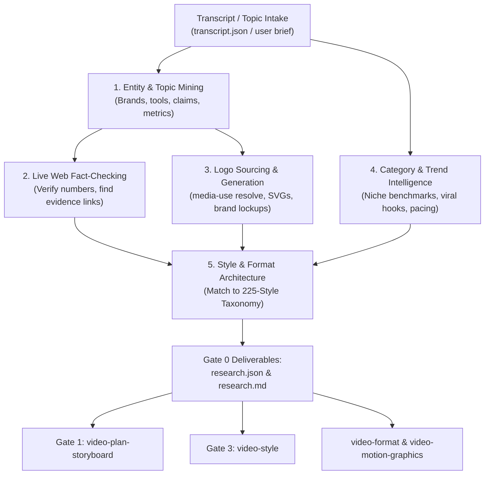

# Video Researcher (Internet Intelligence & Creative Blueprint)

Great videos are anchored in market reality, verified facts, and proven visual formats. **Research must happen BEFORE drafting the narrative storyboard or building graphics.** Guessing what works in a niche results in generic, low-retention videos that miss current visual trends and lack brand authority.

`video-researcher` is the internet intelligence engine of the video editing pipeline. It analyzes the creator's transcript or topic brief, conducts real-time web research, sources official vector logos (or generates sleek marks when none exist), discovers trending reference videos in the exact category, and outputs a concrete creative blueprint (`research.json` & `research.md`) ready for downstream agents.

```bash
ENG="${VIDEO_ENGINE:-$HOME/.agents/skills/video-pipeline/engine}"
W="videos/<project>"
```

---

## The 5 Core Pillars of `video-researcher`



---

## Strict Grounding & Anti-Hardcoding Contract

In accordance with the system-wide contract established in `video-pipeline/SKILL.md`, `video-researcher` enforces complete dynamic grounding across its deliverables:
- **Zero Placeholder URLs:** Never output `example.com`, fake YouTube links, or mock Instagram URLs. Every URL in `research.json` and `research.md` must be an authentic, working URL discovered during the active session via `search_web` or `read_url_content`. Unresearched fields must remain `null` or `[]`.
- **Dynamic Asset & Color Extraction:** Brand colors must be extracted dynamically from resolved vector logos or footage frames (`extract_colors_from_svg` / `extract_colors_from_image`). Never use arbitrary fallback hexes.
- **Evidence-Backed Benchmarks:** View counts, creator handles, and retention metrics must reflect real observed platform search data. Never invent estimates.
- **Universal Linguistic Extraction:** Entities and categories are mined dynamically from the input text rather than static entity dictionaries.

---

## 1. Workflow & Execution Protocol

### Step 1: Intake & Entity Mining
Ingest either the transcribed audio (`$W/transcript-raw.json` or `$W/transcript.json`) or the creator's raw topic brief:
- **Identify Core Entities:** Extract mentioned companies, apps, software frameworks, creators, platforms, and technical jargon.
- **Identify Claims & Metrics:** Extract numbers, percentages, dollar figures, and dates that require visual proof cards.
- **Classify Category & Format:** Categorize into one of 8 standard genres (Tech SaaS / AI, Business & D2C / Finance, Coding Tutorials, Educational Explainers, Productivity, Product Showcases, Lifestyle / Vlog, Commentary) and set target canvas (9:16 vertical vs 16:9 horizontal).

### Step 2: Live Web Research & Fact Verification
Use web search tools to verify claims and unearth authoritative evidence:
- Verify spelling of names, frameworks, and acronyms (prevents embarrassing typos on kinetic captions).
- Gather credible citation links (news releases, GitHub repos, product docs, public valuation stats).
- Locate visual proof assets (product screenshots, tweets, charts) to recommend as B-roll or motion graphic cards.

### Step 3: Logo Sourcing & Generation Protocol
For every entity or tool mentioned, resolve a crisp vector logo:
1. **HyperFrames `media-use` Resolution (Primary):**
   ```bash
   npx hyperframes media-use resolve --type logo --intent "<Brand Name>" --project "$W"
   ```
   Searches theSVG, SimpleIcons, VectorLogoZone, Brandfetch, and GitHub verified avatars into `$W/assets/logos/<slug>.svg`.
2. **Direct Vector CDN Fallback:**
   ```bash
   curl -sL "https://cdn.simpleicons.org/<slug>/ffffff" -o "$W/assets/logos/<slug>.svg"
   ```
3. **Programmatic Generation (For Concepts, New Startups, or Fictional Tools):**
   - Query HyperFrames catalog for brand blocks: `npx hyperframes catalog --query "brand lockup badge pill"`.
   - Or generate a modern geometric SVG vector mark directly into `$W/assets/logos/<slug>.svg`.
   - Or generate an illustrative emblem with Gemini Flash Image (`video-generate`).
4. **Brand Color Extraction:**
   Extract dominant hex colors and log into `$W/assets/logos/manifest.json`.
*(See `references/logo-sourcing-and-generation.md` for full implementation details).*

### Step 4: Category Intelligence & Trending Video Benchmarks
Search YouTube Shorts, Instagram Reels, and TikTok for top-performing videos in this exact category:
- Identify 2–4 top reference videos with high view counts and verifiable audience traction.
- Analyze the winning mechanics:
  - **Hook Structure (First 0.0s – 3.0s):** What hook formula did they use? (Direct confrontation, curiosity loop, proof-first shock).
  - **Cut Rhythm:** What is their visual change frequency? (e.g. 1.4s per cut in tech SaaS vs 2.2s in business reels).
  - **Sound Cues:** What audio cues sell the edits? (tape stops, whooshes, risers, cash dings).
  - **Layout Patterns:** Are they using stacked split-screen, full-bleed face with floating cards, or screen-plus-facecam?
*(See `references/category-benchmarks.md` for ready-to-use niche playbooks).*

### Step 5: Master Style & Motion Graphics Format Strategy
Map the gathered intelligence to the official **225-Style Taxonomy** (`video-editing-styles-master.md`):
- **Formulate 3–4 Format Options for the User:** Never assume a default general video editing template. Present 3–4 tailored format options directly aligned with the transcription context (e.g. Clean Authority Talking-Head, Stacked Split-Screen, Fast-Paced Hook Reel, Step-by-Step Breakdown).
- **Layout & Composition Style:** e.g., `Style 03: Stacked Split-Screen` (44% speaker top / 56% demo bottom) or `Style 01: Split-Screen` or `Style 04: Picture-in-Picture`.
- **Clean Headroom Enforcement:** Overlays, cards, and text must sit in the lower third (`y: 0.58 – 0.75`) or dedicated cutaways, NEVER floating over the speaker's forehead.
- **Color Theme & Mood:** Primary background, card glass, and high-CTR accent colors matching brand standards.
- **Color Grading Preset:** Recommend a calibrated preset from `grade.py` (`commercial-clean`, `cinematic-warm`, `modern-tech`, `moody-film`, `vibrant-pop`, `neutral-correct`).
- **Typography Pairing:** Punch headline font (`Poppins Black 900` / `Anton`), accent display font (`Syne 800`), and supporting body.
- **Motion Dynamics & Physics:** Damped spring parameters (`damping: 14`, `stiffness: 180`, `tilt: -2deg`).
- **HyperFrames Catalog Blocks:** Pre-search specific queries (`npx hyperframes catalog --query "..."`) and select matching registry blocks for each narrative beat.
- **Asset Gap Analysis:** Inventory files in `videos/<project>/raw/`. Identify claims or items mentioned in speech that lack visual footage, preparing specific recording suggestions for the user.

### Step 6: Artifact Generation & Gate 0 Handoff
Write two synchronized output files into the project directory `$W`:
1. **`$W/research.json`**: Machine-readable specification conforming strictly to `references/research-schema.md`.
2. **`$W/research.md`**: Human-readable executive summary and creative briefing.

---

## 2. Downstream Agent Integration Contract

The research package directly feeds every subsequent phase in the video pipeline:

| Downstream Skill | How it Uses `research.json` & `research.md` |
|---|---|
| **`video-plan-storyboard` (Gate 0.5 & Gate 1)** | Consumes context formats to discuss and select the video format with the user, uses asset gap analysis to suggest recording more content, and embeds verified facts and catalog blocks into `plan.md`. |
| **`video-style` (Gate 3)** | Imports `recommended_style` (palette tokens, font families, motion physics, color grading preset, and logo brand colors) directly into `$W/style.json`. |
| **`video-format`** | Reads `$W/assets/logos/` and installs the pre-identified HyperFrames catalog registry blocks (`npx hyperframes add <block>`). |
| **`video-motion-graphics`** | Uses verified SVG logos, brand color tokens, and layout coordinates to construct custom kinetic components. |
| **`video-cut-audit`** | Calibrates target cut pace and jump-cut density to match `target_cut_pace_sec`. |
| **`video-sound-design`** | Aligns SFX markers (whooshes, dings, tape-stops) to the hook and beat transitions identified in the benchmark analysis. |

---

## 3. Gate 0: Interactive Research & Format Verification Gate

Before proceeding to `video-plan-storyboard` (Gate 0.5 Alignment & Gate 1), present `$W/research.md` to the user:
1. **Verified Topic Facts:** Confirm all statistics, claims, and entity spellings are accurate.
2. **Logo Assets:** Show table of resolved and generated logos with preview paths in `$W/assets/logos/`.
3. **Reference Benchmarks:** Share clickable links to trending videos and review the proposed hook strategy.
4. **Format Selection:** Present the 3–4 context-derived formats and **ask the user which format they want** (no general editing default).
5. **Asset Inventory & Recording Suggestions:** Highlight available assets vs missing b-roll and ask if the user wants to record more footage or use graphic elements.

> Once the user approves Gate 0 and selects their format, agents proceed to Gate 0.5 Pre-Storyboarding Alignment.

---

## 4. Scaffold Script Utility

To quickly bootstrap a research workspace and auto-resolve entities from a transcript:

```bash
python3 "$ENG/scripts/research-scaffold.py" --project "$W" --transcript "$W/transcript-raw.json"
```

This helper script:
1. Creates `$W/assets/logos/`.
2. Scans the transcript for capitalized brand names, tools, and numerical metrics.
3. Runs `hyperframes media-use resolve --type logo` on all detected brand entities.
4. Initializes a starter `$W/research.json` and `$W/research.md`.
