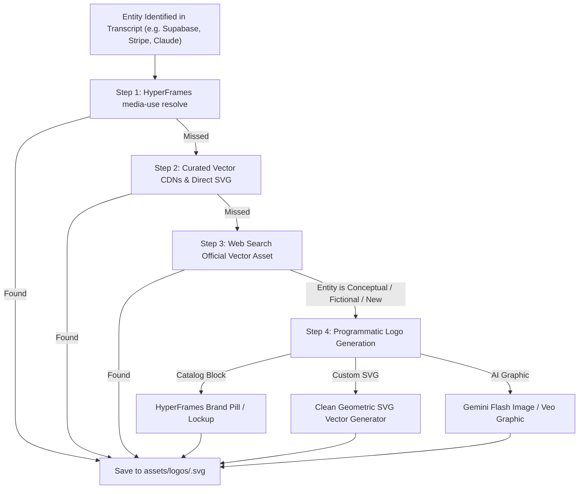

# Logo Sourcing, Verification & Generation Protocol

Visual authority in motion graphics depends heavily on brand marks. **Fuzzy raster JPEGs, pixelated screenshots, or miscolored logos destroy production value.** This document defines the exact protocol for finding, verifying, and generating brand logos for video overlays.

---

## 1. Resolution Hierarchy (Order of Operations)



---

## 2. Step 1: HyperFrames `media-use` Resolution

The first and most reliable method is HyperFrames' built-in media OS:

```bash
npx hyperframes media-use resolve --type logo --intent "<Brand Name>" --project "$W"
```

### What this does automatically:
- Searches official vector registries (theSVG, SimpleIcons, VectorLogoZone, Brandfetch).
- Falls back to GitHub verified organization avatars (high-res SVG/PNG) and official domain favicons.
- Outputs a single deterministic line:
  `resolved logo-supabase → videos/my-project/assets/logos/supabase.svg (logo, svg)`
- Guarantees the mark is never redrawn or distorted.

---

## 3. Step 2: Curated Direct Vector CDNs

If `media-use` needs a direct fallback or specific tech stack brand, fetch directly from verified open-source vector CDN endpoints:

### A. Simple Icons (Over 3,000 Tech, Cloud & SaaS Brands)
Format:
```
https://cdn.simpleicons.org/<slug>/<optional-color-hex>
```
*Examples:*
- Next.js (White): `https://cdn.simpleicons.org/nextdotjs/white`
- Stripe (Brand Violet): `https://cdn.simpleicons.org/stripe/635BFF`
- Python: `https://cdn.simpleicons.org/python/3776AB`
- OpenAI: `https://cdn.simpleicons.org/openai/ffffff`
- Flutter: `https://cdn.simpleicons.org/flutter/02569B`

Curl download helper:
```bash
curl -sL "https://cdn.simpleicons.org/<slug>/ffffff" -o "$W/assets/logos/<slug>.svg"
```

### B. Wikimedia Commons & VectorLogoZone
- High-resolution SVG vectors for global Fortune 500 companies, banks, fashion houses, and auto brands.
- Search query pattern: `"<Brand Name>" logo filetype:svg site:wikimedia.org OR site:vectorlogozone.com`.

---

## 4. Brand Color Extraction

Every resolved logo should have its primary brand color extracted into `research.json`. Downstream skills (`video-style` and `video-format`) use these hex codes for accent glow, borders, and card highlights.

### Automatic SVG Hex Extraction (Python Helper):
```python
import re

def extract_svg_color(svg_path):
    with open(svg_path, 'r', encoding='utf-8') as f:
        content = f.read()
    # Find all hex colors
    hexes = re.findall(r'#(?:[0-9a-fA-F]{3}){1,2}\b', content)
    # Filter out pure black and pure white
    brand_colors = [h.upper() for h in hexes if h.lower() not in ['#fff', '#ffffff', '#000', '#000000', '#111', '#111111']]
    return brand_colors[0] if brand_colors else None
```

---

## 5. Step 4: Generating Brand Marks for Concepts / Fictional Brands

When the creator discusses an internal tool, a conceptual framework, an unreleased startup, or an abstract entity with no public logo:

### Method A: HyperFrames Catalog Brand Lockup (Recommended)
Query the HyperFrames catalog for pre-built, elegant badge components:
```bash
npx hyperframes catalog --query "brand lockup badge pill" --json
```
Install and customize:
- `badge-pill-pill`: A sleek pill badge containing a vector icon + bold typographic title.
- `logo-cloud`: Sleek floating squircle with gradient rim.
- `kinetic-text-brand`: Stylized typography mark with subtle glowing drop-shadow.

### Method B: Programmatic Modern SVG Generation
Generate a sleek, minimalist vector squircle mark directly in code using colors derived from the project's verified palette:

```python
def generate_concept_logo(name, slug, color1, color2, out_path="logo.svg"):
    # color1 and color2 MUST be passed from the project's verified palette (never arbitrary hardcoded values)
    initials = "".join([part[0].upper() for part in name.split()[:2]])
    svg_content = f'''<svg xmlns="http://www.w3.org/2000/svg" viewBox="0 0 120 120" width="120" height="120">
  <defs>
    <linearGradient id="brandGrad" x1="0%" y1="0%" x2="100%" y2="100%">
      <stop offset="0%" stop-color="{color1}" />
      <stop offset="100%" stop-color="{color2}" />
    </linearGradient>
  </defs>
  <rect width="120" height="120" rx="28" fill="url(#brandGrad)" />
  <text x="50%" y="54%" font-family="Poppins, Inter, sans-serif" font-weight="900" font-size="46" fill="#FFFFFF" text-anchor="middle" dominant-baseline="middle" letter-spacing="-0.03em">{initials}</text>
</svg>'''
    with open(out_path, "w", encoding="utf-8") as f:
        f.write(svg_content)
```

### Method C: Generative Vector Icon (Gemini Flash Image / `video-generate`)
When an intricate, illustrative brand mascot or 3D emblem is requested:
- Prompt template:
  > *"Minimalist 3D vector emblem of [Concept], isolated on black transparent background, modern tech branding, sleek aesthetic, high contrast, clean SVG vector style."*
- Save to `$W/assets/logos/<slug>.png`.

---

## 6. Directory Layout & Organization

All assets must be stored inside `$W/assets/logos/`:
```
videos/<project>/
  assets/
    logos/
      supabase.svg
      stripe.svg
      nextjs.svg
      custom-agent-concept.svg
```

In `research.json`:
```json
{
  "entity_name": "Supabase",
  "slug": "supabase",
  "status": "resolved",
  "local_path": "videos/my-project/assets/logos/supabase.svg",
  "source_url": "https://cdn.simpleicons.org/supabase",
  "format": "svg",
  "brand_colors": {
    "primary": "#3ECF8E",
    "accent": "#24B47E"
  }
}
```
